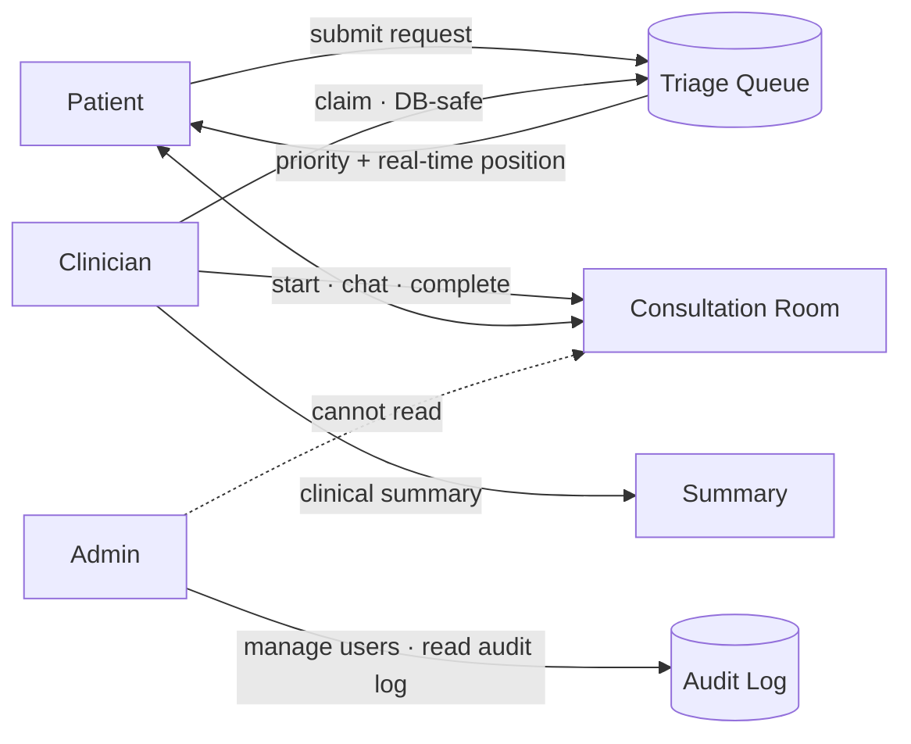
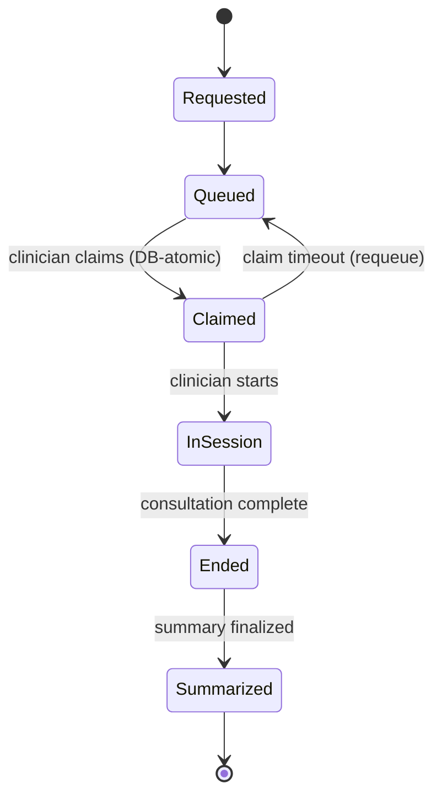
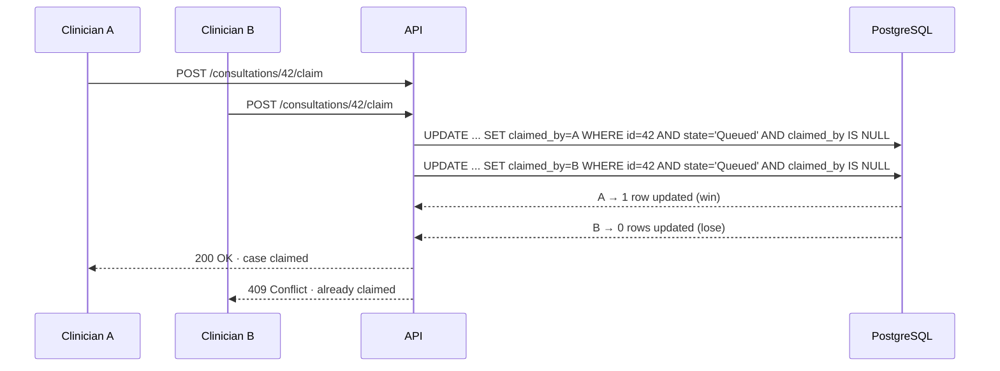

# Virtual Consultation Platform

A full-stack system that simulates how a patient requests an online medical
consultation and how healthcare staff manage that request from start to finish.
Built as a capstone project to demonstrate end-to-end engineering: backend
architecture, database design, authentication & authorization, concurrency,
real-time systems, frontend state management, testing, security, observability,
Docker, and CI/CD.

> **The system is fully implemented** — backend, frontend, real-time, security,
> observability, tests and CI. Bring the whole stack up with one command and click
> through it using the **[demo script](docs/demo-script.md)**; the design reasoning
> lives in **[`docs/`](docs/)**.

## The idea in one picture



## Roles

| Role                         | Can do                                                                                                             | Cannot do                                                      |
| ---------------------------- | ------------------------------------------------------------------------------------------------------------------ | -------------------------------------------------------------- |
| **Patient**                  | Register, submit request, see queue position, join their consultation room, chat + attachments, read their summary | See other patients, see the triage queue                       |
| **Clinician** (nurse/doctor) | See triage queue, claim a case, start/run/complete a consultation, draft summary; **doctors** finalize summaries   | Act outside their role/state; nurses cannot finalize summaries |
| **Admin**                    | Manage users, deactivate accounts, read audit log                                                                  | **Read clinical consultation content** (separation of duties)  |

## Consultation lifecycle



## Signature scenario — two clinicians, one patient

If two clinicians try to claim the same queued case at the same instant, the
**database** decides the winner (an atomic conditional update), not application
code. Exactly one succeeds; the other is told it was already claimed.



## Design invariants

Rules the system upholds (enforced server-side, not left to the UI):

1. The **consultation state machine** is the single source of truth for which
   actions are legal.
2. **Claim concurrency is resolved in the database** — exactly one clinician wins.
3. **Separation of duties:** admins manage users and read the audit log but
   **cannot read clinical consultation content**.
4. **Authorization is role- _and_ state-aware**, from one central matrix.
5. **Security-relevant, state-changing, and clinically significant actions are
   audited.**
6. **Clinical data is minimized and access-controlled** — never placed in logs
   or URLs.

## Run & evaluate it

Requires **Docker Desktop** running and a root `.env` (copy from `.env.example`).

```bash
docker compose up -d --build        # Postgres + Redis + backend (auto-migrates) + frontend
npm install                         # once, for the host-run seed + tests
npm run seed --workspace backend    # demo users + sample consultations (idempotent)
```

Then open **http://localhost:8088** and sign in. All seed users share the password
`Password123!`. Use these canonical one-per-role logins:

| Role    | Email               | Role   | Email              |
| ------- | ------------------- | ------ | ------------------ |
| Patient | `patient@vcp.local` | Doctor | `doctor@vcp.local` |
| Nurse   | `nurse@vcp.local`   | Admin  | `admin@vcp.local`  |

The seed also creates extra dummy accounts for testing lists and queues — several
patients (`alice.patient@vcp.local` … `frank.patient@vcp.local`), nurses
(`nina.nurse@vcp.local`, `noah.nurse@vcp.local`, and a deactivated
`nora.nurse@vcp.local`) and doctors (`dana.doctor@vcp.local`, `omar.doctor@vcp.local`,
`priya.doctor@vcp.local`) — plus a handful of sample consultations across the
lifecycle, so the triage queue and the admin **Users** / **Audit log** screens have
content immediately. Admins land on the audit log and can switch to user management
from the nav bar.

The API is on **http://localhost:3100** (`/health`, `/ready`, `/metrics`). Follow the
**[demo script](docs/demo-script.md)** for a guided click-through of the full
lifecycle, the concurrency race, the RBAC/separation-of-duties boundary and the
accessibility checks.

Run the tests:

```bash
npm test                                   # backend + frontend unit
npm run test:cov --workspace frontend      # frontend coverage + a11y + contrast
# backend e2e / merged coverage need the test DB + Redis — see docs/testing-strategy.md
```

## Documentation

All design docs live in [`docs/`](docs/). Start with:

- [`docs/project-plan.md`](docs/project-plan.md) — phases, MVP, milestones, Gantt, documentation & scaffolding plan.
- [`docs/README.md`](docs/README.md) — full documentation index.
- [`docs/demo-script.md`](docs/demo-script.md) — supervisor walkthrough.
- [`docs/retrospective.md`](docs/retrospective.md) · [`docs/performance.md`](docs/performance.md) — Phase 7 reflection & performance evidence.

## Status

| Phase | Name                                | Status      |
| ----- | ----------------------------------- | ----------- |
| 0     | Planning & Design                   | ✅ Complete |
| 1     | Scaffolding & Foundation            | ✅ Complete |
| 2     | MVP Vertical Slice                  | ✅ Complete |
| 3     | Real-time & Concurrency             | ✅ Complete |
| 4     | Security, Privacy & Audit           | ✅ Complete |
| 5     | Observability & Ops                 | ✅ Complete |
| 6     | Testing & Accessibility             | ✅ Complete |
| 7     | Polish, Performance & Retrospective | ✅ Complete |
