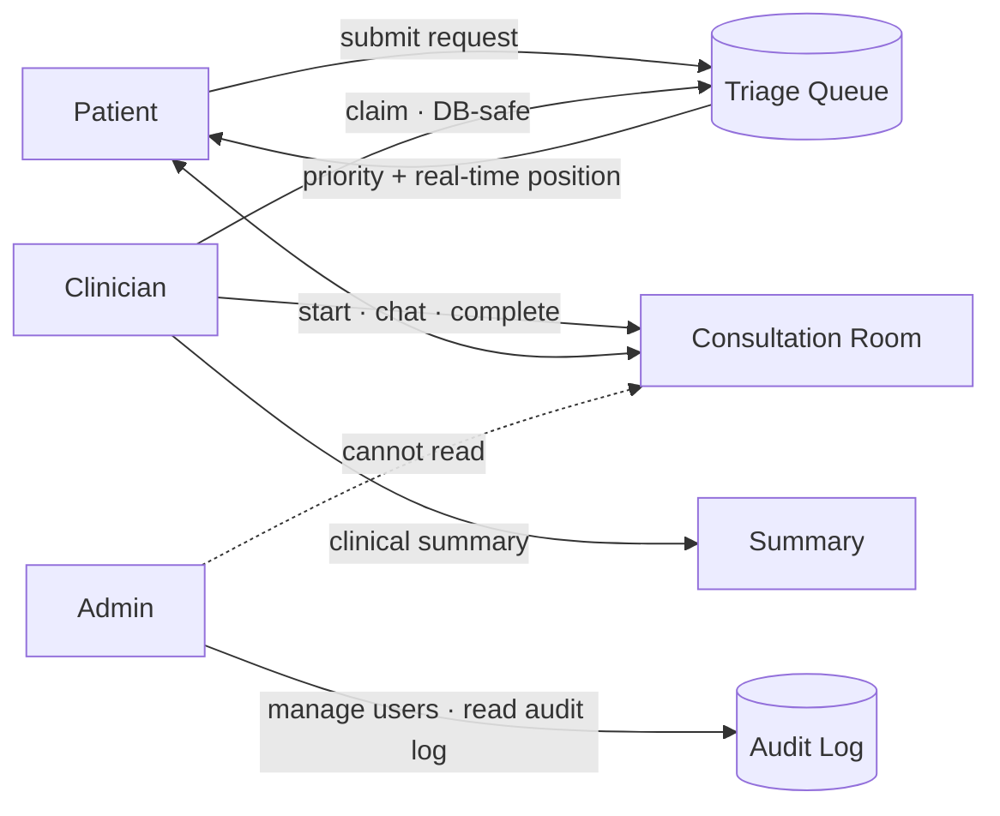
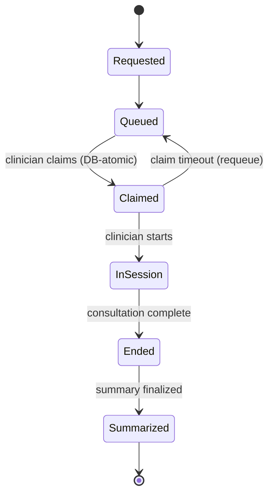
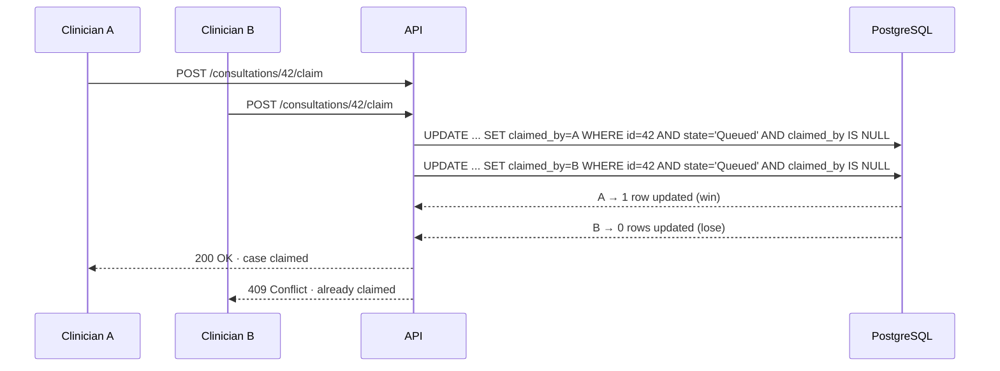

# Virtual Consultation Platform

A full-stack system that simulates how a patient requests an online medical
consultation and how healthcare staff manage that request from start to finish.
Built as a capstone project to demonstrate end-to-end engineering: backend
architecture, database design, authentication & authorization, concurrency,
real-time systems, frontend state management, testing, security, observability,
Docker, and CI/CD.

> **This is the planning phase.** No application code exists yet — by design.
> The repository currently holds the design documentation that the
> implementation will be built against.

## The idea in one picture

## Roles

| Role | Can do | Cannot do |
|------|--------|-----------|
| **Patient** | Register, submit request, see queue position, join their consultation room, chat + attachments, read their summary | See other patients, see the triage queue |
| **Clinician** (nurse/doctor) | See triage queue, claim a case, start/run/complete a consultation, draft summary; **doctors** finalize summaries | Act outside their role/state; nurses cannot finalize summaries |
| **Admin** | Manage users, deactivate accounts, read audit log | **Read clinical consultation content** (separation of duties) |

## Consultation lifecycle

## Signature scenario — two clinicians, one patient

If two clinicians try to claim the same queued case at the same instant, the
**database** decides the winner (an atomic conditional update), not application
code. Exactly one succeeds; the other is told it was already claimed.

## Design invariants

Rules the system upholds (enforced server-side, not left to the UI):

1. The **consultation state machine** is the single source of truth for which
   actions are legal.
2. **Claim concurrency is resolved in the database** — exactly one clinician wins.
3. **Separation of duties:** admins manage users and read the audit log but
   **cannot read clinical consultation content**.
4. **Authorization is role- _and_ state-aware**, from one central matrix.
5. **Security-relevant, state-changing, and clinically significant actions are
   audited.**
6. **Clinical data is minimized and access-controlled** — never placed in logs
   or URLs.

## Documentation

All design docs live in [`docs/`](docs/). Start with:

- [`docs/project-plan.md`](docs/project-plan.md) — phases, MVP, milestones, Gantt, documentation & scaffolding plan.
- [`docs/README.md`](docs/README.md) — full documentation index.

## Status

| Phase | Name | Status |
|-------|------|--------|
| 0 | Planning & Design | 🟡 In progress |
| 1 | Scaffolding & Foundation | ⬜ Not started |
| 2 | MVP Vertical Slice | ⬜ Not started |
| 3 | Real-time & Concurrency | ⬜ Not started |
| 4 | Security, Privacy & Audit | ⬜ Not started |
| 5 | Observability & Ops | ⬜ Not started |
| 6 | Testing & Accessibility | ⬜ Not started |
| 7 | Polish, Performance & Retrospective | ⬜ Not started |
