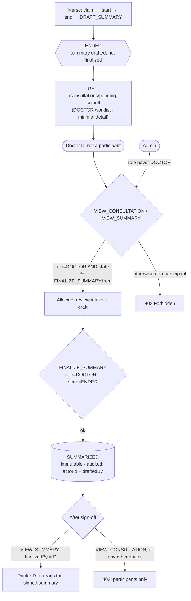

# ADR-0009: Doctor sign-off of nurse-run consultations

- **Status:** Accepted
- **Date:** 2026-10-25
- **Deciders:** Project owner

## Context

A clinical summary may be **drafted** by the assigned clinician (nurse or doctor)
but may only be **finalized** by a doctor (FR-13, SC-7). In the authorization
matrix this is encoded as:

- `DRAFT_SUMMARY` — `role ∈ {NURSE, DOCTOR}`, `ownership = ASSIGNED_CLINICIAN`
- `FINALIZE_SUMMARY` — `role = DOCTOR`, `ownership = NONE`, `state = ENDED`

`FINALIZE_SUMMARY` is deliberately **not** tied to the assigned clinician, so a
doctor can sign off a case a nurse ran. But a doctor who did not claim the case
must also be able to **find** it and **read** it before signing — and the read
actions (`VIEW_CONSULTATION`, `VIEW_SUMMARY`) are normally participants-only. A
nurse-run case ends in `ENDED` with a drafted summary and **no doctor
participant**, so without a rule for it the case could never be signed.

The rule also has to cover the moment after sign-off: once the case is
`SUMMARIZED`, the doctor who signed it is still not a participant, yet they must
be able to re-read the record they put their name to.

## Decision

1. **New ownership mode `PARTICIPANT_OR_SIGNOFF_DOCTOR`** on `VIEW_CONSULTATION`
   and `VIEW_SUMMARY`. It admits:
   - the two participants, as before;
   - **any doctor while the case is awaiting sign-off.** "Awaiting sign-off" is
     not a new constant — it is the `FINALIZE_SUMMARY` transition's `from` set read
     from the central registry (today `{ENDED}`), so the read guard can never drift
     from the states a doctor can actually finalize;
   - for `VIEW_SUMMARY` only, **the doctor who finalized it** (`finalizedBy =
self`). The consultation detail does not get this path, so after sign-off the
     intake goes back to participants-only.

2. **Doctor worklists.** `GET /consultations/pending-signoff` returns every `ENDED`
   case with a drafted, unfinalized summary; `GET /consultations/signed-off` returns
   the cases this doctor finalized. Both carry **minimal detail only** (priority,
   symptom category, truncated complaint, timestamps, drafter id — never the
   summary text; invariant 6). They update live through the doctors' `signoff`
   room ([ADR-0004](0004-realtime-websockets.md)).

3. **Audited hand-off.** `SUMMARY_FINALIZED` records the finalizing doctor as
   `actorId` and also `draftedBy`, so nurse-drafts → doctor-signs is auditable
   end-to-end as who/what/when — never the summary content (invariants 5 & 6).

**Admin stays excluded** (invariant 3): every sign-off path requires
`role = DOCTOR`, and admin never appears in these matrix rows.

### Sign-off flow and read window

## Alternatives considered

- **New ownership mode sourced from the registry, plus a finalizer-only summary
  read** (chosen). Small matrix change, the state condition reuses
  `FINALIZE_SUMMARY.from`, no service re-implements a check, admin excluded by
  construction.
- **Loosen the reads to `ownership = NONE` for doctors.** Simplest to write, but
  any doctor could read **any** case in any state, breaking membership-scoping and
  SC-7. Rejected — and the same objection rules out extending the read window to
  every `SUMMARIZED` case.
- **Auto-claim the case to the signing doctor.** Makes them a participant, but it
  rewrites `claimedBy`, corrupts "who ran this case" in the record and audit, and
  forces a claim just to read. Rejected: sign-off is a review-and-approve act, not
  a hand-off of ownership.
- **A `PENDING_SIGNOFF` state between `ENDED` and `SUMMARIZED`.** More explicit, but
  an enum change + migration + new transitions for no behavioural gain over keying
  on `ENDED`. Rejected as scope.

## Consequences

- A nurse-authored summary is never stranded: a doctor finds it under **Pending
  sign-off**, reviews the intake and draft, and finalizes (`ENDED → SUMMARIZED`).
  It then appears under that doctor's **Completed** sign-offs.
- The read guard tracks the finalize transition automatically — if the finalizable
  state set ever changes in the registry, the sign-off read window follows.
- No schema or state-machine change; the matrix remains the single source of truth
  (invariant 4). `finalizedBy` already exists on the summary.
- Proven by [testing-strategy.md](../testing-strategy.md): the authorization-matrix
  unit spec (doctor may read an `ENDED` case they do not own; the finalizer keeps
  the summary but not the detail; other roles and states denied) and the sign-off
  e2e (a nurse runs and drafts a case, a **different** doctor discovers, reads and
  finalizes it, the hand-off is audited, and the case moves to that doctor's
  history only).
