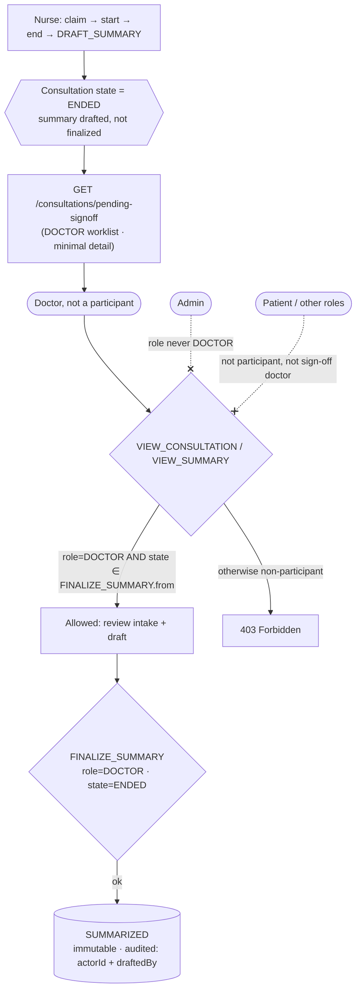

# ADR-0018: Doctor sign-off of nurse-run consultations

- **Status:** Accepted
- **Date:** 2026-10-25
- **Deciders:** Project owner

## Context

A clinical summary may be **drafted** by the assigned clinician (nurse or doctor)
but may only be **finalized** by a doctor (FR-13, SC-7). In the authorization
matrix this is encoded as:

- `DRAFT_SUMMARY` — `role ∈ {NURSE, DOCTOR}`, `ownership = ASSIGNED_CLINICIAN`
- `FINALIZE_SUMMARY` — `role = DOCTOR`, `ownership = NONE`, `state = ENDED`

`FINALIZE_SUMMARY` is deliberately **not** tied to the assigned clinician, so a
doctor can sign off a case a nurse ran. But the two **read** actions a doctor needs
to review that case before signing were tied to participation:

- `VIEW_CONSULTATION` — `ownership = PARTICIPANT`
- `VIEW_SUMMARY` — `ownership = PARTICIPANT`

A nurse-run case ends in `ENDED` with a drafted summary and **no doctor
participant**. The only clinician entry points were the triage queue (QUEUED-only)
and `GET /consultations/assigned` (filters `claimedBy = self`). So a doctor who did
not claim the case could neither **find** it nor **read** what they were empowered
to **finalize** — a dead end. A nurse-authored summary was stranded in `ENDED`
forever: the backend permitted the final write but blocked every read that would
precede it.

## Decision

Close the read/finalize asymmetry with **one rule in the matrix**, plus a worklist
to discover the cases.

1. **New ownership mode `PARTICIPANT_OR_SIGNOFF_DOCTOR`** applied to
   `VIEW_CONSULTATION` and `VIEW_SUMMARY`: the two participants as before, **or any
   doctor while the case is awaiting sign-off**. "Awaiting sign-off" is not a new
   constant — it is the `FINALIZE_SUMMARY` transition's `from` set read from the
   central registry (today `{ENDED}`), so the read guard can never drift from the
   states a doctor can actually finalize (enforcement rule 3). The matrix stays the
   single source of truth (invariant 4); services are unchanged beyond the data
   they already load.

2. **New endpoint `GET /consultations/pending-signoff` (DOCTOR)** returns every
   `ENDED` case with a drafted-but-unfinalized summary, carrying **minimal clinical
   detail only** (priority, symptom category, truncated complaint, ended/drafted
   timestamps, drafter id — never the summary text; invariant 6). This is how a
   doctor discovers cases that are no one's claim.

3. **Finalize audit extended**: `SUMMARY_FINALIZED` already stamps `actorId` (the
   finalizing doctor); it now also records `draftedBy`, so a nurse-drafts →
   doctor-signs-off handoff is auditable end-to-end as who/what/when — still never
   the summary content (invariants 5 & 6).

**Admin stays excluded** (invariant 3): the sign-off branch requires
`role = DOCTOR`, and admin never appears in these matrix rows, so separation of
duties is untouched.

### Updated authorization / sign-off flow

## Alternatives considered

- **New ownership mode sourced from the registry** (chosen). One matrix cell change
  per read action, the state condition reuses `FINALIZE_SUMMARY.from`, no service
  re-implements a check, admin excluded by construction.
- **Loosen `VIEW_SUMMARY`/`VIEW_CONSULTATION` to `ownership = NONE` for doctors.**
  Simplest to write, but it would let any doctor read **any** case in any state
  (active sessions they have nothing to do with), breaking membership-scoping and
  the SC-7 "non-assigned clinician cannot read detail" invariant. Rejected.
- **Auto-assign/claim the case to the signing doctor.** Makes them a participant, so
  no matrix change — but it rewrites `claimedBy`, corrupts "who ran this case" in the
  record and audit, and forces a claim just to read. Rejected: sign-off is a
  review-and-approve act, not a hand-off of ownership.
- **A `PENDING_SIGNOFF` state between `ENDED` and `SUMMARIZED`.** More explicit, but
  an enum change + migration + new transitions for no behavioural gain over keying
  on `ENDED` (already `FINALIZE_SUMMARY`'s source state). Rejected as scope.

## Consequences

- A nurse-authored summary is no longer stranded: a doctor finds it under **Pending
  sign-off**, reviews the intake and draft, and finalizes (`ENDED → SUMMARIZED`).
- The read guard tracks the finalize transition automatically — if the finalizable
  state set ever changes in the registry, the sign-off read window follows.
- No schema or state-machine change; the matrix remains the single source of truth.
- Proven by [testing-strategy.md](../testing-strategy.md): the authorization-matrix
  unit spec (doctor may read an `ENDED` case they do not own; patient/other role and
  a non-`ENDED` case denied) and an e2e where a nurse runs and drafts a case and a
  **different** doctor discovers, reads and finalizes it, with the sign-off audited.
