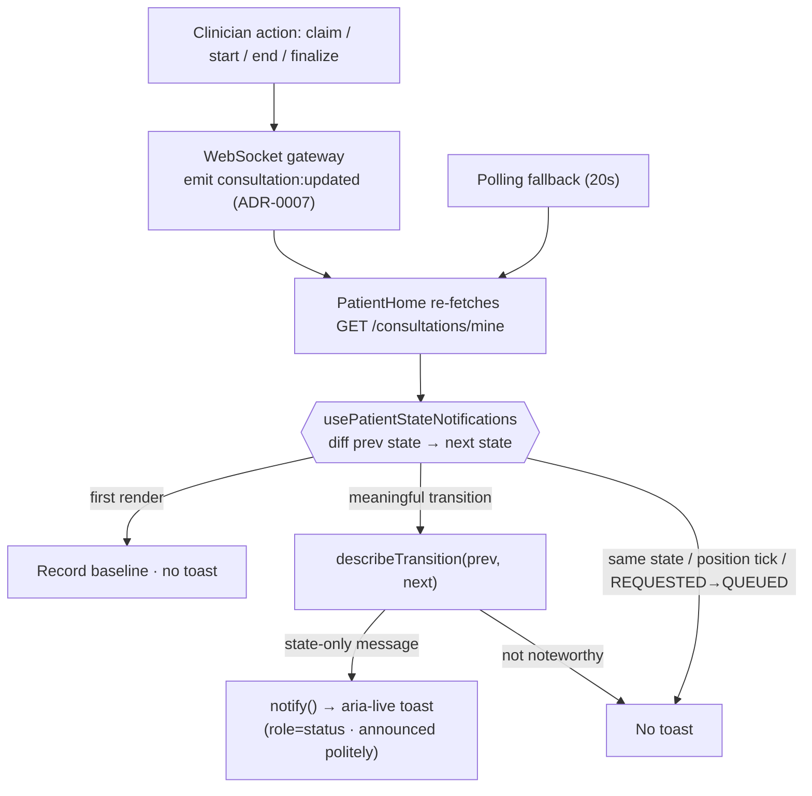

# ADR-0019: Patient in-app notifications for consultation state changes

- **Status:** Accepted
- **Date:** 2026-10-25
- **Deciders:** Project owner

## Context

A patient watches their consultation progress through the state machine
(`REQUESTED → QUEUED → CLAIMED → IN_SESSION → ENDED → SUMMARIZED`). The live
plumbing to tell them about these changes already exists: the WebSocket gateway
emits `consultation:updated` to each patient's personal room (ADR-0007), and
`PatientHome` re-fetches `/consultations/mine` on every such event, with a slow
polling interval as a fallback.

But the change only landed **silently** — a table row's `State` cell flipped, or
a "View summary" link appeared. A patient not staring at the table missed the
moment a clinician picked up their case or their summary became available, and a
screen-reader user got **nothing**: there was no `aria-live` region anywhere in
the frontend, so a state change that mutated the DOM under them was never
announced (a WCAG 2.1 AA gap, not merely a UX nicety — see ADR-0015).

Two moments matter most to a patient — a clinician **claiming** the case and the
**summary becoming ready** — plus the claim-start TTL re-queue (ADR-0008), which
otherwise looks like an unexplained bounce back into the queue.

## Decision

Add a small **in-app notification layer** that surfaces state changes the server
already pushes. No new backend events, no new transport.

1. **An app-root `aria-live` region** (`lib/notifications.tsx`): a
   `NotificationProvider` exposes `notify(message, { tone })`, and a single
   `role="status"` / `aria-live="polite"` container renders transient toasts.
   Adding a toast both shows it and has it announced politely, closing the a11y
   gap. The region is the **delivery mechanism only** and holds no clinical
   content of its own.

2. **State-transition → message mapping** (`lib/patientNotifications.ts`): a pure
   `describeTransition(prev, next)` returns the message for a transition, or
   `null`. A `usePatientStateNotifications` hook diffs the live-updated
   `/consultations/mine` list and fires a toast per meaningful change. It diffs
   **observed state**, so it works identically for a socket push and the polling
   fallback, and the **first render only records a baseline** so existing states
   are never re-announced on mount or login.

3. **Deliberately quiet, and state-only.** Only clinician-driven transitions
   notify — `CLAIMED`, `IN_SESSION`, `ENDED`, `SUMMARIZED`, and the
   `CLAIMED → QUEUED` re-queue. The ordinary `REQUESTED → QUEUED` on submit and
   every `position:updated` tick stay silent. Message text is **state-only**
   (e.g. "Your consultation summary is ready to view.") and never carries the
   chief complaint or any clinical detail — invariant 6 holds at the UI edge just
   as it does in logs and URLs.

### Scope boundary

**In-app only.** Browser/OS push (the Notification API + a service worker,
permission prompts, background delivery) and email are **deferred**: they add a
permission-and-lifecycle surface out of proportion to a capstone demo, and buy
nothing while the tab is open, which is the demo case. If revisited, push would
layer on top of the same `describeTransition` mapping.

### Notification flow

## Alternatives considered

- **Diff the patient's observed state list** (chosen). Transport-agnostic (socket
  or poll), needs no payload contract beyond the state the list already carries,
  and the baseline-on-mount rule makes "don't re-announce what's already there"
  trivial.
- **Drive toasts off the raw `consultation:updated` socket payload.** Couples the
  UI to the event's shape, misses the polling fallback path, and still needs a
  fetch to know the new state. Rejected.
- **Browser/OS push notifications now.** Reach the patient with the tab closed,
  but pull in permission prompts and a service worker for no benefit in the
  open-tab demo. Deferred (see scope boundary).
- **A persistent notification center / unread badge.** More than the brief calls
  for; the live status table already is the durable view. Rejected as scope.

## Consequences

- A patient is now told — visually and to assistive tech — when their case is
  claimed, started, ended, summarized, or re-queued, using events the server
  already emitted; the marginal cost was a UI layer, not new infrastructure.
- The frontend gains its first `aria-live` region, closing a real WCAG 2.1 AA
  gap (ADR-0015) rather than only adding polish.
- `describeTransition` is a pure function, unit-tested per transition; the
  provider is tested for show/dismiss and axe-clean; the test harness
  (`test/render.tsx`) now wraps screens in `NotificationProvider`, mirroring
  production (`main.tsx`).
- Notification text is reviewed as state-only; invariant 6 is not weakened by the
  new surface.
