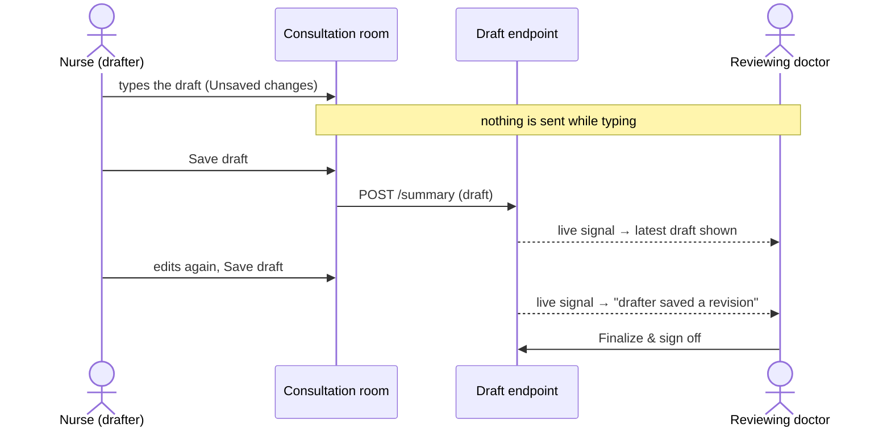

# ADR-0021: Explicit save for the summary draft

- **Status:** Accepted
- **Date:** 2026-10-26
- **Deciders:** Project owner
- **Related:** [ADR-0018](0018-doctor-signoff-of-nurse-run-cases.md), [ADR-0022](0022-live-summary-and-signoff-signals.md)

## Context

The clinician who ran a consultation writes the clinical summary in the consultation
room. Deciding _when_ that text reaches the server matters more than it looks,
because **a save is a hand-off**:

- Saving a draft on an `ENDED` case puts it in front of every doctor for sign-off
  ([ADR-0018](0018-doctor-signoff-of-nurse-run-cases.md)).
- With [ADR-0022](0022-live-summary-and-signoff-signals.md), a reviewing doctor's open
  copy updates live from each save — and finalize signs whatever the server holds.

If text were saved automatically as the clinician types, a doctor could see — and sign
— a half-written sentence. Clinicians also need a clear moment of "this is my summary".

## Decision

**Saving the summary draft is an explicit action, with protections against losing
work.** Frontend-only — the draft endpoint, data model and authorization are unchanged.

1. The editor has a **Save draft** button, enabled only when there are unsaved changes.
2. An `aria-live` status shows **Unsaved changes** / **Saved at hh:mm**, so the state of
   the draft is always visible.
3. **Nothing is lost by forgetting to click:**
   - **End consultation** saves an unsaved draft before closing the session (and the
     confirmation says so).
   - **Finalize & sign off** by the assigned doctor saves the editor content first, so
     the signed record is exactly what they see.
   - Closing or reloading the tab with unsaved changes triggers the browser's
     leave-page warning; the in-app Back button asks before leaving.
4. **A case is never stranded without a draft:** `GET /consultations/assigned` returns
   `summaryDrafted`, and the clinician's _My consultations_ list shows **Write the
   summary** for any ended case with no saved draft; the room itself says a doctor can
   only sign off once a draft is saved.

## Alternatives considered

- **Autosave (debounced, after typing stops).** Removes the "forgot to save" risk, but
  sends half-edited text to reviewing doctors and lets them sign it. Rejected; the
  protections in point 3 cover the forgetting case instead.
- **Autosave plus an explicit "Submit for sign-off".** Separates "persist" from
  "publish", but needs a new draft state on the server (a migration and new
  authorization rules) and two save concepts in the UI. Rejected as over-modelling
  for a single-author draft.
- **Autosave to the browser, explicit save to the server.** Would protect against a
  crashed tab, but keeps clinical text in browser storage (invariant 6). Rejected; the
  leave-page warning covers the common case.

## Consequences

- The doctor only ever sees — and can only sign — text the drafter chose to save.
- Ending a session or signing off never loses typed text; closing the tab warns first.
- A drafter who types and then navigates away inside the app via the nav bar (not the
  Back button) loses unsaved edits without a prompt: the router in use has no
  navigation blocker. Accepted; the editor shows "Unsaved changes" persistently.
- Proven by the consultation-room component tests (typing never persists; Save does;
  End consultation saves first; a live signal never overwrites text being edited) and
  the My consultations "Write the summary" test.
