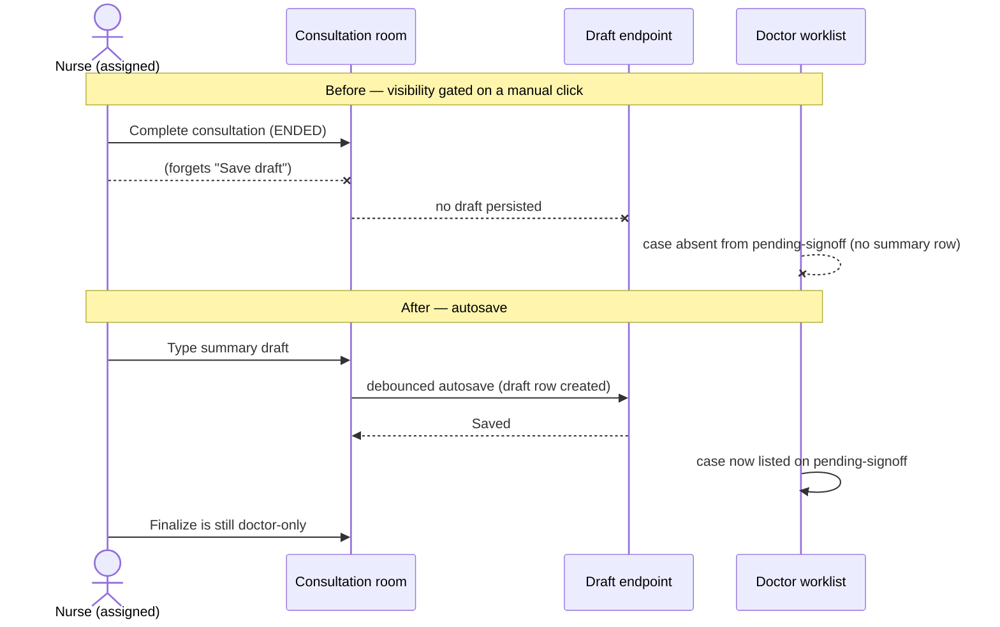

# ADR-0022: Autosave the summary draft (remove the manual "Save draft")

- **Status:** Superseded by [ADR-0026](0026-explicit-summary-save.md)
- **Date:** 2026-10-25
- **Deciders:** Project owner

## Context

A clinical summary is **drafted** by the assigned clinician and **finalized** by a
doctor (ADR-0020). A nurse cannot finalize, so for a nurse the only way to persist
their work was the **"Save draft"** button in the consultation room. That button
also had a second, non-obvious job: the doctor's sign-off worklist
(`GET /consultations/pending-signoff`) lists only ENDED cases that **have a
summary row** (`summary: { is: { finalizedAt: null } }` — ADR-0020,
[consultations.service.ts](../../backend/src/consultations/consultations.service.ts)),
and that row is created by the first draft save.

The two facts combined into a real failure: a nurse who completed a consultation
but did not click "Save draft" left the case **invisible to every doctor** — no
summary row, so nothing on the sign-off dashboard. The handoff depended on the
nurse remembering a button whose connection to "a doctor can now see this" was
never stated in the UI.

## Decision

**Remove the "Save draft" button and autosave the draft instead** (frontend-only).

1. While the assigned clinician is editing (states `IN_SESSION` or `ENDED`, not yet
   finalized), edits are **debounced ~800ms and persisted** via the existing
   `PATCH` draft endpoint — no API or schema change. A small `aria-live` status
   shows `Saving… / Saved`, so the removed button's reassurance is not lost.
2. The draft loaded on entry is recorded as the last-saved value, so autosave never
   re-persists an unchanged or empty draft (no spurious empty summary rows).
3. **Finalize & sign off is unchanged**: it still writes the current editor content
   then finalizes in one action, so the latest text is captured even between
   debounce ticks, and a non-assigned sign-off doctor still never re-drafts
   (that would 403 — ADR-0020).

The handoff is now a side effect of writing the summary, which is what a nurse
already intends, rather than a separate step they must remember.

### Nurse → doctor handoff, before and after

## Alternatives considered

- **Autosave, frontend-only** (chosen). Removes the friction and the stranding bug
  with no backend change; keeps the clinical model (draft exists ⇒ ready for
  sign-off) intact.
- **Keep "Save draft".** Rejected: the button's dual role (persist _and_ publish to
  the doctor) was invisible to users and the direct cause of stranded cases.
- **Also decouple dashboard visibility from the draft** — list every ENDED,
  unfinalized case for doctors even with no draft (a backend + ADR-0020 change).
  Not taken now: it lets a doctor open a case with nothing to review, and the
  common path (a nurse who writes _something_) is already fixed by autosave. Left
  as a follow-up if an empty-draft completion needs to be visible.
- **Save only on Complete.** Simpler than debounced autosave, but loses edits made
  after completing and still needs an explicit moment. Rejected.

## Consequences

- A nurse-run case reaches the doctor's dashboard as soon as the nurse writes the
  summary — no button, no stranding on a forgotten click.
- One remaining edge: completing with a **completely empty** draft still creates no
  row, so the case stays off the worklist. Accepted for now (see the decoupling
  alternative).
- No API, schema, state-machine, or authorization change; ADR-0020's sign-off model
  is untouched. Proven by the consultation-room component tests (autosave persists
  the edit and shows "Saved"; the manual button is gone; finalize still flushes the
  editor content and a non-assigned doctor never re-drafts).
