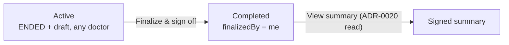

# ADR-0023: A doctor's own sign-off history on the sign-off screen

- **Status:** Accepted
- **Date:** 2026-10-26
- **Deciders:** Project owner
- **Related:** [ADR-0018](0018-doctor-signoff-of-nurse-run-cases.md), [ADR-0020](0020-finalizing-doctor-summary-read.md), [ADR-0022](0022-live-summary-and-signoff-signals.md)

## Context

The **Pending sign-off** screen lists ended cases awaiting a doctor
([ADR-0018](0018-doctor-signoff-of-nurse-run-cases.md)). Once a doctor signed one off,
it left that list — and because a nurse-run case was never _claimed_ by the doctor, it
was not in their **My consultations** either. The doctor's final review simply
disappeared from their screens, even though they keep read access to the summary they
signed ([ADR-0020](0020-finalizing-doctor-summary-read.md)) and may need to revisit it
(to re-read it).

## Decision

Give the sign-off screen the same **Active / Completed / All** switch as _My
consultations_:

- **Active** — the existing worklist (ENDED, drafted, unfinalized), unchanged.
- **Completed** — the cases **this doctor finalized**, newest first, each linking to the
  signed summary.
- **All** — both.

The data comes from a new doctor-only endpoint, `GET /consultations/signed-off`, scoped
strictly to `summary.finalizedBy = caller`. It returns the same minimal fields as the
worklist (complaint label, category, priority, ended/finalized times, drafter id) —
never the summary text. Opening a row reads the summary through the existing
`VIEW_SUMMARY` finalizing-doctor grant (ADR-0020), so **no new read access** is created.
The list stays live: finalize already emits `summary:updated` to the doctors'
`signoff` room ([ADR-0022](0022-live-summary-and-signoff-signals.md)), which now
refreshes both lists.

## Alternatives considered

- **Show signed cases in _My consultations_.** That list means "cases I claimed";
  mixing in cases the doctor only reviewed blurs what it is for. Rejected.
- **Every finalized case for every doctor.** Would widen exposure beyond ADR-0020's
  "exactly the one signing doctor". Rejected (invariant 6).
- **Filter on the client from the worklist.** Impossible: finalized cases are no longer
  in the worklist's data at all.

## Consequences

- A doctor's completed reviews stay findable; nothing about who may read what changes.
- One extra lightweight query per refresh (bounded to the most recent 200).
- Proven by the consultations unit spec (scoping + ordering + no summary text), the
  sign-off e2e (the case moves from the worklist to the signing doctor's history, not
  another doctor's; nurses get 403), and the sign-off screen component tests.
