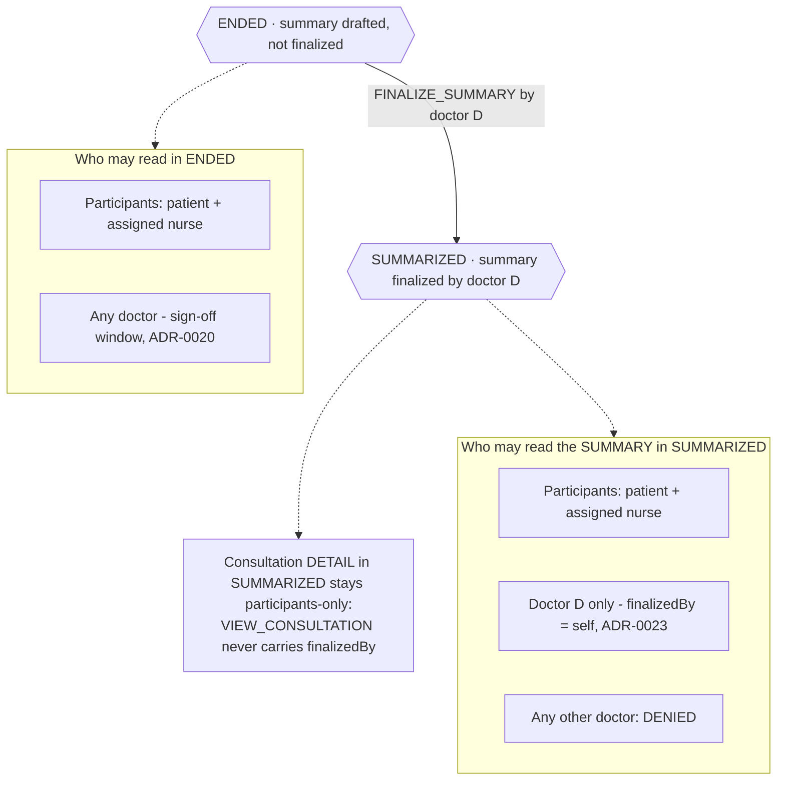

# ADR-0023: Finalizing doctor retains read access to the signed summary

- **Status:** Accepted
- **Date:** 2026-10-26
- **Deciders:** Project owner
- **Refines:** [ADR-0020](0020-doctor-signoff-of-nurse-run-cases.md)

## Context

[ADR-0020](0020-doctor-signoff-of-nurse-run-cases.md) let a doctor read a
nurse-run case while it is **awaiting sign-off** so they can review it before
finalizing. That read window is deliberately keyed to the `FINALIZE_SUMMARY`
transition's source state (`ENDED`), sourced from the central registry so the
read guard can never drift from the states a doctor can actually finalize
(enforcement rule 3). "Loosen the read to `ownership = NONE` for doctors" was
considered there and **rejected** — it would let any doctor read any case in any
state, breaking membership-scoping.

That keying has an unintended side-effect at the moment of sign-off. When a
doctor who did **not** run the case finalizes it, the state moves
`ENDED → SUMMARIZED`. The doctor is not a participant (they are neither the
patient nor `claimedBy`, which is the nurse), and the case is no longer in the
sign-off window — so `VIEW_SUMMARY` now denies them. **The doctor is locked out
of the very summary they just signed**, the instant they sign it. The record
exists and is fully attributed (`finalizedBy` is stamped, `SUMMARY_FINALIZED` is
audited with the doctor as actor), but the API will not return it to the
finalizer. A doctor cannot re-read what they put their name to, and cannot read
the summary they would need in order to add an addendum (`ADD_ADDENDUM` is
`ownership = NONE`, so the write is permitted while the read is not).

This only affects the nurse-drafts → doctor-finalizes handoff. A doctor who ran
the case themselves is a participant and keeps access as before.

## Decision

Grant the **finalizing doctor** — and only that doctor — continued read access to
the summary they signed, keyed to `finalizedBy`.

1. `Ownership.PARTICIPANT_OR_SIGNOFF_DOCTOR` gains a third admit path: a caller
   whose `role = DOCTOR` **and** `finalizedBy = self`. This is strictly the one
   doctor who performed the accountable act, never "any doctor", so exposure
   stays minimal (invariant 6) and separation of duties is untouched (admin is
   never a doctor, invariant 3).

2. `finalizedBy` is carried into the authorization check **only for the summary
   read**. `SummariesService.get` loads the summary before composing authorization
   and passes its `finalizedBy` on the consultation reference. Role → state →
   ownership still composes in that order, so a disallowed caller still gets `403`
   ahead of any not-found. Every other action leaves `finalizedBy` absent, where
   it has no effect.

3. **The consultation detail stays membership-scoped.** `VIEW_CONSULTATION` never
   carries `finalizedBy`, so once the case is `SUMMARIZED` the signing doctor is
   still denied the intake (ADR-0020's "membership-scoping restored" is
   preserved). The finalized **summary** is the record the doctor is accountable
   for and is the minimum they need post-sign-off; re-opening the full intake
   after sign-off is a separate decision and out of scope here.

### Sign-off read window over the case lifecycle

## Alternatives considered

- **Key the summary read to `finalizedBy`** (chosen). Exactly the accountable
  doctor keeps access; nothing wider; one additional admit path in the existing
  ownership mode; the consultation detail is unchanged.
- **Extend the sign-off window to include `SUMMARIZED`.** One line, but it would
  let _every_ doctor read _every_ finalized summary, re-opening the exposure
  ADR-0020 was careful to avoid. Rejected.
- **Make the finalizing doctor a participant (write `claimedBy`).** Rewrites "who
  ran this case" and corrupts the record/audit, for a read grant. Rejected for the
  same reason ADR-0020 rejected auto-claim.
- **Leave it as-is and rely on the addendum flow.** Does not help: the doctor
  still cannot read the summary, and would be adding an addendum blind. Rejected.

## Consequences

- The doctor who signs a nurse-run summary can re-read it afterward and read it
  before adding an addendum — closing the read/write asymmetry at sign-off.
- Exposure does not widen: a non-finalizing doctor still cannot read a finalized
  summary, and no role gains access to the consultation detail post-sign-off.
- No schema or state-machine change; the authorization matrix remains the single
  source of truth (invariant 4). `finalizedBy` already exists on the summary.
- Covered by tests: the authorization-matrix unit spec (finalizer admitted in
  `SUMMARIZED`, a different doctor denied, consultation detail still denied), the
  `SummariesService` unit spec (finalizer reads a nurse-run summary; a different
  doctor is forbidden), and the sign-off e2e (after finalize, the doctor `GET`s
  the summary `200` while the consultation detail stays `403`).
