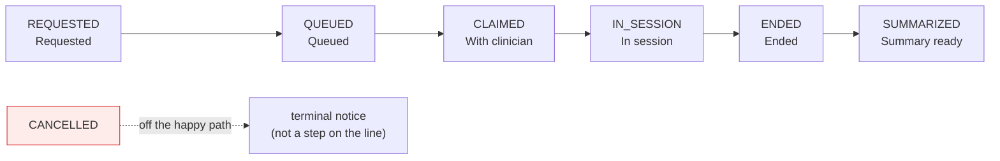

# ADR-0023: Patient-facing status stepper for consultation progress

- **Status:** Accepted
- **Date:** 2026-10-25
- **Deciders:** Project owner

## Context

A patient's "My consultations" list showed each consultation's state as a **bare
enum word** — a `REQUESTED` / `QUEUED` / `CLAIMED` / … badge. That assumes the
patient knows what the words mean, and it shows neither _where they are_ in the
journey nor _what is left_. Combined with state changes that (until ADR-0021)
landed silently, the patient's view of their own case was thin: a word that
occasionally changed.

The states and their **order** are invariant 1 — the single source of truth the
whole system is built on (`REQUESTED → QUEUED → CLAIMED → IN_SESSION → ENDED →
SUMMARIZED`). The patient-facing surface should **reflect that same ordered
progression**, not reinvent it or drift from it.

## Decision

Render each of the patient's consultations as a horizontal **status stepper**
([`components/StatusStepper.tsx`](../../frontend/src/components/StatusStepper.tsx)),
used in the patient's "My consultations" status list
([`screens/PatientHome.tsx`](../../frontend/src/screens/PatientHome.tsx)).

1. **Steps map 1:1 to the happy-path states**, with patient-friendly labels:
   Requested → Queued → **With clinician** (`CLAIMED`) → In session → Ended →
   **Summary ready** (`SUMMARIZED`). Each step is marked done / current / upcoming
   from the consultation's current state.
2. **`CANCELLED` is off the happy path**, so it renders a distinct terminal
   "Consultation cancelled" notice rather than a point on the line — it is a
   terminal off-ramp, not a stage every consultation passes through.
3. The **current step** carries a pulsing halo to draw the eye to where the case
   is now. The pulse is purely decorative and is replaced by a **static outline**
   under `prefers-reduced-motion: reduce`.
4. The per-consultation **actions** (Open room / View summary / Cancel) are
   restyled as a consistent button/link action row, so the patient's next move is
   obvious instead of a bare inline text link.

### Accessibility (first-class, not bolted on)

- The stepper is an ordered list (`<ol>`) labelled **"Consultation progress"**;
  the active step carries **`aria-current="step"`**.
- **Status never rests on colour or the tick icon alone** (WCAG 1.4.1): the tick
  glyph is `aria-hidden`, and each step's done/upcoming status is exposed to
  assistive tech as visually-hidden text ("(completed)" / "(not started)").
  Complements the accessibility tooling in ADR-0017.
- The current-step label uses `--primary-700` on `--surface`, whose ≥ 4.5:1
  contrast is enforced in
  [`contrast.test.ts`](../../frontend/src/test/contrast.test.ts).
- The pulse animation respects `prefers-reduced-motion`.

### States → stepper steps

## Alternatives considered

- **Horizontal labelled stepper** (chosen). Communicates both _position_ and the
  _named stages_ at a glance, and mirrors invariant 1's order exactly.
- **Keep the bare state badge.** Rejected: opaque to a non-technical patient and
  conveys no sense of progress or of what remains.
- **A percentage progress bar.** Rejected: hides _which_ stage you are in and what
  each stage means; a labelled stepper carries both.
- **Show `CANCELLED` as a greyed step on the line.** Rejected: it would
  misrepresent the happy path by implying every consultation passes through it.

## Consequences

- The patient sees **where their consultation is and what is left**, in the same
  ordered states the server enforces — the state machine made legible rather than
  re-described. Pairs with ADR-0021: the stepper advancing is now also _announced_
  to assistive tech via the notification layer.
- **Presentation-only.** No API, state-machine, or authorization change; the
  stepper is a read-only projection of state the `/consultations/mine` list
  already carries.
- Covered by component tests
  ([`StatusStepper.test.tsx`](../../frontend/src/components/StatusStepper.test.tsx))
  for the state→step mapping, the `CANCELLED` branch, and the a11y attributes, and
  by the axe + token-contrast tiers (ADR-0017). (The visual-regression baseline
  covers Login, Triage Queue, Consultation Room and Summary — not the patient
  home — so the stepper is guarded by the component and axe/contrast tests rather
  than a pixel snapshot.)
