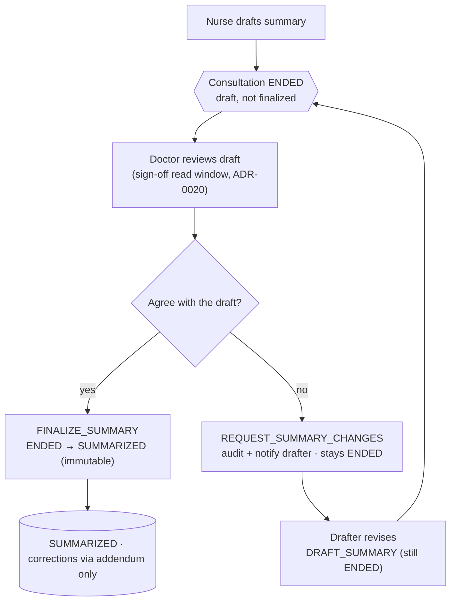

# ADR-0024: Request changes — return a drafted summary to the drafter

- **Status:** Accepted
- **Date:** 2026-10-26
- **Deciders:** Project owner
- **Related:** [ADR-0020](0020-doctor-signoff-of-nurse-run-cases.md), [ADR-0023](0023-finalizing-doctor-summary-read.md)

## Context

A summary is **drafted** by the assigned clinician (nurse or doctor) and **signed
off** by a doctor ([ADR-0020](0020-doctor-signoff-of-nurse-run-cases.md)). Once
finalized it is immutable; corrections are append-only addenda (FR-13). A doctor
reviewing a nurse's draft cannot edit it — `DRAFT_SUMMARY` is
`ownership = ASSIGNED_CLINICIAN`, and the signing doctor is not the assigned
clinician.

That leaves a reviewing doctor who **disagrees** with a draft no good move. Their
only options were to finalize a summary they do not agree with and then append an
addendum — but the signature implies agreement, so correcting _after_ signing is
backwards — or to leave the case stranded in `ENDED`. There was no way to hand the
draft back to the author to fix.

## Decision

Add a **request-changes** action: a doctor returns a drafted, unfinalized summary
to the drafter to revise, as an explicit alternative to finalizing.

1. **New action `REQUEST_SUMMARY_CHANGES`** — `role = DOCTOR`, `ownership = NONE`,
   exactly like `FINALIZE_SUMMARY`, so a doctor can request changes on a nurse-run
   case they did not run. The state gate (`ENDED`, a draft exists, not yet
   finalized) lives in the service, matching `DRAFT_SUMMARY` / `ADD_ADDENDUM`
   (actions that do not themselves transition state). Admin never appears in the
   row, so separation of duties is untouched (invariant 3).

2. **No state transition.** The case stays `ENDED`. The assigned clinician can
   already re-draft in `ENDED` (`DRAFT_SUMMARY`'s state set is `{IN_SESSION,
ENDED}`), so the revise step needs no new rule, and a doctor finalizes once
   satisfied. Keeping the case `ENDED` also keeps it on the pending-sign-off
   worklist (ADR-0020), so it is never lost.

3. **New endpoint** `POST /consultations/:id/summary/request-changes` (DOCTOR),
   returning `200` with the unchanged draft view. Body: an optional `note`
   (1–2000 chars) of feedback for the drafter.

4. **Audited as `SUMMARY_CHANGES_REQUESTED`** — actor (the doctor), consultation,
   and `{ draftedBy }` (the clinician who must act): who / what / when only. The
   **note is never persisted or audited** (invariant 6); it is delivered to the
   drafter in real time via `summary:changes-requested`, emitted only to that
   clinician's personal room.

### Review → revise → finalize loop

## Alternatives considered

- **Request-changes, case stays `ENDED`** (chosen). No schema or state-machine
  change; reuses the drafter's existing re-draft path and the sign-off worklist;
  one matrix row and one audit event. The note stays ephemeral, honouring
  invariant 6 without a new persisted clinical-text field.
- **Let the reviewing doctor edit the draft directly.** One fewer round-trip, but
  it overwrites a nurse's clinical note under the nurse's authorship (`draftedBy`),
  erasing "who wrote this" unless a separate `lastRevisedBy` field is added. It
  also blurs the nurse-drafts / doctor-approves separation. Rejected; the
  return-to-author model mirrors real clinical sign-off.
- **A dedicated `CHANGES_REQUESTED` state between `ENDED` and `SUMMARIZED`.** More
  explicit, but an enum + migration + new transitions for no behavioural gain over
  staying in `ENDED` (already the draft/finalize state). Rejected as scope.
- **Persist the note (new column or a review-comments table).** A durable,
  offline-safe record of the feedback, but it introduces a store of free clinical
  text to protect under invariant 6 and a migration. Deferred (see below).

## Consequences

- A reviewing doctor can hand a draft back instead of signing one they disagree
  with; the nurse revises and the doctor finalizes — the summary is signed only
  once a doctor actually agrees with it.
- Exposure does not widen: the action is doctor-only, the case stays `ENDED`, and
  the note reaches only the drafter's own realtime channel. The audit trail gains
  a who/what/when record of each request.
- ~~**Known limitation (deferred):** the note is delivered in real time only, so a
  drafter who is offline when changes are requested sees that the case is still
  `ENDED` (on their assigned list) but not the specific feedback.~~ **Resolved by
  [ADR-0025](0025-durable-changes-requested-indicator.md):** the request + note are
  now persisted on the summary and surfaced to the drafter as a badge and a banner
  until they revise, so a missed live toast no longer loses the request.
- Covered by tests: the authorization-matrix unit spec (doctor-only; admin denied),
  the `SummariesService` unit spec (audit + drafter notification, note never
  audited, and the no-draft / finalized / wrong-state / non-doctor guards), and a
  sign-off e2e running the full doctor-returns → nurse-revises → doctor-finalizes
  loop plus a nurse-forbidden check.
- The UI surfaces the action in the sign-off review (consultation room) and on the
  summary screen, with a "Request changes" control and an optional note; the drafter
  is told via a `summary:changes-requested` toast through the existing `aria-live`
  region (a clinician counterpart to [ADR-0021](0021-patient-in-app-notifications.md)).
  Frontend component tests cover the doctor action and the drafter toast.
