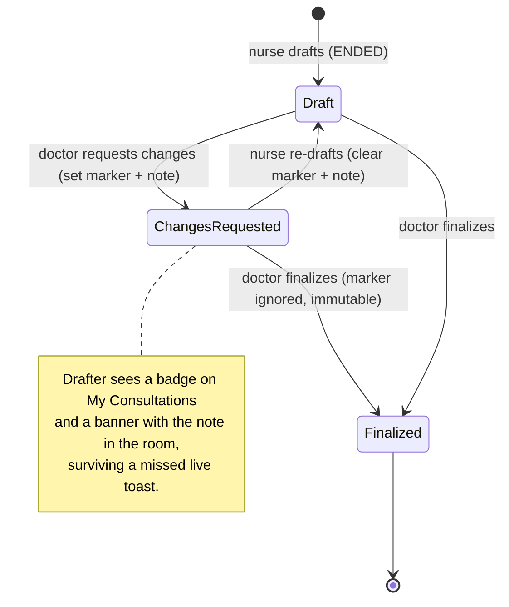

# ADR-0025: Durable "changes requested" indicator for the drafter

- **Status:** Accepted
- **Date:** 2026-10-26
- **Deciders:** Project owner
- **Refines:** [ADR-0024](0024-request-summary-changes.md) · **Related:** [ADR-0021](0021-patient-in-app-notifications.md)

## Context

[ADR-0024](0024-request-summary-changes.md) let a doctor return a drafted summary
to its author to revise. It delivered the request **only** as a live toast on the
drafter's socket (`summary:changes-requested`) and recorded the fact in the audit
log. ADR-0024 explicitly **deferred** a durable, drafter-facing indicator.

That deferral left a real gap: the toast auto-dismisses and has no history, so a
drafter who was offline, on another screen, or simply not looking when the doctor
clicked **Request changes** has **no way to find out**. Their "My consultations"
list showed only state `ENDED` — a returned case looked identical to one still
awaiting a doctor's sign-off — and the audit log is admin-only. In practice the
nurse could not tell that, or why, a revision was wanted.

## Decision

Persist the request on the summary so the drafter sees it until they act.

1. **Two nullable columns on `Summary`:** `changesRequestedAt` (when a doctor last
   returned the draft) and `changesRequestedNote` (their feedback). Additive
   migration; no new table or state.
2. **Set on `REQUEST_SUMMARY_CHANGES`, cleared on the next `DRAFT_SUMMARY`.** When
   the drafter saves any revision the marker and note are wiped, so the signal is
   exactly "a revision is outstanding". Finalizing supersedes it (a finalized
   summary is immutable; the marker is ignored once `finalizedAt` is set).
3. **Surfaced to the drafter, durably:**
   - `GET /consultations/assigned` returns `summaryChangesRequested` (true only
     while unfinalized), so the nurse's **My consultations** list shows a
     **"Changes requested"** badge.
   - The summary view carries `changesRequestedAt` / `changesRequestedNote`, so the
     consultation room shows the drafter a banner **with the note** above the draft
     editor; saving clears it.
   - The live toast (ADR-0024) stays as the immediate nudge; this is the fallback
     that survives being missed.
4. **Privacy unchanged.** The note is feedback for the drafter, stored only on the
   summary and shown in-app; it is **never** written to the audit log or any
   message/URL (invariant 6). No authorization changes — the marker rides the
   existing `DRAFT_SUMMARY` / `REQUEST_SUMMARY_CHANGES` / `VIEW_SUMMARY` rules.

### Lifecycle of the marker

## Alternatives considered

- **Persist marker + note on the summary** (chosen). Smallest durable change — two
  nullable columns, no new table/state — and it reads back wherever the drafter
  already looks. The note lives with the draft it is about and clears naturally on
  revision.
- **Keep toast-only (ADR-0024 as-is).** No migration, but the drafter can miss the
  one signal entirely — the gap this ADR exists to close. Rejected.
- **A dedicated `CHANGES_REQUESTED` state.** Explicit, but an enum + migration +
  new transitions, and the case genuinely stays `ENDED` (re-draftable, still on the
  sign-off worklist). Rejected as over-modelling (as in ADR-0024).
- **A separate review-comments table (threaded feedback).** Richer, but more schema
  and UI than a single outstanding request needs for this capstone. Deferred; the
  single note covers the workflow.

## Consequences

- A drafter reliably learns a revision was requested — a badge on their list and a
  banner with the note in the room — even if they never saw the live toast. This
  **resolves the limitation ADR-0024 deferred.**
- Exposure does not widen: the note is drafter-facing and in-app only; the audit
  trail still records who/what/when without the text; no authorization change.
- Covered by tests: the `SummariesService` unit spec (request persists the marker +
  note; a re-draft clears it), the sign-off e2e (the marker + note read back on the
  summary and as `summaryChangesRequested` on the assigned list, then clear after a
  re-draft), and frontend specs for the list badge and the room banner. The new
  attention badge/banner colour is checked by the token-contrast test (AA).
