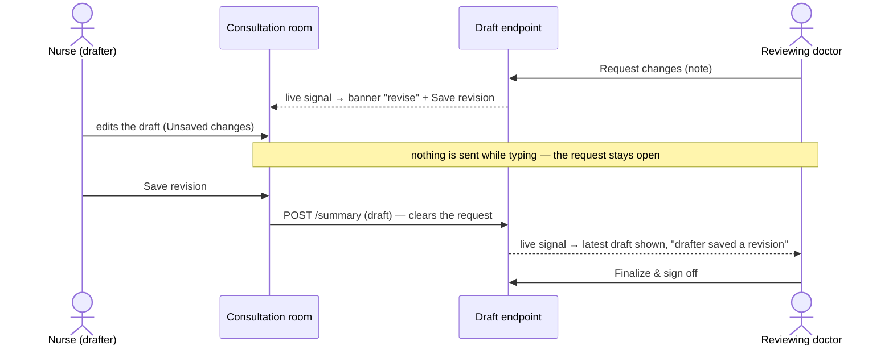

# ADR-0026: Explicit save for the summary draft (supersedes autosave)

- **Status:** Accepted
- **Date:** 2026-10-26
- **Deciders:** Project owner
- **Supersedes:** [ADR-0022](0022-autosave-summary-draft.md) · **Related:** [ADR-0020](0020-doctor-signoff-of-nurse-run-cases.md), [ADR-0024](0024-request-summary-changes.md), [ADR-0025](0025-durable-changes-requested-indicator.md), [ADR-0027](0027-live-summary-and-signoff-signals.md)

## Context

[ADR-0022](0022-autosave-summary-draft.md) replaced the "Save draft" button with a
debounced autosave (~800ms after typing stops). That solved one problem — a nurse who
forgot to click Save left a case off the doctors' sign-off worklist — but two later
decisions changed what a save _means_:

- **A save is a hand-off.** Saving a draft on an `ENDED` case puts it in front of every
  doctor for sign-off ([ADR-0020](0020-doctor-signoff-of-nurse-run-cases.md)), and with
  [ADR-0027](0027-live-summary-and-signoff-signals.md) a reviewing doctor's open copy
  now updates live from each save.
- **A save answers a review.** Saving clears a doctor's "please revise" request
  ([ADR-0024](0024-request-summary-changes.md)/[0025](0025-durable-changes-requested-indicator.md)).

With autosave, both happened on the first pause in typing. A nurse revising a returned
draft cleared the doctor's request — and showed the doctor a half-edited text — after
typing a single word, and the doctor could sign that half-edit. Clinicians also had no
clear moment of "this is my summary": the UI offered no Save button at all, which in
review was reported as confusing rather than convenient.

## Decision

**Saving the summary draft is an explicit action again, with protections against losing
work.** Frontend-only — the draft endpoint, data model and authorization are unchanged.

1. The editor has a **Save draft** button (labelled **Save revision** while a doctor's
   change request is outstanding). It is enabled only when there are unsaved changes.
2. An `aria-live` status shows **Unsaved changes** / **Saved at hh:mm**, so the state of
   the draft is always visible.
3. **Nothing is lost by forgetting to click:**
   - **End consultation** saves an unsaved draft before closing the session (and the
     confirmation says so).
   - **Finalize & sign off** by the assigned doctor saves the editor content first, so
     the signed record is exactly what they see (unchanged from ADR-0022).
   - Closing or reloading the tab with unsaved changes triggers the browser's
     leave-page warning; the in-app Back button asks before leaving.
4. **The stranding risk ADR-0022 fixed stays fixed differently:** `GET
/consultations/assigned` now returns `summaryDrafted`, and the clinician's _My
   consultations_ list shows **Write the summary** for any ended case with no saved
   draft; the room itself says a doctor can only sign off once a draft is saved.

## Alternatives considered

- **Keep autosave (ADR-0022).** Rejected: a save is a hand-off and an answer to a
  review, and autosave made both happen mid-edit.
- **Autosave plus an explicit "Submit for sign-off".** Separates "persist" from
  "publish", but needs a new draft state on the server (a migration and new
  authorization rules) and two save concepts in the UI. Rejected as over-modelling
  for a single-author draft.
- **Autosave to the browser, explicit save to the server.** Would protect against a
  crashed tab, but keeps clinical text in browser storage (invariant 6). Rejected; the
  leave-page warning covers the common case.

## Consequences

- The doctor only ever sees — and can only sign — text the drafter chose to save, and a
  change request stays open until the drafter actually saves a revision.
- Ending a session or signing off never loses typed text; closing the tab warns first.
- A drafter who types and then navigates away inside the app via the nav bar (not the
  Back button) loses unsaved edits without a prompt: the router in use has no
  navigation blocker. Accepted; the editor shows "Unsaved changes" persistently.
- Proven by the consultation-room component tests (typing never persists; Save does;
  End consultation saves first; a live signal never overwrites text being edited) and
  the My consultations "Write the summary" test.
