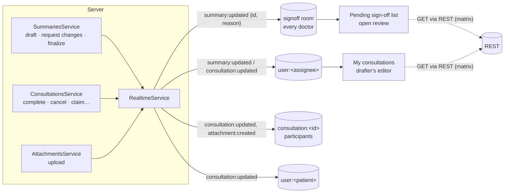

# ADR-0027: Live summary and sign-off signals (doctors' sign-off room)

- **Status:** Accepted
- **Date:** 2026-10-26
- **Deciders:** Project owner
- **Related:** [ADR-0009](0009-realtime-implementation.md), [ADR-0020](0020-doctor-signoff-of-nurse-run-cases.md), [ADR-0024](0024-request-summary-changes.md), [ADR-0025](0025-durable-changes-requested-indicator.md), [ADR-0026](0026-explicit-summary-save.md)

## Context

Everything in the consultation lifecycle updates live ([ADR-0009](0009-realtime-implementation.md))
— except the summary hand-off between a nurse and a doctor, which was the newest part
of the workflow:

- When a doctor **requested changes**, the drafter got a toast
  (`summary:changes-requested`), but the open consultation room did not show the
  durable "revise" banner ([ADR-0025](0025-durable-changes-requested-indicator.md)) and
  _My consultations_ did not show the badge until a reload or a 20-second poll.
- When the drafter **saved a revision**, a doctor reviewing that case kept looking at
  the old text — and could sign it off, since finalize signs the server's latest draft.
- The doctors' **pending sign-off** worklist and the clinician's **My consultations**
  list were polled, not pushed: `consultation:updated` reached only the room and the
  patient, so a clinician's own list never heard about a cancel or a requeue.
- Attachments shared mid-session did not appear for the other participant until they
  reloaded.

The gap is structural: any doctor may sign off any ended case
([ADR-0020](0020-doctor-signoff-of-nurse-run-cases.md)), so the audience for a
summary change is "every doctor", and no room expressed that.

## Decision

Add content-free signals, delivered by room, following the existing rule that events
are **signals** and clients **reconcile over REST** (where the matrix applies).

1. **A `signoff` room.** Every socket whose verified JWT role is `DOCTOR` joins it on
   connect. Membership grants nothing but the signals below — no data.
2. **`summary:updated { consultationId, reason }`**, `reason ∈ drafted |
changes_requested | finalized | ended`, emitted (in one multi-room emit) to the
   `signoff` room and to the assigned clinician's personal room `user:<claimedBy>`:
   - on **draft saved**, **changes requested** and **finalized** (summaries service);
   - on **consultation ended** (the case may have just entered the worklist).
     It is **never** sent to the patient or the consultation room — a draft is not the
     patient's to see, not even as a signal.
3. **`consultation:updated`** is also sent to the **assigned clinician's personal room**
   (claim, start, end, patient cancel, TTL requeue, deactivation reassignment,
   finalize), so _My consultations_ reconciles live.
4. **`attachment:created { consultationId }`** to the consultation room after an upload;
   members re-fetch the list, which re-checks the matrix (participants only) and
   mints fresh signed URLs.
5. Clients filter room events by `consultationId`, and the drafter's editor never
   replaces text that has unsaved changes ([ADR-0026](0026-explicit-summary-save.md)).

## Alternatives considered

- **Keep polling (20s) for the summary flow.** Simple, but a doctor could sign a stale
  draft within that window, and it was the one part of the product that did not feel
  live. Rejected.
- **Put the summary text in the event.** Saves a REST round-trip, but sends clinical
  text to every doctor's socket whether or not they open the case, and bypasses the
  matrix. Rejected (invariants 4 & 6).
- **Per-doctor fan-out by querying doctors on each change.** Equivalent delivery,
  but a DB query per event and no different exposure. Rejected in favour of a room
  joined from the verified role.
- **Send summary signals to the consultation room.** The patient is a member, and a
  sign-off doctor usually is not. Rejected.

## Consequences

- A change request appears in the drafter's open room and list at once; a saved
  revision appears in the reviewing doctor's open copy at once ("the drafter saved a
  revision"), so sign-off is never of a stale draft. The worklist and the clinician's
  list need no polling (a 30-second fallback remains for a dropped socket).
- Exposure does not widen: signals carry an id and a reason only, the patient never
  receives summary signals, and every read still goes through REST + the matrix.
  `signoff` membership is derived from the JWT role on the server, never requested.
- Proven by `realtime.service.spec.ts` (room targeting, single emit), the summaries and
  attachments unit specs (signals emitted, no note text), the realtime e2e
  (`summary:updated` reaches every doctor and the drafter, carries no note, and never
  reaches the patient; the nurse's personal room gets `consultation:updated`), and the
  frontend room / worklist / list tests for live reconciliation.
