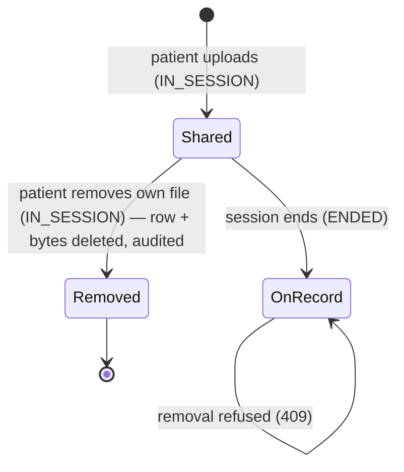

# ADR-0028: A patient may remove a file they shared, during the session only

- **Status:** Accepted
- **Date:** 2026-10-26
- **Deciders:** Project owner
- **Related:** [ADR-0007](0007-attachment-storage.md), [ADR-0027](0027-live-summary-and-signoff-signals.md)

## Context

Patients share photos and PDFs with the clinician during a session
([ADR-0007](0007-attachment-storage.md)). Mistakes happen — the wrong photo, a document
for someone else, an image showing more than intended — and until now a shared file
could never be taken back. At the same time, files a clinician relied on during a
consultation are part of the clinical record once it is over, and records must not be
silently edited afterwards (the same principle as the immutable summary, FR-13).

## Decision

**The patient who uploaded a file may remove it while the consultation is
`IN_SESSION`; after the session ends, files are permanent.**

1. **Authorization** — a new matrix action `DELETE_ATTACHMENT`: role `PATIENT`,
   ownership `OWNER` (their own consultation). The service additionally requires that
   the patient **uploaded that file** (a clinician's file can never be removed by the
   patient) and that the state is `IN_SESSION`. Nurses, doctors and admins are denied.
2. **Race-safe** — the row is removed with a conditional delete that re-checks
   `state = IN_SESSION` in the database, so a removal racing **End consultation**
   either wins before the session ends or gets `409` (the same pattern as the claim,
   [ADR-0003](0003-claim-concurrency.md)).
3. **Really removed** — the database row and the stored bytes are deleted (the file
   may be a private photo shared by mistake); the object-store delete is best-effort
   after the row is gone, which is what makes the file unreachable.
4. **Audited, without content** — `ATTACHMENT_DELETED` records who/what/when
   (`{ attachmentId, mimeType, sizeBytes }`), never the filename or bytes.
5. **Live** — `attachment:removed { consultationId }` tells the room; the clinician's
   file list drops it without a refresh ([ADR-0027](0027-live-summary-and-signoff-signals.md)).
6. **UI** — a **Remove** action appears only on the patient's own files while the
   session is in progress, behind an inline confirmation.

`DELETE /consultations/:id/attachments/:attachmentId` → `204`; `403` for the wrong role
or someone else's file, `404` for a file not in this consultation, `409` once the
session has ended.

## Alternatives considered

- **Soft delete (hide, keep the bytes).** Keeps everything for audit, but the point of
  removal is often that the file should not have been shared at all; keeping a private
  photo nobody can see adds risk without value. The audit row already proves that a
  file was shared and removed. Rejected.
- **Let any uploader (clinicians too) remove their files.** Reasonable, but not asked
  for, and a clinician's shared material is closer to the clinical record. Left out;
  it would be a one-line matrix change plus tests if wanted.
- **Allow removal until the summary is finalized.** Would let files disappear after the
  clinician has based a summary on them. Rejected: the session's end is the cut-off.

## Consequences

- A patient can correct a mistaken upload immediately, and the clinician sees it vanish
  live; nothing can be removed once the session is over.
- The audit trail shows that a file was shared and later removed, by whom and when,
  without retaining the file.
- Proven by the attachments unit spec (own file / other's file / role / ended / wrong
  consultation), the matrix spec (patient-only), the attachments e2e (204 then gone and
  audited; 403 for clinicians, other patients and the clinician's file; 409 after the
  session ends with the file kept), and the consultation-room component tests.
