# Architecture

How the Virtual Consultation Platform is structured, why, and where each
responsibility lives. This document is **diagram-first**: each section opens with
the picture, then explains it. It is updated as capabilities land — the claim-race
and lifecycle sequence diagrams landed in Phase 2 (§4); the real-time fan-out,
claim-TTL auto-requeue and reconnection sequences land in Phase 3 (§7).

Related: [data model](data-model.md) · [state machine](state-machine.md) ·
[authorization matrix](authorization-matrix.md) · [ADRs](adr/).

---

## 1. System context

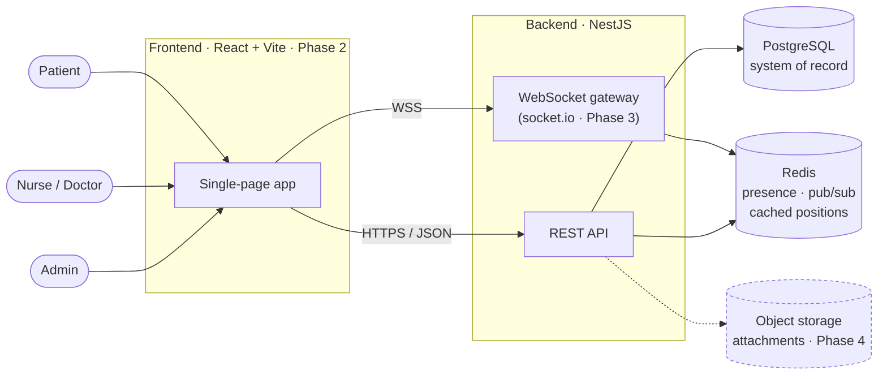

The REST API and the WebSocket gateway (Phase 3) are both live; object storage
(dashed) arrives in Phase 4. The backend is the only thing that touches the
database — clients never do. Redis is reachable from both the gateway (pub/sub
fan-out, presence) and the API (cached positions), but it is **not** a source of
truth ([ADR-0004](adr/0004-redis-responsibilities.md)); PostgreSQL is.

---

## 2. Backend module structure

NestJS was chosen ([ADR-0001](adr/0001-backend-framework.md)) precisely because
its modules, guards and interceptors give clean, testable seams for the
cross-cutting concerns this domain needs (authorization, transition checks,
audit, correlation IDs).

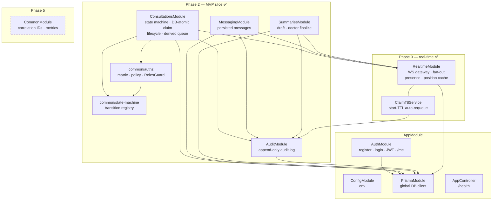

The queue is **not** a module or a table — it is the set of `QUEUED` consultations
read straight from Postgres, ordered by priority tier then FIFO, so there is no
second source of truth to keep in sync. `common/authz` and `common/state-machine`
are plain, dependency-free units (a matrix, a policy function, a transition
registry) that both the controllers and services read — the single definition of
who-may-do-what-when (invariants 1 & 4).

| Module                 | Responsibility                                                                                              | Phase                 |
| ---------------------- | ----------------------------------------------------------------------------------------------------------- | --------------------- |
| `ConfigModule`         | Load env (`../.env`), expose typed config                                                                   | 1                     |
| `PrismaModule`         | Single global Prisma client; connection lifecycle                                                           | 1                     |
| `AuthModule`           | Register (patient), login, JWT issue/verify, `GET /auth/me`                                                 | 1                     |
| `AppController`        | Unauthenticated `GET /health` liveness                                                                      | 1                     |
| `ConsultationsModule`  | State-machine enforcement, DB-atomic claim, lifecycle, derived priority+FIFO queue, "N ahead" positions     | 2 ✅ (real-time in 3) |
| `MessagingModule`      | Persisted messages (REST); WebSocket room in Phase 3                                                        | 2 ✅ / 3              |
| `SummariesModule`      | Draft (assigned clinician) + doctor-only finalize; immutable                                                | 2 ✅                  |
| `AuditModule`          | Append-only audit events (no clinical content); admin-only read                                             | 2 ✅ / 4              |
| `common/authz`         | Authorization matrix, role+state+ownership policy, `RolesGuard`                                             | 2 ✅                  |
| `common/state-machine` | Transition registry (the central bank of transitions)                                                       | 2 ✅                  |
| `RealtimeModule`       | WebSocket gateway (JWT handshake, room authz), Redis fan-out + presence + position cache, claim-TTL sweeper | 3 ✅                  |
| `CommonModule`         | Validation helpers, error mapping, correlation-ID middleware, metrics                                       | 5                     |

### Authorization seams (where the invariants are enforced)

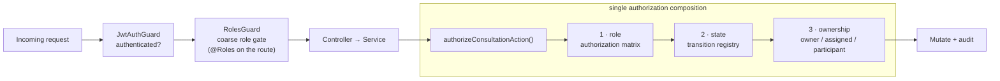

`JwtAuthGuard` authenticates; `RolesGuard` fails fast on the route's allowed
roles; then the service runs `authorizeConsultationAction` — the **one** place
that composes **role → state → ownership**, reading the authorization matrix and
the shared transition registry. Ordering the checks this way makes the HTTP code
correct: a disallowed role is `403`, an action illegal from the current state is
`409`, and a wrong owner is `403` (invariants 1, 3 & 4). State-changing actions
then write an audit record in the same path (invariant 5).

---

## 3. Authentication request flow (Phase 1, implemented)

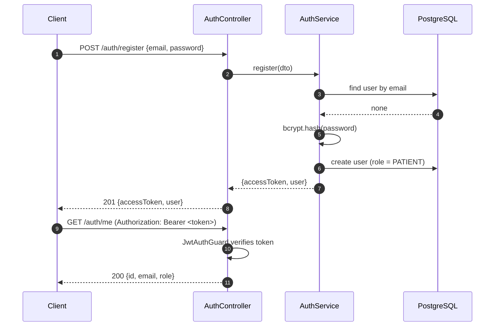

Self-registration always creates a **PATIENT**; staff (nurse/doctor/admin) are
provisioned by seed or by an admin later (prevents privilege escalation, NFR-1).
Access tokens are short-lived JWTs ([ADR-0006](adr/0006-authn-authz.md)); refresh
tokens are a Phase 2 addition.

---

## 4. Data & concurrency

PostgreSQL is the durable system of record ([ADR-0002](adr/0002-postgresql-system-of-record.md));
the full schema and ER diagram live in [data-model.md](data-model.md). Redis is
deliberately _not_ a source of truth ([ADR-0004](adr/0004-redis-responsibilities.md)).

### 4.1 The claim race (ADR-0003, invariant 2)

Two clinicians may claim the same queued case at the same instant. The race is
resolved **in the database** by a single atomic conditional `UPDATE` — never by
application-level coordination. Whichever transaction's update matches one row
wins; the other matches zero rows and is told it was already claimed.

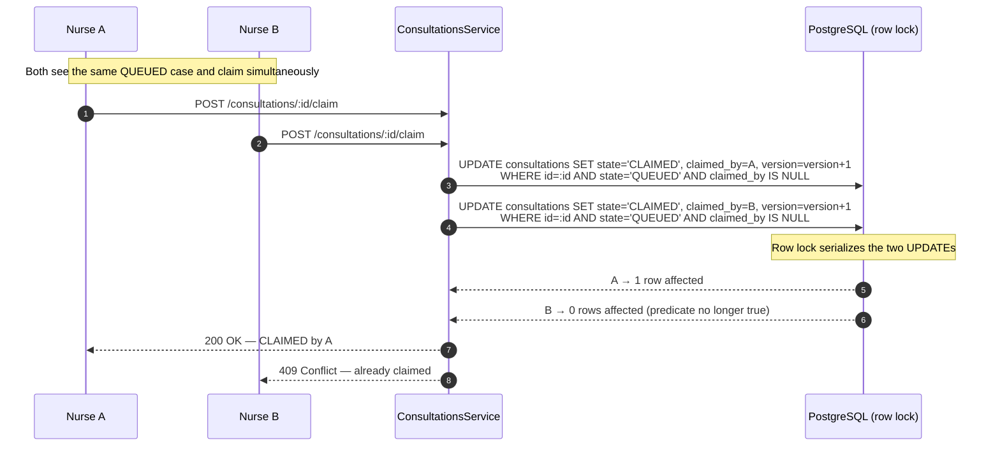

Prisma expresses this as `updateMany({ where: { id, state: QUEUED, claimedBy: null }, … })`;
`result.count === 1` is the winner, `0` ⇒ `409`. The same conditional-update
pattern guards every other transition (start / complete / cancel), so a state that
moves under a request is caught as a zero-row result rather than a lost update.
This is proven by `backend/test/e2e/claim-concurrency.e2e-spec.ts` (SC-2).

### 4.2 Lifecycle request flow

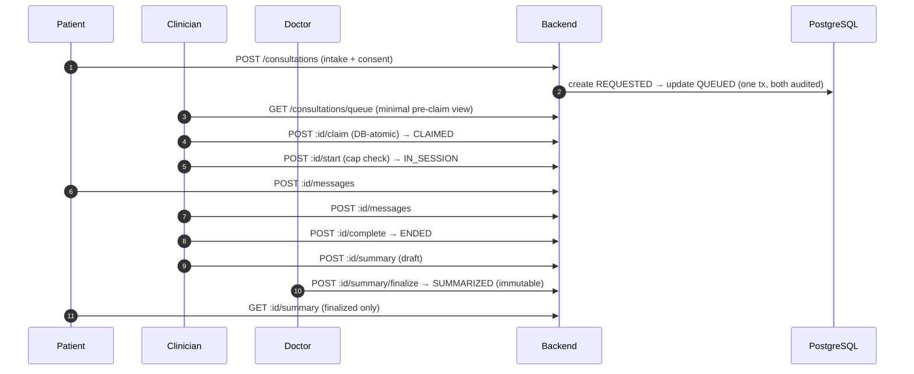

---

## 5. Local deployment topology (Phase 1)

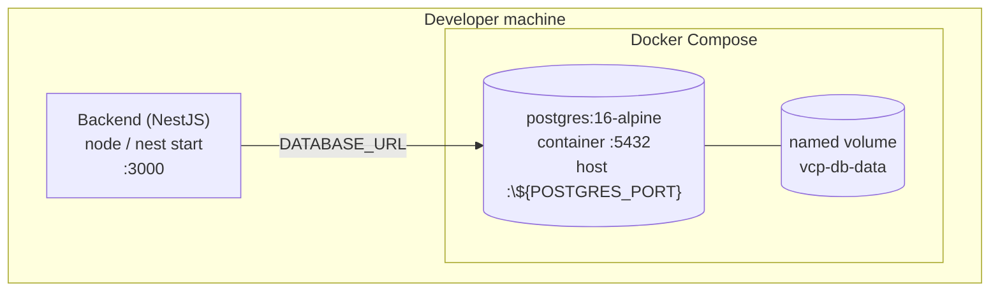

Phase 1 runs the API on the host (fast reload) against a Dockerised Postgres. The
full stack — app container + Redis — is assembled in Phase 5. The target is
**local Docker Compose** ([ADR-0008](adr/0008-deployment-target.md)); no hosted
environment is in scope for the capstone.

### Environment & configuration

A single git-ignored `.env` at the repo root feeds both Docker Compose and the
backend; `.env.example` is the committed, canonical list of variables. The host
port is configurable (`POSTGRES_PORT`) to avoid clashes with other local Postgres
instances.

---

## 6. Build, test & CI

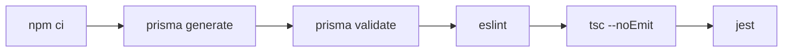

CI runs this chain on every PR and on `main` (`.github/workflows/ci.yml`). Build,
integration/E2E and coverage gates are layered on in Phases 2–6
([project-plan.md](project-plan.md)). The repo is an **npm workspaces monorepo**
(`backend`, `frontend`) sharing one TypeScript base config, ESLint (flat) and
Prettier, with Conventional-Commit enforcement via husky + commitlint.

---

## 7. Real-time & concurrency hardening (Phase 3)

The triage queue and the consultation room go **live** over WebSockets
([ADR-0005](adr/0005-realtime-websockets.md)), fanned out across API instances by
Redis pub/sub ([ADR-0004](adr/0004-redis-responsibilities.md)). The transport is
socket.io with the `@socket.io/redis-adapter`
([ADR-0009](adr/0009-realtime-implementation.md)); the claim-start TTL is a
DB-authoritative sweeper ([ADR-0010](adr/0010-claim-start-ttl.md)). Two rules keep
the real-time layer honest:

- **PostgreSQL stays authoritative.** Every event is emitted _after_ the DB change
  commits; clients treat events as _signals_ and reconcile the real state from REST
  (and from the DB behind it). Redis is speed/ephemerality only.
- **The matrix governs WebSockets too.** The JWT is verified on the handshake;
  joining the `queue` room is clinician-only and joining a `consultation:<id>` room
  runs the same `authorizeConsultationAction` (role → state → ownership) as REST —
  so admins and non-participants are refused (invariants 3 & 4).

Events (no clinical content beyond what the room's members may already see):
`queue:updated` (signal → re-fetch the queue), `consultation:updated`
(state changed), `message:created` (into the private room only),
`position:updated` (a patient's "N ahead"), `presence:updated`.

### 7.1 Real-time fan-out across instances

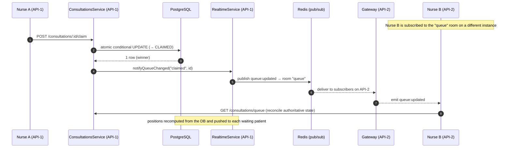

A change made on one instance reaches a subscriber on another because the socket
adapter publishes to Redis and every instance's gateway is subscribed. Without
Redis the same path works within a single instance (in-memory adapter) and simply
does not cross instances — core flows are unaffected.

### 7.2 Claim-start TTL auto-requeue (FR-12 / SC-4)

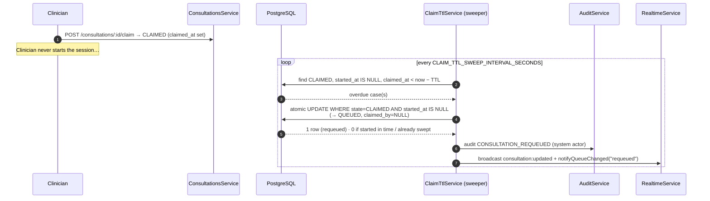

The requeue uses the same atomic conditional-update pattern as the claim, so a
race with a legitimate `start` is resolved in the database (exactly one of them
affects the row) and two instances sweeping at once is safe. The sweeper reconciles
from the DB on every tick, so it survives restarts.

### 7.3 Reconnection — reconcile from authoritative state

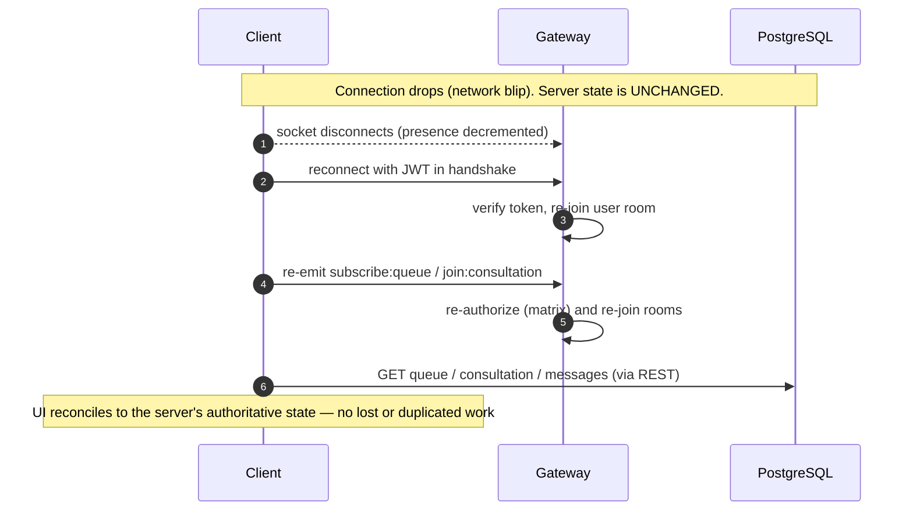

Connection loss changes nothing server-side (state-machine.md "connection loss"
exception). On reconnect the client re-authenticates, the gateway re-authorizes
every room join, and the UI pulls the authoritative state over REST — missed
events don't matter because the client re-reads the source of truth.
