# Architecture

How the Virtual Consultation Platform is structured, why, and where each
responsibility lives. This document is **diagram-first**: each section opens with
the picture, then explains it. It is updated as capabilities land — the claim-race
and lifecycle sequence diagrams landed in Phase 2 (§4); the real-time fan-out,
claim-TTL auto-requeue and reconnection sequences land in Phase 3 (§7); the
deactivation sequence lands in Phase 4 (§8).
Phase 5 adds the observability & ops cross-cutting concerns — structured logging,
correlation-ID tracing, health/readiness probes and metrics in
[observability.md](observability.md), and the full-stack Docker Compose topology and
CI/CD pipeline in [deployment.md](deployment.md).

Related: [data model](data-model.md) · [state machine](state-machine.md) ·
[authorization matrix](authorization-matrix.md) · [ADRs](adr/).

---

## 1. System context

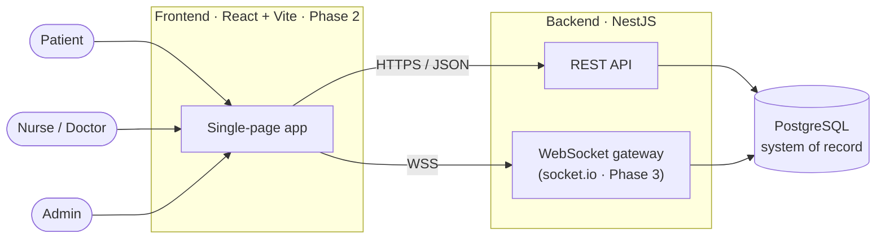

The REST API and the WebSocket gateway (Phase 3) are the backend's two doors. The
backend is the only thing that touches the database — clients never do. Both doors
read it: the gateway checks PostgreSQL when a socket connects (is the account still
active?) and when it joins a consultation room (authorization). PostgreSQL is the
single source of truth; there is no second store to keep in sync.

---

## 2. Backend module structure

NestJS was chosen ([ADR-0001](adr/0001-backend-framework.md)) precisely because
its modules, guards and interceptors give clean, testable seams for the
cross-cutting concerns this domain needs (authorization, transition checks,
audit, correlation IDs).

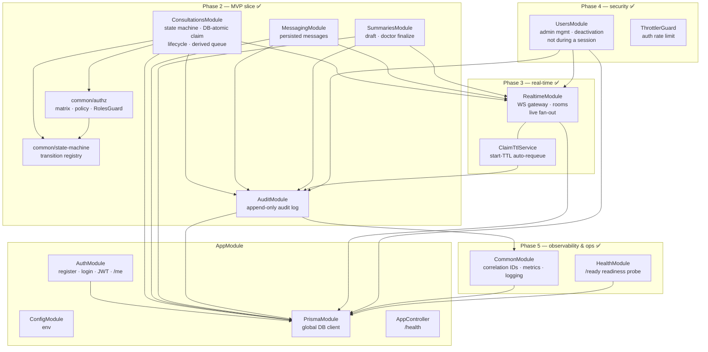

The queue is **not** a module or a table — it is the set of `QUEUED` consultations
read straight from Postgres, ordered by priority tier then FIFO, so there is no
second source of truth to keep in sync. `common/authz` and `common/state-machine`
are plain, dependency-free units (a matrix, a policy function, a transition
registry) that both the controllers and services read — the single definition of
who-may-do-what-when (invariants 1 & 4).

| Module                 | Responsibility                                                                                          | Phase                 |
| ---------------------- | ------------------------------------------------------------------------------------------------------- | --------------------- |
| `ConfigModule`         | Load env (`../.env`), expose typed config                                                               | 1                     |
| `PrismaModule`         | Single global Prisma client; connection lifecycle                                                       | 1                     |
| `AuthModule`           | Register (patient), login, JWT issue/verify, `GET /auth/me`                                             | 1                     |
| `AppController`        | Unauthenticated `GET /health` liveness                                                                  | 1                     |
| `ConsultationsModule`  | State-machine enforcement, DB-atomic claim, lifecycle, derived priority+FIFO queue, "N ahead" positions | 2 ✅ (real-time in 3) |
| `MessagingModule`      | Persisted messages (REST); WebSocket room in Phase 3                                                    | 2 ✅ / 3              |
| `SummariesModule`      | Draft (assigned clinician) + doctor-only finalize; immutable                                            | 2 ✅                  |
| `AuditModule`          | Append-only audit events (no clinical content); admin-only read                                         | 2 ✅ / 4              |
| `common/authz`         | Authorization matrix, role+state+ownership policy, `RolesGuard`                                         | 2 ✅                  |
| `common/state-machine` | Transition registry (the central bank of transitions)                                                   | 2 ✅                  |
| `RealtimeModule`       | WebSocket gateway (JWT handshake, room authz), live fan-out to rooms, claim-TTL sweeper                 | 3 ✅                  |
| `UsersModule`          | Admin user management, deactivation/reactivation (refused while the user is in an active session)       | 4 ✅                  |
| `ThrottlerGuard`       | Global rate limiting with a stricter auth limit                                                         | 4 ✅                  |
| `CommonModule`         | Correlation-ID store (ALS) + middleware, structured-logging config, Prometheus metrics                  | 5 ✅                  |
| `HealthModule`         | `GET /ready` readiness probe gated on PostgreSQL; liveness stays on `GET /health`                       | 5 ✅                  |

### Authorization seams (where the invariants are enforced)

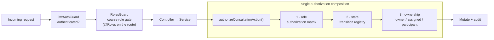

`JwtAuthGuard` authenticates; `RolesGuard` fails fast on the route's allowed
roles; then the service runs `authorizeConsultationAction` — the **one** place
that composes **role → state → ownership**, reading the authorization matrix and
the shared transition registry. Ordering the checks this way makes the HTTP code
correct: a disallowed role is `403`, an action illegal from the current state is
`409`, and a wrong owner is `403` (invariants 1, 3 & 4). State-changing actions
then write an audit record in the same path (invariant 5).

---

## 3. Authentication request flow (Phase 1, implemented)

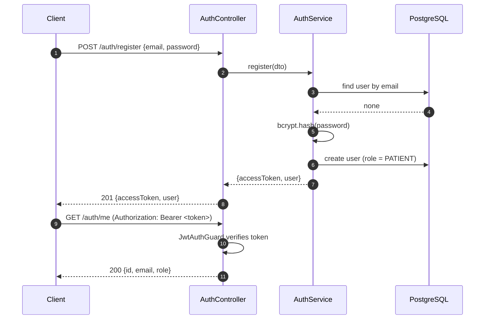

Self-registration always creates a **PATIENT**; staff (nurse/doctor/admin) are
provisioned by seed or by an admin later (prevents privilege escalation, NFR-1).
Access tokens are short-lived JWTs ([ADR-0005](adr/0005-authn-authz.md)); refresh
tokens are a Phase 2 addition.

---

## 4. Data & concurrency

PostgreSQL is the durable system of record ([ADR-0002](adr/0002-postgresql-system-of-record.md));
the full schema and ER diagram live in [data-model.md](data-model.md).

### 4.1 The claim race (ADR-0003, invariant 2)

Two clinicians may claim the same queued case at the same instant. The race is
resolved **in the database** by a single atomic conditional `UPDATE` — never by
application-level coordination. Whichever transaction's update matches one row
wins; the other matches zero rows and is told it was already claimed.

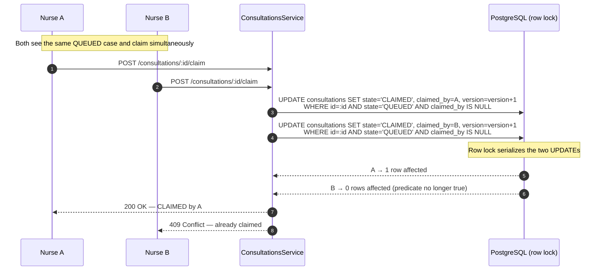

Prisma expresses this as `updateMany({ where: { id, state: QUEUED, claimedBy: null }, … })`;
`result.count === 1` is the winner, `0` ⇒ `409`. The same conditional-update
pattern guards every other transition (start / complete / cancel), so a state that
moves under a request is caught as a zero-row result rather than a lost update.
This is proven by `backend/test/e2e/claim-concurrency.e2e-spec.ts` (SC-2).

### 4.2 Lifecycle request flow

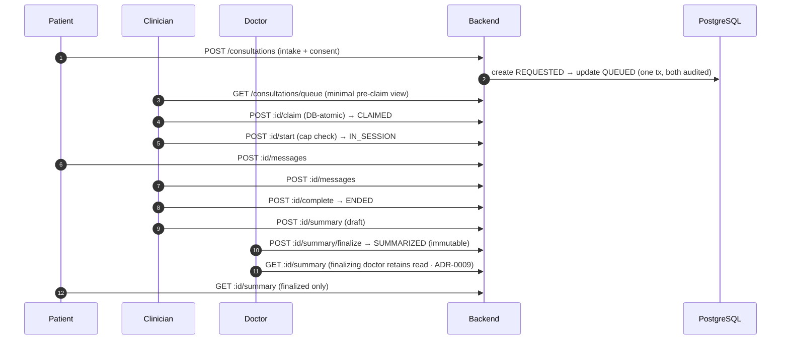

---

## 5. Local deployment topology (Phase 1)

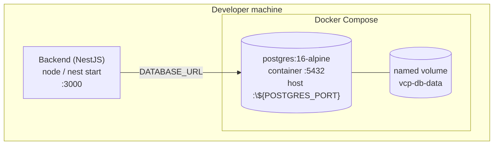

Phase 1 runs the API on the host (fast reload) against a Dockerised Postgres. The
full stack — backend + frontend + Postgres — is assembled in Phase 5 behind
one `docker compose up`; the topology, host-port mapping and container lifecycle are
in [deployment.md](deployment.md). The target is **local Docker Compose**
([ADR-0006](adr/0006-deployment-target.md)); no hosted environment is in scope for
the capstone.

### Environment & configuration

A single git-ignored `.env` at the repo root feeds both Docker Compose and the
backend; `.env.example` is the committed, canonical list of variables. The host
port is configurable (`POSTGRES_PORT`) to avoid clashes with other local Postgres
instances.

---

## 6. Build, test & CI

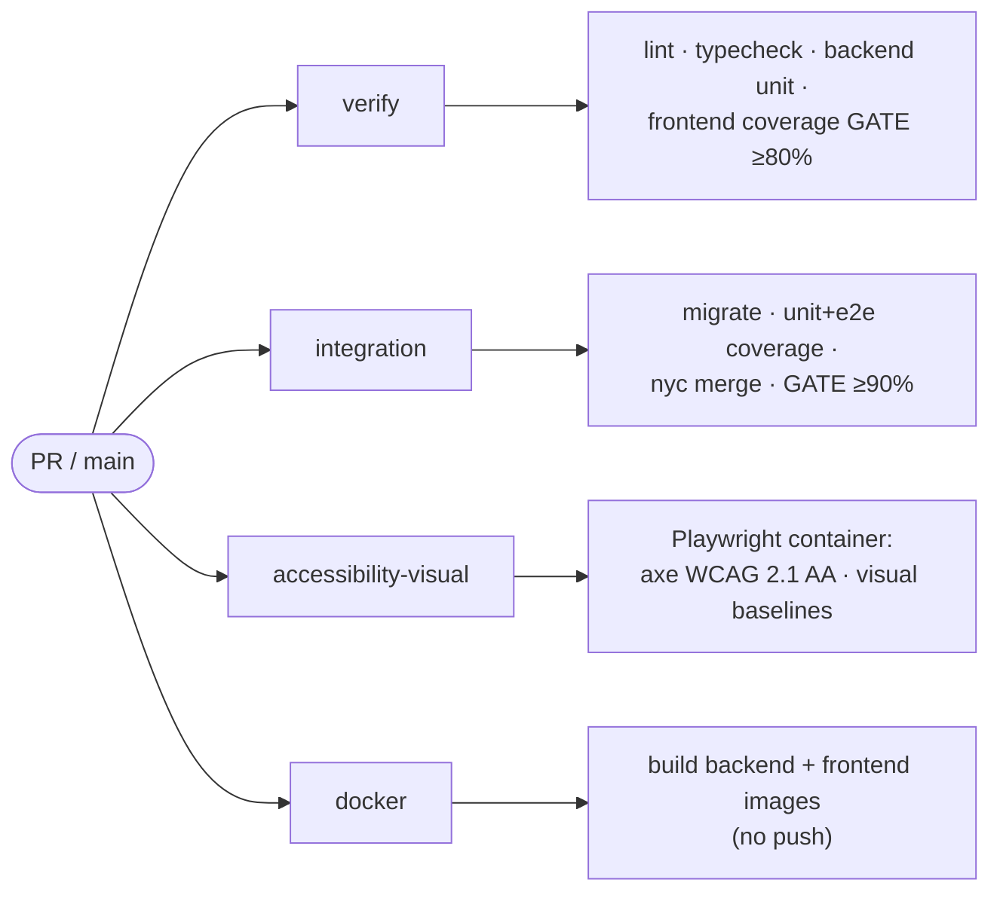

CI runs these jobs on every PR and on `main` (`.github/workflows/ci.yml`). The
**integration/e2e** job runs against a real Postgres; the **docker** job proves
both images containerise (built, not pushed — local Compose target, ADR-0006). As of
**Phase 6** coverage is **gate-enforced**, not observe-only: the frontend Vitest gate
(≥80%) runs in `verify`, and the **merged** backend unit + e2e coverage gate (≥90%
statements/lines/functions) runs in `integration` via `nyc`
([testing-strategy.md](testing-strategy.md#coverage-ci-enforced)). A fourth job,
**accessibility-visual**, runs axe WCAG 2.1 AA and visual-regression on the four
critical screens inside the pinned Playwright container ([testing-strategy.md](testing-strategy.md)). Full
pipeline detail is in [testing-strategy.md](testing-strategy.md) and
[deployment.md](deployment.md). The repo is an **npm workspaces monorepo**
(`backend`, `frontend`) sharing one TypeScript base config, ESLint (flat) and
Prettier, with Conventional-Commit enforcement via husky + commitlint.

---

## 7. Real-time & concurrency hardening (Phase 3)

The triage queue and the consultation room go **live** over WebSockets
([ADR-0004](adr/0004-realtime-websockets.md)). The transport is socket.io, with
rooms as the authorization unit ([ADR-0004](adr/0004-realtime-websockets.md));
the claim-start TTL is a
DB-authoritative sweeper ([ADR-0007](adr/0007-claim-start-ttl.md)). Two rules keep
the real-time layer honest:

- **PostgreSQL stays authoritative.** Every event is emitted _after_ the DB change
  commits; clients treat events as _signals_ and reconcile the real state from REST
  (and from the DB behind it).
- **The matrix governs WebSockets too.** The JWT is verified on the handshake;
  joining the `queue` room is clinician-only and joining a `consultation:<id>` room
  runs the same `authorizeConsultationAction` (role → state → ownership) as REST —
  so admins and non-participants are refused (invariants 3 & 4). Every user is in
  their personal `user:<id>` room, and every doctor in the `signoff` room — both
  derived from the verified JWT on connect, never requested by the client.

Events (no clinical content beyond what the room's members may already see):
`queue:updated` (signal → re-fetch the queue), `consultation:updated`
(state changed — also to the assigned clinician's personal room),
`message:created` (into the private room only), `position:updated` (a patient's
"N ahead") and `summary:updated` (content-free; doctors + the assignee). The
full contract is in [api-spec.md §WebSocket API](api-spec.md#websocket-api-phase-3).

### 7.1 Real-time fan-out to the queue room

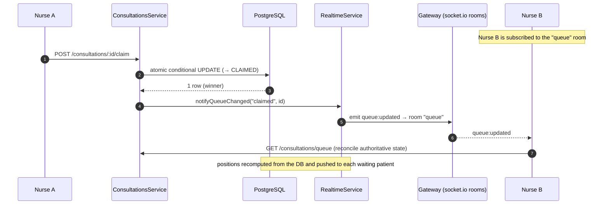

The event is only a nudge: Nurse B's screen re-reads the queue over REST, so what
they see always comes from PostgreSQL, never from the event itself.

### 7.2 Claim-start TTL auto-requeue (FR-12 / SC-4)

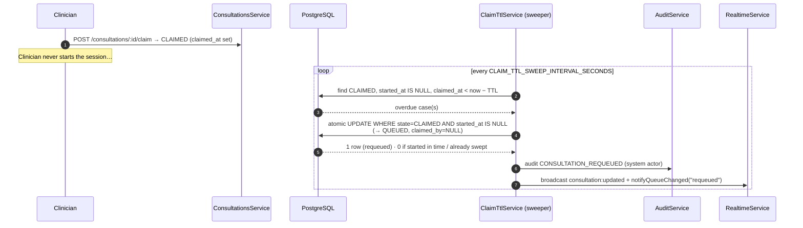

The requeue uses the same atomic conditional-update pattern as the claim, so a
race with a legitimate `start` is resolved in the database (exactly one of them
affects the row) and two instances sweeping at once is safe. The sweeper reconciles
from the DB on every tick, so it survives restarts.

### 7.3 Reconnection — reconcile from authoritative state

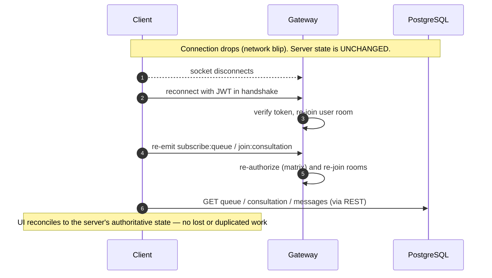

Connection loss changes nothing server-side (state-machine.md "connection loss"
exception). On reconnect the client re-authenticates, the gateway re-authorizes
every room join, and the UI pulls the authoritative state over REST — missed
events don't matter because the client re-reads the source of truth.

### 7.4 Live summary hand-off — nurse drafts, any doctor signs (ADR-0004, ADR-0009)

A nurse-run case is signed off by **any** doctor (ADR-0009), so summary changes are
signalled to the `signoff` room (every doctor) and to the drafter's personal room —
never to the patient. Saving is explicit: nothing reaches a reviewer while
the drafter is still typing.

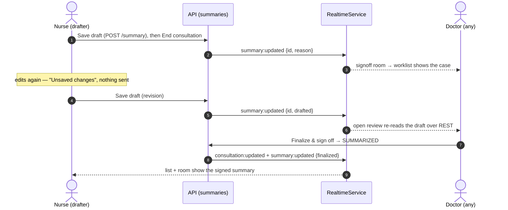

The signals carry an id and a reason only; every read goes back through REST and the
authorization matrix, so the live path never widens exposure (invariants 4 & 6).

---

## 8. Security, privacy & audit (Phase 4)

Phase 4 hardens the sensitive-data paths without changing the invariants: the
single authorization matrix still governs everything, PostgreSQL stays
authoritative, and admins still cannot read clinical content. The full threat model
is in [security-privacy.md](security-privacy.md) and the audit catalogue in
[audit-logging.md](audit-logging.md).

### 8.1 Deactivation during an active session (ADR-0008)

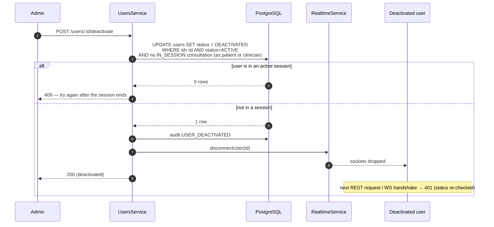

The rule lives inside the `UPDATE` itself, so the check and the write cannot be split
by a session starting in between — the same conditional-update pattern as the claim.
A clinician who has only **claimed** a case (not started it) can be deactivated: the
claim-start TTL sweeper (§7.2) returns that case to the queue and the patient keeps
their place in line.
