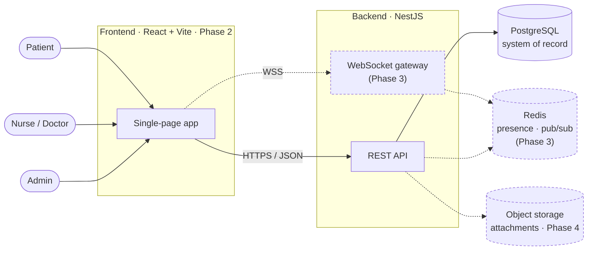
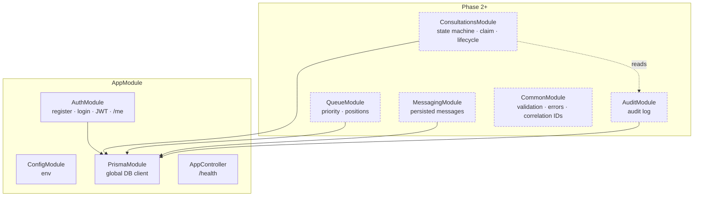
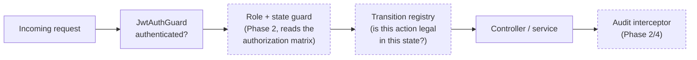
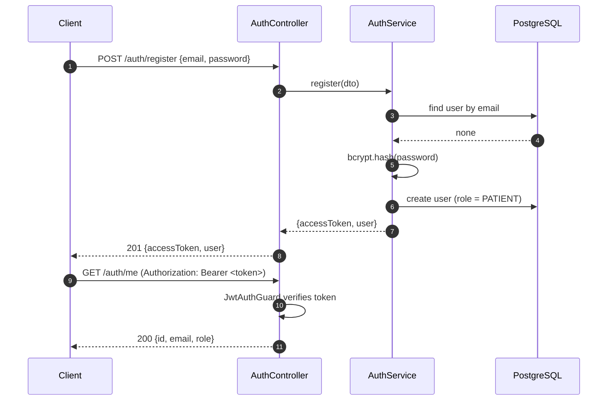
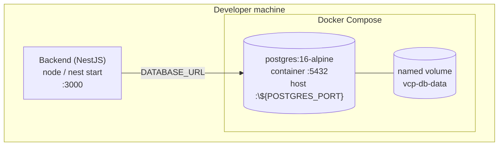
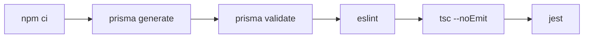

# Architecture

How the Virtual Consultation Platform is structured, why, and where each
responsibility lives. This document is **diagram-first**: each section opens with
the picture, then explains it. It is updated as capabilities land (sequence
diagrams for the claim race and real-time fan-out arrive with Phases 2–3).

Related: [data model](data-model.md) · [state machine](state-machine.md) ·
[authorization matrix](authorization-matrix.md) · [ADRs](adr/).

---

## 1. System context

Solid edges are live after Phase 1–2; dashed elements are introduced in later
phases (labelled). The backend is the only thing that touches the database —
clients never do.

---

## 2. Backend module structure

NestJS was chosen ([ADR-0001](adr/0001-backend-framework.md)) precisely because
its modules, guards and interceptors give clean, testable seams for the
cross-cutting concerns this domain needs (authorization, transition checks,
audit, correlation IDs).

| Module                | Responsibility                                              | Phase              |
| --------------------- | ----------------------------------------------------------- | ------------------ |
| `ConfigModule`        | Load env (`../.env`), expose typed config                   | 1                  |
| `PrismaModule`        | Single global Prisma client; connection lifecycle           | 1                  |
| `AuthModule`          | Register (patient), login, JWT issue/verify, `GET /auth/me` | 1                  |
| `AppController`       | Unauthenticated `GET /health` liveness                      | 1                  |
| `ConsultationsModule` | State-machine enforcement, DB-atomic claim, lifecycle       | 2                  |
| `QueueModule`         | Priority + FIFO ordering, "N ahead" positions               | 2 (real-time in 3) |
| `MessagingModule`     | Persisted messages (REST); WebSocket room in Phase 3        | 2 / 3              |
| `AuditModule`         | Append-only audit events (no clinical content)              | 2 / 4              |
| `CommonModule`        | Validation, error mapping, correlation-ID middleware        | 2 / 5              |

### Authorization seams (where the invariants are enforced)

Authentication is in place now (`JwtAuthGuard`). The role+state guard and the
shared transition registry land in Phase 2 so that _one_ source of truth defines
who-can-do-what in each state — never ad-hoc checks in handlers (invariants 1 & 4).

---

## 3. Authentication request flow (Phase 1, implemented)

Self-registration always creates a **PATIENT**; staff (nurse/doctor/admin) are
provisioned by seed or by an admin later (prevents privilege escalation, NFR-1).
Access tokens are short-lived JWTs ([ADR-0006](adr/0006-authn-authz.md)); refresh
tokens are a Phase 2 addition.

---

## 4. Data & concurrency (summary)

PostgreSQL is the durable system of record ([ADR-0002](adr/0002-postgresql-system-of-record.md));
the full schema and ER diagram live in [data-model.md](data-model.md). The
**claim race** is resolved by a single atomic conditional `UPDATE`
([ADR-0003](adr/0003-claim-concurrency.md)); its sequence diagram is added in
Phase 2 when the claim endpoint is built. Redis is deliberately _not_ a source of
truth ([ADR-0004](adr/0004-redis-responsibilities.md)).

---

## 5. Local deployment topology (Phase 1)

Phase 1 runs the API on the host (fast reload) against a Dockerised Postgres. The
full stack — app container + Redis — is assembled in Phase 5. The target is
**local Docker Compose** ([ADR-0008](adr/0008-deployment-target.md)); no hosted
environment is in scope for the capstone.

### Environment & configuration

A single git-ignored `.env` at the repo root feeds both Docker Compose and the
backend; `.env.example` is the committed, canonical list of variables. The host
port is configurable (`POSTGRES_PORT`) to avoid clashes with other local Postgres
instances.

---

## 6. Build, test & CI

CI runs this chain on every PR and on `main` (`.github/workflows/ci.yml`). Build,
integration/E2E and coverage gates are layered on in Phases 2–6
([project-plan.md](project-plan.md)). The repo is an **npm workspaces monorepo**
(`backend`, `frontend`) sharing one TypeScript base config, ESLint (flat) and
Prettier, with Conventional-Commit enforcement via husky + commitlint.
