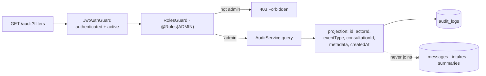

# Audit Logging

What the platform audits, why those events and not others, the record schema, and
how an admin queries the trail. This document is **diagram-first**: the audit-query
authorization boundary comes first, then the catalogue and schema.

Related: [authorization matrix](authorization-matrix.md) ·
[security & privacy](security-privacy.md) · [data model](data-model.md) ·
[API spec](api-spec.md) · [ADR-0005](adr/0005-authn-authz.md).

---

## 1. What counts as "important"

From the reviewer's ask to define "important" ([C13/C20](amrit-feedback-responses.md)
in the private responses; mirrored here for supervisors): an action is audited when
it is **security-relevant**, **state-changing**, or **clinically significant**.

- **Security-relevant** — authentication outcomes, user management, account status
  changes.
- **State-changing** — every consultation state transition (request, enqueue, claim,
  requeue, start, complete, cancel, finalize) and priority changes.
- **Clinically significant** — a message was sent, a summary was drafted or
  finalized.

The rule is deliberately about **the fact of the action**, never its content: the
audit log records **who / what / when**, never a message body or summary text
(invariants 5 & 6).

---

## 2. Audit-query authorization boundary

Reading the audit log is **admin-only** (FR-15) and is the admin's _one_ legitimate
read view. The query projects a fixed who/what/when shape and **never joins to**
clinical tables, so separation of duties holds on the read path too (invariant 3):
an admin can see _that_ a message was sent on a consultation, never _what_ it said.

---

## 3. Event catalogue

Defined in `backend/src/audit/audit-events.ts`; metadata is who/what/when only.

| Event                    | Class         | Actor                       | Metadata (no clinical content)                                   |
| ------------------------ | ------------- | --------------------------- | ---------------------------------------------------------------- |
| `LOGIN_SUCCESS`          | security      | the user                    | `{ role }`                                                       |
| `LOGIN_FAILURE`          | security      | user id if known, else none | `{ reason }` — reason code only, never the password/email        |
| `USER_DEACTIVATED`       | security      | admin                       | `{ targetUserId, targetRole }`                                   |
| `USER_REACTIVATED`       | security      | admin                       | `{ targetUserId, targetRole }`                                   |
| `CONSULTATION_REQUESTED` | state         | patient                     | `{ priority }`                                                   |
| `CONSULTATION_ENQUEUED`  | state         | patient (system step)       | `{ from, to, priority }`                                         |
| `CONSULTATION_CLAIMED`   | state         | clinician                   | —                                                                |
| `CONSULTATION_REQUEUED`  | state         | system                      | `{ reason: 'start_ttl_expired', ttlSeconds, previousClaimedBy }` |
| `CONSULTATION_STARTED`   | state         | clinician                   | —                                                                |
| `CONSULTATION_COMPLETED` | state         | clinician                   | —                                                                |
| `CONSULTATION_CANCELLED` | state         | patient                     | —                                                                |
| `PRIORITY_CHANGED`       | state         | clinician                   | `{ from, to }`                                                   |
| `MESSAGE_SENT`           | clinical-sig. | sender                      | `{ senderRole }` — never the body                                |
| `SUMMARY_DRAFTED`        | clinical-sig. | clinician                   | —                                                                |
| `SUMMARY_FINALIZED`      | clinical-sig. | doctor                      | `{ draftedBy }` — who wrote the draft the doctor signed          |

---

## 4. Log schema

The `AUDIT_LOG` table ([data-model.md](data-model.md)):

| Column            | Type                              | Notes                                                                                                            |
| ----------------- | --------------------------------- | ---------------------------------------------------------------------------------------------------------------- |
| `id`              | uuid PK                           |                                                                                                                  |
| `actor_id`        | uuid, nullable FK → users         | Who performed it; **null for system** events (requeue) and some failures. `ON DELETE SET NULL` preserves history |
| `event_type`      | string                            | One of the catalogue above                                                                                       |
| `consultation_id` | uuid, nullable FK → consultations | The subject consultation, when applicable                                                                        |
| `metadata`        | jsonb, nullable                   | Who/what/when context only — **never** clinical content                                                          |
| `created_at`      | timestamp                         | When                                                                                                             |

Indexed on `consultation_id`, `actor_id`, `created_at` and
`(event_type, created_at)` to back the filtered, newest-first query
([ADR-0017](adr/0017-audit-log-indexing.md)). Writes are **append-only** and, for state changes, committed in the **same
transaction** as the change they describe (so an audited action never diverges from
what happened). The audit service accepts a transaction client for exactly this.

---

## 5. Admin query API

`GET /audit` (admin only) — filterable and paginated. All filters compose (AND):

| Query param        | Meaning                                |
| ------------------ | -------------------------------------- |
| `actorId`          | Events by a specific user              |
| `eventType`        | A single event type                    |
| `consultationId`   | A single consultation's trail          |
| `from` / `to`      | ISO-8601 time range (inclusive)        |
| `limit` / `offset` | Pagination (`limit` ≤ 200, default 50) |

Response: `{ items, total, limit, offset }`, most recent first. Unknown query
params are rejected (`400`) by the global validation pipe. See
[api-spec.md](api-spec.md#audit-admin-only).

---

## 6. What is _not_ audited (and why)

- **Reads of clinical content** by legitimate participants are not individually
  audited (a patient re-opening their own messages), to avoid a high-volume,
  low-value trail.
- **No content, ever.** If an event needs context, it carries a code or an id, not
  the underlying text or bytes — the whole point of the separation-of-duties
  boundary.
