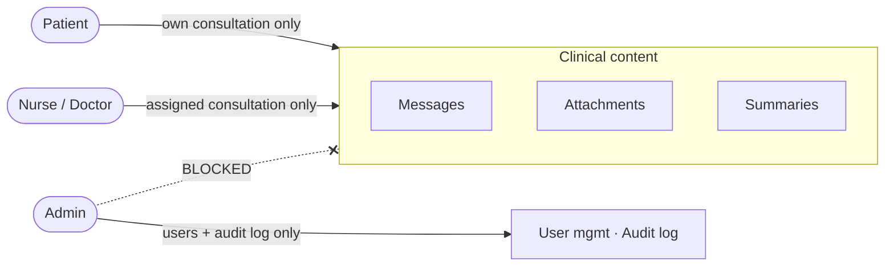

# Authorization Matrix

Authorization is **role- _and_ state-aware** and enforced server-side from this
single source of truth. "Ownership/guard" captures the conditions beyond role.

## Authorization boundary — clinical content

The strongest boundary is **separation of duties**: admins operate the system but
can never read clinical content.

## Matrix

Legend: ✅ allowed · ⚠️ allowed with guard · ❌ denied.

| Action | Patient | Nurse | Doctor | Admin | Ownership / guard |
|--------|:------:|:-----:|:------:|:-----:|-------------------|
| Register / log in | ✅ | ✅ | ✅ | ✅ | — |
| Submit request | ✅ | ❌ | ❌ | ❌ | — |
| View own queue position | ⚠️ | ❌ | ❌ | ❌ | Own consultation |
| View triage queue | ❌ | ✅ | ✅ | ❌ | — |
| View pre-claim case info (minimal) | ❌ | ✅ | ✅ | ❌ | Minimal fields only |
| Claim case | ❌ | ⚠️ | ⚠️ | ❌ | `state=QUEUED`, under claim cap |
| Start consultation | ❌ | ⚠️ | ⚠️ | ❌ | `actor = claimed_by`, `state=CLAIMED` |
| Send / read messages | ⚠️ | ⚠️ | ⚠️ | ❌ | Participant of that consultation |
| Upload / view attachment | ⚠️ | ⚠️ | ⚠️ | ❌ | Participant; signed URL |
| End consultation | ❌ | ⚠️ | ⚠️ | ❌ | `actor = claimed_by`, `state=IN_SESSION` |
| Draft summary | ❌ | ⚠️ | ⚠️ | ❌ | Assigned clinician |
| Finalize summary | ❌ | ❌ | ⚠️ | ❌ | `role=DOCTOR`, `state=ENDED` |
| View summary | ⚠️ | ⚠️ | ⚠️ | ❌ | Patient(own, finalized) / assigned clinician |
| View clinical content | ⚠️ | ⚠️ | ⚠️ | ❌ | **Admin always denied** |
| Manage / deactivate users | ❌ | ❌ | ❌ | ✅ | — |
| View audit log | ❌ | ❌ | ❌ | ✅ | Excludes clinical content |

## Enforcement rules

1. **Deny by default.** An action absent from the matrix for a role is denied.
2. **Role + state + ownership** are all checked; passing one is not enough
   (e.g. a doctor who is not `claimed_by` cannot start that consultation).
3. **Guards share the transition registry** in [state-machine.md](state-machine.md)
   so state checks are never duplicated.
4. **Admin ≠ clinical access** is a hard, tested invariant, not a configuration.
