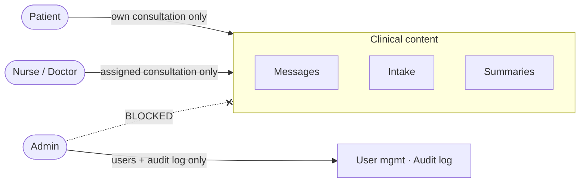

# Authorization Matrix

Authorization is **role- _and_ state-aware** and enforced server-side from this
single source of truth. "Ownership/guard" captures the conditions beyond role.

## Authorization boundary — clinical content

The strongest boundary is **separation of duties**: admins operate the system but
can never read clinical content.

## Matrix

Legend: ✅ allowed · ⚠️ allowed with guard · ❌ denied.

| Action                             | Patient | Nurse | Doctor | Admin | Ownership / guard                                                                                             |
| ---------------------------------- | :-----: | :---: | :----: | :---: | ------------------------------------------------------------------------------------------------------------- |
| Register / log in                  |   ✅    |  ✅   |   ✅   |  ✅   | —                                                                                                             |
| Submit request                     |   ✅    |  ❌   |   ❌   |  ❌   | —                                                                                                             |
| View own queue position            |   ⚠️    |  ❌   |   ❌   |  ❌   | Own consultation                                                                                              |
| View triage queue                  |   ❌    |  ✅   |   ✅   |  ❌   | —                                                                                                             |
| View pre-claim case info (minimal) |   ❌    |  ✅   |   ✅   |  ❌   | Minimal fields only                                                                                           |
| View pending sign-off worklist     |   ❌    |  ❌   |   ✅   |  ❌   | ENDED + drafted-unfinalized; minimal fields                                                                   |
| View own sign-off history          |   ❌    |  ❌   |   ⚠️   |  ❌   | Own sign-offs only (`finalizedBy=self`); minimal fields ([ADR-0023](adr/0023-doctor-signoff-history.md))      |
| Claim case                         |   ❌    |  ⚠️   |   ⚠️   |  ❌   | `state=QUEUED`                                                                                                |
| Start consultation                 |   ❌    |  ⚠️   |   ⚠️   |  ❌   | `actor = claimed_by`, `state=CLAIMED`, under active-session cap                                               |
| Send / read messages               |   ⚠️    |  ⚠️   |   ⚠️   |  ❌   | Participant of that consultation                                                                              |
| End consultation                   |   ❌    |  ⚠️   |   ⚠️   |  ❌   | `actor = claimed_by`, `state=IN_SESSION`                                                                      |
| Draft summary                      |   ❌    |  ⚠️   |   ⚠️   |  ❌   | Assigned clinician                                                                                            |
| Finalize summary                   |   ❌    |  ❌   |   ⚠️   |  ❌   | `role=DOCTOR`, `state=ENDED`                                                                                  |
| View summary                       |   ⚠️    |  ⚠️   |   ⚠️   |  ❌   | Participant, **any doctor while `state=ENDED`** (sign-off), **or the finalizing doctor** (`finalizedBy=self`) |
| View clinical content              |   ⚠️    |  ⚠️   |   ⚠️   |  ❌   | **Admin always denied**                                                                                       |
| Manage / deactivate users          |   ❌    |  ❌   |   ❌   |  ⚠️   | Not yourself; not a user who is in an active session (`409` until it ends)                                    |
| View audit log                     |   ❌    |  ❌   |   ❌   |  ✅   | Excludes clinical content                                                                                     |

## Enforcement rules

1. **Deny by default.** An action absent from the matrix for a role is denied.
2. **Role + state + ownership** are all checked; passing one is not enough
   (e.g. a doctor who is not `claimed_by` cannot start that consultation).
3. **Guards share the transition registry** in [state-machine.md](state-machine.md)
   so state checks are never duplicated.
4. **Admin ≠ clinical access** is a hard, tested invariant, not a configuration.
5. **Deactivated accounts are denied everything.** Account status is re-checked
   against the database on every REST request and WebSocket handshake, so a token
   issued before deactivation stops working immediately (FR-25).
6. **Doctor sign-off read window.** Because `FINALIZE_SUMMARY` is doctor-only and
   not participant-scoped, a doctor may also **read** a case (consultation detail +
   summary) while it is **awaiting sign-off** — i.e. in the `FINALIZE_SUMMARY`
   transition's source state (`ENDED`) with a drafted, unfinalized summary — even if
   they did not run it. This closes the read/finalize asymmetry for nurse-run cases
   and is scoped by rule 3 (states come from the registry); admin is never a doctor,
   so separation of duties is untouched ([ADR-0018](adr/0018-doctor-signoff-of-nurse-run-cases.md)).
7. **Finalizing doctor keeps the summary they signed.** The sign-off window (rule 6) ends at `ENDED`, so a doctor who signs off a nurse-run case — a
   non-participant — would otherwise be locked out of the summary the instant they
   finalize it (`ENDED → SUMMARIZED`). The **summary** read therefore also admits
   the doctor whose id is the summary's `finalizedBy` — exactly the one signing
   doctor, never any wider, and the summary only: the consultation **detail** stays
   participants-only after sign-off (rule 6 unchanged). Admin is never a doctor, so
   separation of duties is untouched ([ADR-0020](adr/0020-finalizing-doctor-summary-read.md)).
8. **Real-time rooms follow the same rules.** WebSocket room membership never
   grants more than REST would: `queue` requires `VIEW_QUEUE`; `consultation:<id>`
   runs `authorizeConsultationAction(VIEW_CONSULTATION)`; `user:<id>` and the
   doctors' `signoff` room are joined by the server from the verified JWT. Events
   in `user:<id>` and `signoff` are content-free signals (`summary:updated`,
   `consultation:updated`) — clients re-read through REST, where this matrix applies
   — and summary signals are never sent to the patient
   ([ADR-0007](adr/0007-realtime-implementation.md), [ADR-0022](adr/0022-live-summary-and-signoff-signals.md)).
