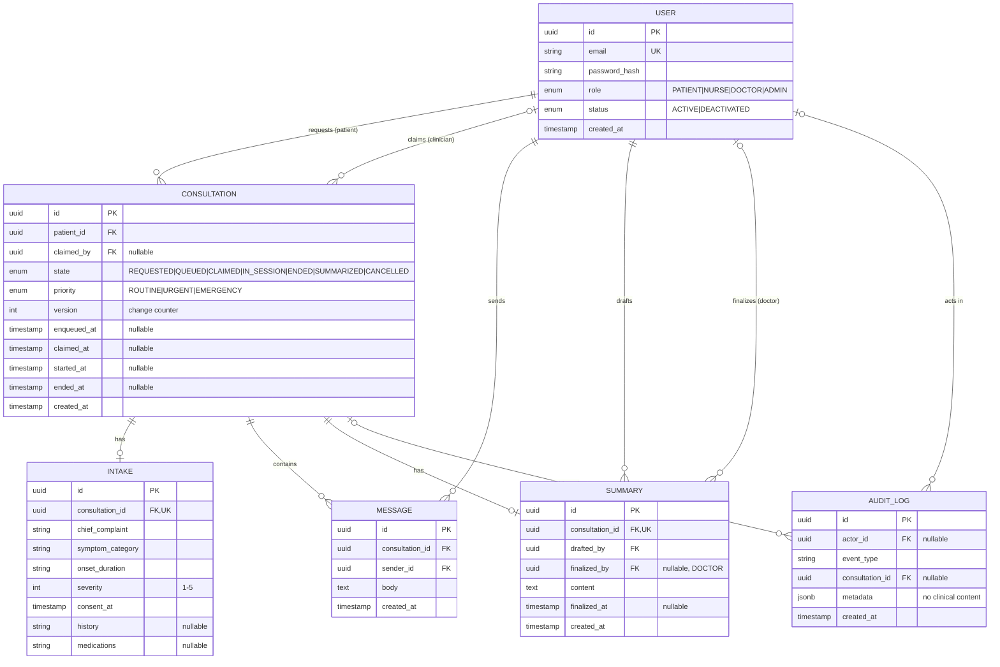

# Data Model

The durable system of record is **PostgreSQL** (via Prisma), and it is the only data
store: every piece of state the app relies on lives here. See
[ADR-0002](adr/0002-postgresql-system-of-record.md).

## Entity–relationship diagram

How to read it: `||` means "exactly one", `o|` means "zero or one" and `o{` means
"zero or more". So a consultation belongs to exactly one patient, may or may not be
claimed by a clinician, and has at most one intake and one summary.

## Key modeling decisions

- **One role per user** via an enum keeps authorization simple; nurse vs doctor
  differences are expressed in the [authorization matrix](authorization-matrix.md).
- **Claim concurrency** relies on `state` + `claimed_by`: the claim is an atomic
  conditional `UPDATE … WHERE state = 'QUEUED' AND claimed_by IS NULL`, so only one
  clinician's update can match (see [ADR-0003](adr/0003-claim-concurrency.md)). The
  `version` column is just a change counter bumped on every state change; the claim
  does not depend on it.
- **The queue is derived**, not a separate table: it is the set of `QUEUED`
  consultations ordered by `priority` then `enqueued_at`, and each patient's
  "N ahead" position is counted from it on demand.
- **Summary immutability:** once `finalized_at` is set the `SUMMARY` row is never
  edited again — the signed record stays exactly as the doctor signed it.
- **Who drafted vs who signed:** `drafted_by` and `finalized_by` are separate columns,
  so a nurse-drafts → doctor-signs hand-off is recorded on the row itself.
- **Audit log excludes clinical content:** `metadata` records who/what/when, never
  message bodies or summary text.
- **Soft deactivation:** `USER.status = DEACTIVATED` (never a hard delete) so
  history and references remain intact.

## Indexing & integrity

- Composite index on `consultations (state, priority, enqueued_at)` backs the triage
  queue read; `patient_id` and `claimed_by` are indexed for "my consultations" lists.
- `messages (consultation_id, created_at)` serves a room's conversation in order.
- `audit_logs` has `(created_at)` and `(event_type, created_at)` for the admin audit
  query, plus `consultation_id` and `actor_id` filters (chosen from measured query
  plans — see [performance.md](performance.md)).
- Unique constraints enforce one `INTAKE` and one `SUMMARY` per consultation.
- Foreign keys use `RESTRICT` for people (a user with history cannot be deleted —
  they are deactivated instead), `CASCADE` from a consultation to its intake,
  messages and summary, and `SET NULL` on the audit log so audit rows outlive what
  they describe.
