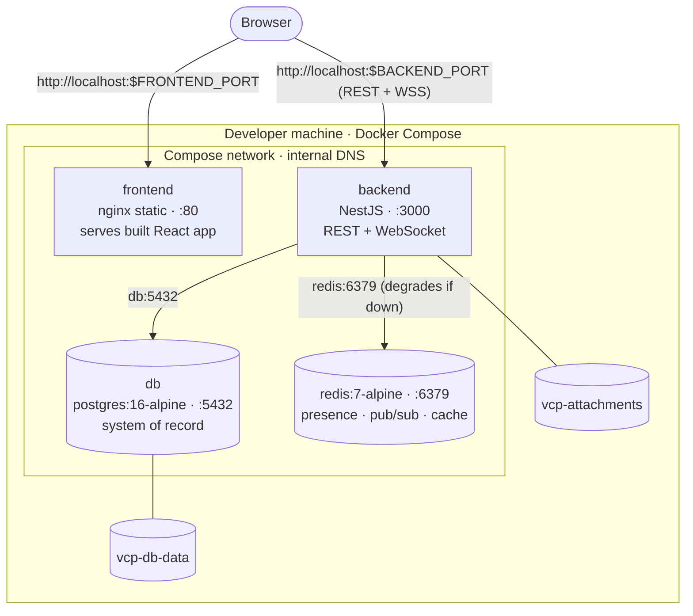
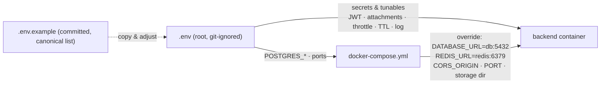
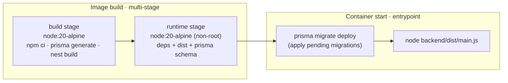
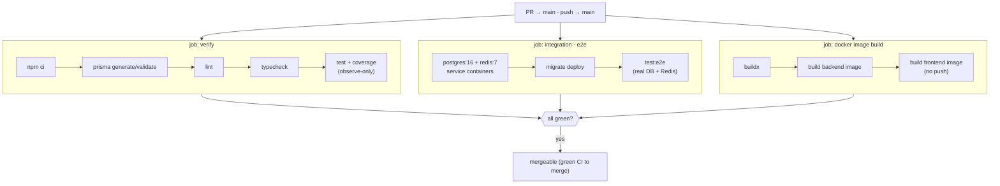

# Deployment

How the whole system is built, assembled and shipped. The deployment target is
**local Docker Compose** ([ADR-0008](adr/0008-deployment-target.md)) — one command
brings the entire stack up (SC-14, NFR-8); no hosted environment is in scope.
**Diagram-first:** each section opens with the picture. Delivered in Phase 5.

Related: [architecture](architecture.md) · [observability](observability.md) ·
[testing strategy](testing-strategy.md) · [ADR-0004 Redis](adr/0004-redis-responsibilities.md).

---

## 1. Full-stack topology (one `docker compose up`)



Four services behind a single `docker compose up`:

- **frontend** — the React app built by Vite and served as static files by nginx,
  with SPA fallback so deep links work. `VITE_API_URL` is baked in **at build time**
  and must be **browser-reachable**, so it points at the backend's _host-published_
  address (`http://localhost:$BACKEND_PORT`), **not** the internal `backend` DNS name
  the browser can't resolve.
- **backend** — the NestJS API + WebSocket gateway. It reaches `db` and `redis` by
  their **internal Compose DNS names** (`db:5432`, `redis:6379`), independent of the
  host-port overrides a developer uses locally.
- **db / redis** — Postgres (durable, backed by the `vcp-db-data` volume) and Redis
  (ephemeral; the app degrades gracefully if it's down, [ADR-0004](adr/0004-redis-responsibilities.md)).
- **vcp-attachments** volume — persists the local attachment object store
  ([ADR-0007](adr/0007-attachment-storage.md)) across restarts.

### Host-port mapping (why the indirection)

Containers always use their **internal** ports; only the **host-published** ports
are configurable, so the stack coexists with whatever else is running locally
(on the build machine `3000`, `5432` and `8080` were already taken):

| Service  | Internal | Host (env, default)    |
| -------- | -------- | ---------------------- |
| frontend | 80       | `FRONTEND_PORT` (8088) |
| backend  | 3000     | `BACKEND_PORT` (3100)  |
| db       | 5432     | `POSTGRES_PORT` (5432) |
| redis    | 6379     | `REDIS_PORT` (6379)    |

---

## 2. Configuration — the single `.env`



One git-ignored root `.env` feeds both Compose and the app (`.env.example` is the
committed canonical list). For the **backend container**, secrets and tunables load
from `.env` via `env_file`, while the **connection strings, ports, CORS origin and
attachment path are pinned in `docker-compose.yml`** (these override `env_file`), so
the container always talks to the internal network regardless of a developer's local
host-port overrides. This keeps the single-`.env` convention intact while making the
containers correct.

---

## 3. Backend image & container lifecycle



The image is **multi-stage** to keep the runtime lean-ish: the build stage installs
dependencies, generates the Prisma client and compiles to `dist/`; the runtime stage
(a **non-root** user) carries the compiled app, the hoisted `node_modules` and the
Prisma schema/migrations. Both images build **from the repository root** because the
monorepo's single `package-lock.json` lives there.

On start, the entrypoint runs **`prisma migrate deploy`** against `db` — which only
_applies_ already-generated migrations and never prompts or alters the schema — then
starts the API. The backend waits for `db` and `redis` to be **healthy**
(`depends_on: condition: service_healthy`) before it starts.

> **Future work (not built — ADR-0008 scope):** image-size optimisation (prune dev
> deps from the runtime layer), TLS termination, managed secrets, and horizontal
> scaling. These are production concerns documented as out-of-scope for the capstone.

---

## 4. CI/CD pipeline (C26)



Three jobs run on every PR and on `main` (`.github/workflows/ci.yml`):

- **verify** — `npm ci` → Prisma generate/validate → lint → typecheck → unit tests
  **with coverage**. Coverage is **observe-only** in Phase 5: the report is produced
  and uploaded as an artifact, but **not gated**. The ≥90% backend / ≥80% frontend
  gates (NFR-7, SC-10/11) are a **Phase 6** concern, so effort stays on the critical
  scenarios until then.
- **integration** — boots the app against a **real** `postgres:16` and `redis:7`
  (service containers), applies migrations, and runs the e2e suite — the DB-atomic
  and cross-role guarantees can't be proven with mocks.
- **docker image build** — builds the backend and frontend images with Buildx to
  prove the stack containerises (SC-14). Images are **built but not pushed**: the
  target is local Compose (ADR-0008), so there is **no registry, no deploy stage,
  and no registry secrets**. A real hosted deploy would be an additive ADR.

"Green CI to merge" is the measurable definition of clean history from
`CONTRIBUTING.md` (C27).

---

## 5. Running it

```bash
# Bring the whole stack up (build on first run). One command (SC-14).
docker compose up -d --build

# Health / readiness / metrics (host ports from .env; defaults shown)
curl -s http://localhost:3100/health      # liveness  → {"status":"ok",...}
curl -s http://localhost:3100/ready       # readiness → postgres gates, redis non-gating
curl -s http://localhost:3100/metrics     # Prometheus metrics

# Frontend
open http://localhost:8088

# Seed demo users (patient|nurse|doctor|admin@vcp.local) — runs inside the container
docker compose exec backend node_modules/.bin/ts-node backend/src/prisma/seed.ts  # or: npm run seed

# Tear down (keep data) / wipe data too
docker compose down
docker compose down -v
```

If a host port is already in use, override `BACKEND_PORT` / `FRONTEND_PORT` /
`POSTGRES_PORT` / `REDIS_PORT` in `.env` (see `.env.example`).

---

## 6. Environments

| Environment | DB                                              | Redis                      | Notes                                                    |
| ----------- | ----------------------------------------------- | -------------------------- | -------------------------------------------------------- |
| Local dev   | Compose `db` (or host API against it)           | Compose `redis` (optional) | Fast reload; API may run on the host                     |
| e2e / CI    | `postgres:16` + `redis:7`                       | required in CI             | Dedicated `*_test` DB; safety guard refuses non-test DBs |
| Full stack  | Compose `db` + `redis` + `backend` + `frontend` | included                   | `docker compose up` — the SC-14 target                   |
| Hosted      | —                                               | —                          | **Out of scope** (ADR-0008); additive ADR if ever wanted |
