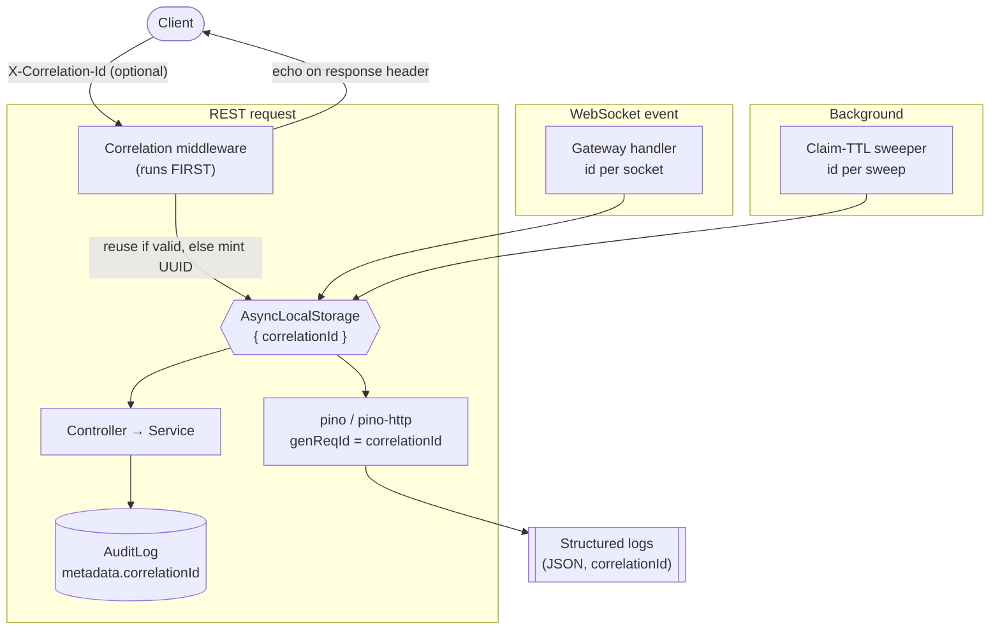
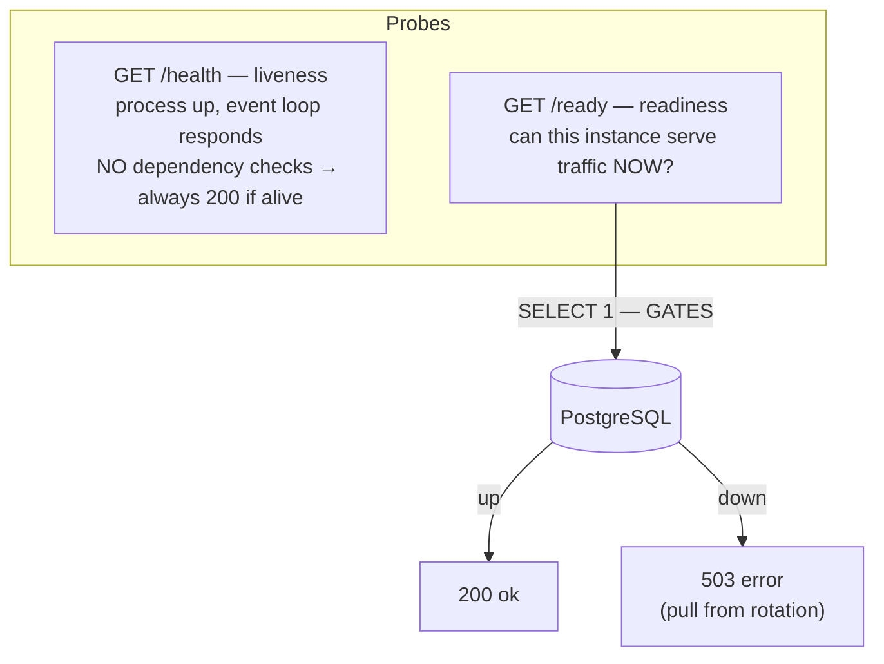

# Observability

How the platform is made **operable**: structured logs, a per-request correlation
ID that traces a request end-to-end, dependency-aware health probes, and metrics.
This document is **diagram-first** — each section opens with the picture, then
explains it. Delivered in Phase 5.

Related: [architecture](architecture.md) · [deployment](deployment.md) ·
[security & privacy](security-privacy.md) · [audit log](audit-logging.md).

> **The one rule that governs everything here (NFR-2, invariant 6):**
> logs, metrics, correlation IDs and probe output are **who / what / when only** —
> never PII or clinical content, never tokens, never query strings. Observability
> reuses the Phase 4 privacy boundary; it does not punch a hole in it.

---

## 1. Structured logging

Logs are **JSON** emitted by `pino` (via `nestjs-pino`), which replaces the default
Nest logger so every existing `Logger` call is reformatted with no code change. A
log line is a flat record a machine can index:

```json
{
  "level": 30,
  "time": 1760000000000,
  "correlationId": "req-trace-0001",
  "req": { "id": "req-trace-0001", "method": "POST", "url": "/consultations" },
  "res": { "statusCode": 201 },
  "responseTime": 14,
  "msg": "request completed"
}
```

What makes it safe is **what is absent**. The pino serializers emit only
`req.id` / `method` / `url` and `res.statusCode`; the **query string is stripped**
from the URL (it can carry identifiers), and request/response **headers and bodies
are removed** by redaction as defence in depth. So an `Authorization: Bearer …`
token, a patient's message body, or an `?email=` filter can never appear in the log
stream. The probe/metrics endpoints (`/health`, `/ready`, `/metrics`) are excluded
from request logging to keep the signal clean.

This is a privacy control, not formatting, so it is pinned by a unit test
(`test/logging-redaction.spec.ts`, **CS-18**): the test fails if a future config
change lets headers, bodies, query strings or clinical text through.

`LOG_LEVEL` sets verbosity; `LOG_PRETTY=true` gives human-readable local logs while
production emits raw JSON.

---

## 2. Correlation-ID tracing (SC-15)

A single request must be followable across the REST API, the domain services, the
audit trail and — for live actions — the WebSocket gateway. One **correlation ID**
does that, carried in an `AsyncLocalStorage` (ALS) store rather than threaded
through every function.



**REST.** The correlation middleware runs **before** Helmet, the body parsers and
pino-http. It reuses a well-formed caller-supplied `X-Correlation-Id` (so a trace
can span a client and the server) or mints a UUID, **echoes it on the response
header**, and runs the remainder of the request inside the ALS store. `pino-http`'s
`genReqId` reuses that ID, so every request-scoped log line shares it, and the
`AuditService` reads it from the ALS and stamps it onto each audit row's `metadata`
— which the admin audit query already returns verbatim (FR-15). Proven end-to-end
by **CS-16**: a `POST /consultations` with a known ID echoes it on the response and
every audit row it produced carries the same ID.

**Beyond REST.** The WebSocket gateway assigns one ID per socket (from the handshake
`auth.correlationId` if well-formed, else minted) and runs each handler inside the
store; the claim-TTL sweeper runs each sweep under a fresh ID. So an auto-requeue's
audit row and log lines share a trace token even though no HTTP request drove them.

A malformed inbound ID (spaces, symbols, over-length) is **rejected and replaced**
with a safe UUID, so the header can't be used for log- or response-header injection.

---

## 3. Health & readiness probes

Liveness and readiness answer different questions, so they are different endpoints.



- **`GET /health` (liveness)** checks nothing external: if the process answers, it's
  alive. A container orchestrator uses it to decide whether to restart the process.
  (It also backs the Compose `healthcheck`.)
- **`GET /ready` (readiness)**, built on `@nestjs/terminus`, checks the one real
  dependency: **PostgreSQL gates readiness.** A `SELECT 1` must succeed; the DB is
  the system of record (ADR-0002), so if it's unreachable the instance is **not
  ready** and returns **503** — a load balancer would stop sending it traffic until
  it recovers.

**CS-17** asserts `/ready` returns 200 with `postgres: up` while the database is
healthy.

---

## 4. Metrics

`GET /metrics` exposes Prometheus-format metrics for a scraper (or `curl`):

| Metric                     | Type    | Meaning                                              |
| -------------------------- | ------- | ---------------------------------------------------- |
| `vcp_queue_depth`          | gauge   | Consultations currently `QUEUED`                     |
| `vcp_active_consultations` | gauge   | Consultations currently `IN_SESSION`                 |
| `process_*`, `nodejs_*`    | various | Default process metrics (event-loop lag, memory, GC) |

The two **domain gauges are read from PostgreSQL on each scrape** (ADR-0002 is
authoritative), so they can't drift from the real state. Every series is an
aggregate count — no PII, no clinical content.

```bash
curl -s http://localhost:${BACKEND_PORT:-3100}/metrics | grep vcp_
# vcp_queue_depth{app="vcp-backend"} 0
# vcp_active_consultations{app="vcp-backend"} 1
```

---

## 5. Putting it together — tracing one request

1. A client calls `POST /consultations` (optionally with `X-Correlation-Id`).
2. The response comes back carrying `X-Correlation-Id`.
3. `GET /metrics` shows `vcp_queue_depth` incremented.
4. The structured logs for that request all carry the same `correlationId`.
5. The admin audit query (`GET /audit?consultationId=…`) shows the resulting rows,
   each with `metadata.correlationId` equal to the response header — the request is
   traceable end-to-end (SC-15), without any PII or clinical content having touched
   a log line, a label or the trace token.
