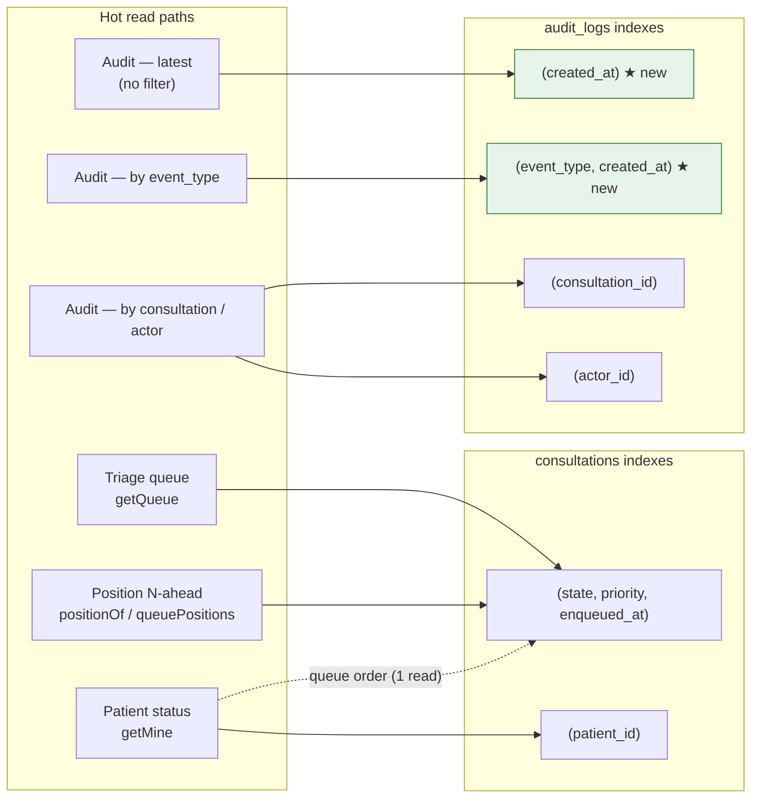

# Performance

The Phase 7 performance pass. The guiding rule (from the plan) is **fix genuine
issues only — measure, don't micro-optimize**. So every hot read path was profiled
against a realistically-sized database with `EXPLAIN (ANALYZE, BUFFERS)`, and only
the changes the query plans justified were made. This document is **diagram-first**:
the picture maps each hot read to the index that serves it; the evidence and the
"considered and rejected" calls follow.

Related: [data model](data-model.md) · [architecture](architecture.md) ·
[observability](observability.md) (the `vcp_queue_depth` / `vcp_active_consultations` metrics).

> **Invariants held throughout.** PostgreSQL stays authoritative (ADR-0002); no PII
> or clinical content entered any index, log or URL (invariant 6).

---

## 1. Hot read paths → the index that serves each



The two green indexes are the only schema change this phase
(§3.1–3.2). Everything else was already served
by an existing index and was left alone.

---

## 2. Method

A throwaway `vcp_perf` database was seeded with realistic-but-stressing volume so an
index problem would actually show up in a plan (a few hundred rows hides a seq
scan):

| Table           | Rows   | Notes                                                        |
| --------------- | ------ | ------------------------------------------------------------ |
| `users`         | 315    | 300 patients, 15 clinicians                                  |
| `consultations` | 4,030  | 610 `QUEUED` (priority + FIFO spread), rest terminal         |
| `intakes`       | 4,030  | one per consultation (queue projection joins it)             |
| `audit_logs`    | 80,000 | 8 event types, random actor/consultation refs, 30-day spread |

`ANALYZE` was run so the planner had fresh statistics, then each hot query was
profiled with `EXPLAIN (ANALYZE, BUFFERS)` before and after the index change on the
same data. Numbers below are from that run (Postgres 16, warm cache); the **shape**
of the plan — index scan vs. sequential scan + sort — is the durable result, the
millisecond figures scale with data size.

---

## 3. Findings & evidence

### 3.1 Audit "latest events" scanned the whole table ✅ fixed

The admin audit view (`GET /audit`, FR-15) always orders **`created_at DESC`**, and
the common call — open the log with no filter — had **no index on `created_at`**.

```
-- BEFORE:  SELECT * FROM audit_logs ORDER BY created_at DESC LIMIT 50
Limit → Gather Merge → Sort (top-N heapsort)
          → Parallel Seq Scan on audit_logs (rows=80000)
Execution Time: 13.086 ms   Buffers: shared hit=1711

-- AFTER (index on created_at):
Limit → Index Scan Backward using audit_logs_created_at_idx
Execution Time: 0.082 ms    Buffers: shared hit=50 read=2
```

The whole-table scan became a 50-row index read: **~160× faster, ~33× fewer buffers**,
and — the point that matters — it no longer grows with the size of the audit log.

### 3.2 Filtering by event_type read every match, then sorted ✅ fixed

`event_type` has only a handful of distinct values, so a filter on it matches
thousands of rows; the old single-column index found them but then everything was
sorted in memory to get the newest 50.

```
-- BEFORE:  WHERE event_type='MESSAGE_SENT' ORDER BY created_at DESC LIMIT 50
Limit → Sort (top-N heapsort)
          → Bitmap Heap Scan (rows=10019)
Execution Time: 3.520 ms    Buffers: shared hit=1679

-- AFTER (composite (event_type, created_at), replaces the bare event_type index):
Limit → Index Scan Backward using audit_logs_event_type_created_at_idx
Execution Time: 0.117 ms    Buffers: shared hit=50 read=3
```

The composite index serves the filter **and** the ordering, so the read stops after
50 rows: **~30× faster**. Deep pagination stays cheap (offset 500 → 0.47 ms). Because
`event_type` is the leading column, the composite also answers a bare
`event_type` equality lookup, so the old single-column index was dropped rather than
kept alongside it (no redundant index on the write path — see §4).

### 3.3 `getMine` had an N+1 position lookup ✅ fixed (code)

`getMine` fetched a patient's consultations in one query, then called `positionOf`
**once per queued row** — a `COUNT` per row. The per-row DB query itself is
well-indexed (0.1 ms), but the _shape_ is a classic N+1:

- **Before:** `1 + N` queries (N = the patient's queued cases), each extra one a
  Postgres `COUNT`.
- **After:** the queued positions are read **once**, in serving order, and mapped by
  id — so `getMine` issues **at most 2 queries regardless of N**
  ([consultations.service.ts](../backend/src/consultations/consultations.service.ts)).

N is small in practice (a patient rarely holds more than one queued case), so this is
a **robustness** fix, not a hot-loop rescue — it keeps the list from fanning out into
per-row queries. The single-row submit view still uses `positionOf` (one `COUNT`),
and the WebSocket `position:updated` push recomputes every position from one ordered
read of the queue.

---

## 4. Considered and rejected (no evidence to justify)

Discipline cuts both ways — these looked like candidates but the plans said leave
them alone:

- **Queue sort index `(state, priority DESC, enqueued_at ASC)`.** `getQueue` does show
  a `Sort` node (the composite index can't serve the mixed sort direction), but the
  sort is over the **already-filtered `QUEUED` set** (610 rows → 0.6 ms, 82 kB
  quicksort), which is bounded by the domain. A direction-specific index would shave
  a fraction of a millisecond and add write cost to the hot `consultations` table on
  every claim/transition. Not worth it.
- **`positionOf` OR-predicate.** Already a `BitmapOr` of two scans on the existing
  composite index (0.15 ms). Fine.
- **`(consultation_id, created_at)` / `(actor_id, created_at)` audit composites.**
  Those filters are high-cardinality (tens of matching rows), so the existing
  equality indexes + a tiny sort are already sub-millisecond (0.14 ms). Only
  `event_type` (low-cardinality → thousands of matches) needed the composite.
- **`audit_logs` `COUNT(*)` for the pagination `total`.** An index-only scan of the
  whole table, ~7 ms at 80k rows. It is unchanged, and accepted: the admin audit
  screen is a low-frequency, human-driven view, and an exact total is worth one
  bounded scan. If the log grew by orders of magnitude the honest next step is an
  approximate/estimated count, recorded as a follow-up rather than pre-optimized now.

**Write-path cost (the trade-off that was weighed).** `audit_logs` is the most
append-heavy table — a row is written on every auditable action — so each index adds
per-insert work. The net change is **one** additional index (`created_at`), since the
`event_type` index was _replaced_ by the composite, not added to. That single extra
write-path index is justified by turning the default admin view from a full-table
scan into a bounded read.

---

## 5. Reproducing

With Docker up (Postgres on 5433) the measurement is repeatable: seed a throwaway DB
to the volumes in §2, `ANALYZE`, then run `EXPLAIN (ANALYZE, BUFFERS)` on the queries
in §3 before and after `prisma migrate deploy`. The migration that carries the two
indexes is
[`20261023021229_perf_audit_log_indexes`](../backend/src/prisma/migrations). The
seed/EXPLAIN scripts are throwaway harness (not committed — they belong to the
measurement, not the app).
