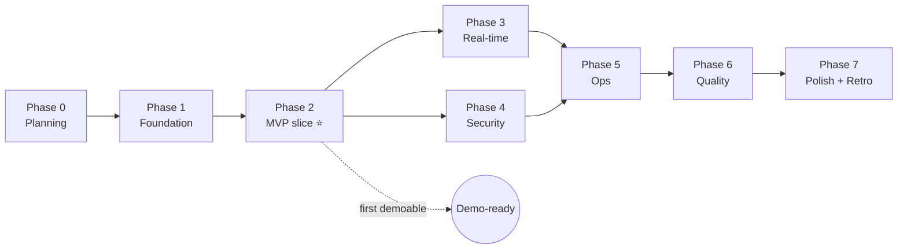
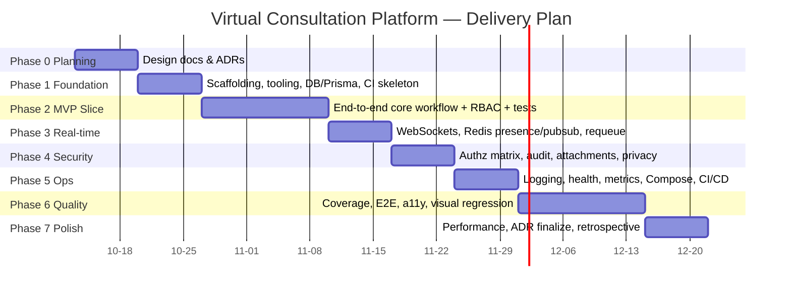

# Project Plan

A timeboxed, phased plan for the Virtual Consultation Platform. It defines the
**MVP as a complete end-to-end vertical slice**, then layers the remaining
capabilities as incremental, demonstrable milestones — keeping scope disciplined
so the core workflow gets depth rather than many features built superficially.

Dates below are indicative (10-week solo schedule starting **2026-10-13**) and
exist to force prioritization, estimation and risk-tracking — not as hard
commitments. Adjust freely.

---

## Philosophy

- **Process over product.** Every phase produces not just code but the artifacts
  that show the thinking: diagrams, ADRs, docs, tests.
- **Always demonstrable.** By the end of Phase 2 there is a working system you can
  click through; every later phase keeps it working and adds depth.
- **Vertical before horizontal.** Build one thin, complete slice through all
  layers before widening any single layer.

---

## What the MVP is (and is not)

**MVP = the smallest end-to-end slice that proves the core workflow.**

A patient can register, log in, and submit a consultation request → it enters the
queue with a priority → a clinician sees the queue, **claims** the case (safe
under concurrency), **starts** it, exchanges **persisted messages** with the
patient, **completes** it, and a **summary** is finalized — all gated by the
**state machine** and **role-based authorization**, with the core actions
**audited**.

**In the MVP:** auth + RBAC, the full state machine, DB-level claim concurrency,
persisted messaging, summary finalize rules, core audit events, happy-path +
critical-scenario tests.

**Not in the MVP (later phases):** live WebSocket/Redis real-time, presence,
claim-timeout aging, attachments with signed URLs, full audit catalogue,
metrics/health dashboards, accessibility & visual-regression suites, performance
tuning. These are deliberately deferred so the core gets depth, not breadth.

---

## Phases & milestones

Each phase builds on the last. Phase 2 is the first point where there is a
**working, demonstrable system**; every later phase keeps it working and adds depth.





### Phase 0 — Planning & Design _(current)_

**Goal:** decisions made and visible before code.
**Deliverables:** this plan, `README.md`, `CONTRIBUTING.md`, the documentation
index, and the first pass of `requirements.md`, `state-machine.md`,
`authorization-matrix.md`, `data-model.md`, `success-criteria.md`, initial ADRs.
**Exit criteria:** MVP defined, state machine & data model drafted, open
decisions resolved or explicitly deferred.

### Phase 1 — Scaffolding & Foundation

**Goal:** an empty but runnable skeleton with the plumbing in place.
**Deliverables:** repo structure (`backend/`, `frontend/`), TypeScript + lint +
format config, PostgreSQL + Prisma schema (migrations), Docker Compose for DB,
auth skeleton (register/login, JWT/session), a CI skeleton (lint + typecheck +
test on PR), `architecture.md`.
**Exit criteria:** `docker compose up` starts the DB; backend boots; a trivial
authenticated endpoint works; CI runs green on a PR.

### Phase 2 — MVP Vertical Slice

**Goal:** the demonstrable core workflow end-to-end.
**Deliverables:** consultation entity + state machine enforcement, request
submission, queue listing (polled is acceptable here), **DB-atomic claim**, start
/ message (persisted) / complete, summary draft + doctor finalize, RBAC on all of
it, core audit events, minimal React UI for each screen, critical-scenario tests.
**Exit criteria:** a scripted click-through of the full lifecycle passes;
concurrency test proves exactly one claimer wins; RBAC test proves an admin
cannot read clinical content.

### Phase 3 — Real-time & Concurrency hardening

**Goal:** make it live.
**Deliverables:** WebSocket channel for queue + room, Redis presence + pub/sub
fan-out, real-time position ("N ahead"), claim-start **TTL + auto-requeue**,
reconnection handling. `architecture.md` updated with sequence diagrams.
**Exit criteria:** two browser sessions see live updates; a claimed-but-not-
started case requeues automatically and is audited.

### Phase 4 — Security, Privacy & Audit

**Goal:** defensible handling of sensitive data.
**Deliverables:** full authorization matrix enforced, complete audit catalogue +
query view for admins, attachments via signed URLs, input validation hardening,
`security-privacy.md` threat model.
**Exit criteria:** threat-model mitigations implemented or documented as accepted
risks; privilege-escalation and attachment-access tests pass.

### Phase 5 — Observability & Ops

**Goal:** operable and reproducible.
**Deliverables:** structured logging with correlation IDs, health/readiness
endpoints, basic metrics, full Docker Compose (app + DB + Redis), complete CI/CD
pipeline with coverage gates and image build. `observability.md`, `deployment.md`.
**Exit criteria:** one command brings the whole stack up; a request can be traced
end-to-end by correlation ID; CI enforces coverage.

### Phase 6 — Testing depth & Accessibility

**Goal:** quality to target.
**Deliverables:** backend ≥ 90% / frontend ≥ 80% coverage, E2E suite covering all
critical scenarios, WCAG 2.1 AA accessibility checks, visual regression on the
four critical screens. `testing-strategy.md` finalized.
**Exit criteria:** coverage gates pass; a11y automated checks pass on critical
screens; visual-regression baseline established.

### Phase 7 — Polish, Performance & Retrospective

**Goal:** finish with evidence of judgment.
**Deliverables:** performance pass (queue queries, N+1 checks, payload sizes),
ADRs finalized, `retrospective.md` (assumptions that proved wrong, risks
encountered, lessons, what you'd redesign), demo script/readme polish.
**Exit criteria:** retrospective written; performance notes recorded; `main` is
clean and green.

---

## Documentation plan — every document to be produced

| #   | Document                                                     | Phase      |
| --- | ------------------------------------------------------------ | ---------- |
| 1   | `README.md` (root)                                           | 0 ✅       |
| 2   | `CONTRIBUTING.md`                                            | 0 ✅       |
| 3   | `docs/README.md` (index)                                     | 0 ✅       |
| 4   | `docs/project-plan.md`                                       | 0 ✅       |
| 5   | `docs/requirements.md`                                       | 0 ✅       |
| 6   | `docs/state-machine.md`                                      | 0 ✅       |
| 7   | `docs/authorization-matrix.md`                               | 0 ✅       |
| 8   | `docs/data-model.md` (ER)                                    | 0 ✅       |
| 9   | `docs/success-criteria.md`                                   | 0 ✅       |
| 10  | `docs/architecture.md`                                       | 1 ✅       |
| 11  | `docs/api-spec.md`                                           | 1/2        |
| 12  | `docs/security-privacy.md` (threat model)                    | 1/4        |
| 13  | `docs/audit-logging.md`                                      | 4          |
| 14  | `docs/observability.md`                                      | 5          |
| 15  | `docs/deployment.md`                                         | 5          |
| 16  | `docs/testing-strategy.md`                                   | 2/6        |
| 17  | `docs/adr/` — template + 0001–0019 (more as decisions arise) | 🟡 ongoing |
| 18  | `docs/retrospective.md`                                      | 7 ✅       |
| 19  | `docs/performance.md`                                        | 7 ✅       |
| 20  | `docs/demo-script.md`                                        | 7 ✅       |

### Planned ADRs (initial set)

- ADR-0001 — Backend framework choice (NestJS vs Express/Fastify)
- ADR-0002 — PostgreSQL as system of record
- ADR-0003 — Claim concurrency strategy (DB-atomic conditional update)
- ADR-0004 — Redis responsibilities (and non-responsibilities)
- ADR-0005 — Real-time transport (WebSockets) & fan-out
- ADR-0006 — AuthN/AuthZ approach (sessions/JWT + role+state matrix)
- ADR-0007 — Attachment storage & signed-URL access ✅
- ADR-0008 — Deployment target (local Docker Compose) ✅
- ADR-0009 — Real-time implementation (socket.io + Redis adapter) ✅
- ADR-0010 — Claim-start TTL via a DB-authoritative sweeper ✅
- ADR-0011 — Application-level rate limiting ✅
- ADR-0012 — Mid-session reassignment on clinician deactivation ✅
- ADR-0013 — Structured logging & correlation IDs ✅
- ADR-0014 — Metrics (Prometheus) ✅
- ADR-0015 — Frontend test runner (Vitest) ✅
- ADR-0016 — Coverage-gate strategy (merged unit + e2e) ✅
- ADR-0017 — Accessibility tooling (two-tier axe) ✅
- ADR-0018 — Visual-regression tooling & baseline strategy ✅
- ADR-0019 — Audit-log query indexing (Phase 7 performance) ✅

---

## Scaffolding plan — target repository structure

Built out in Phase 1 (nothing created yet beyond docs):

```
/
├─ README.md                 ✅
├─ CONTRIBUTING.md           ✅
├─ .gitignore               ✅
├─ .env.example              ⬜ Phase 1
├─ docker-compose.yml        ⬜ Phase 1 (DB) → Phase 5 (full stack)
├─ docs/                     ✅ (populated through all phases)
│  └─ adr/                   ⬜ Phase 1+
├─ backend/                  ⬜ Phase 1
│  ├─ src/
│  │  ├─ auth/               # register/login, RBAC guards
│  │  ├─ consultations/      # state machine, claim, lifecycle
│  │  ├─ queue/              # priority queue, positions
│  │  ├─ messaging/          # persisted messages (Phase 2) + WS (Phase 3)
│  │  ├─ audit/              # audit logging
│  │  ├─ common/             # validation, errors, correlation IDs
│  │  └─ prisma/             # schema + migrations + client
│  └─ test/                  # unit / integration / e2e
├─ frontend/                 ⬜ Phase 2
│  └─ src/
│     ├─ features/           # queue, room, summary, admin
│     ├─ components/
│     └─ lib/                # api client, ws client, auth state
└─ .github/
   └─ workflows/             ⬜ Phase 1 (ci.yml) → Phase 5 (cd.yml)
```

### Other required setup (non-doc)

- Package manager + lockfile; shared TS config; ESLint + Prettier.
- Prisma schema + initial migration; seed script with test users per role.
- `.env.example` enumerating required env vars (DB URL, Redis URL, JWT secret…).
- Postman collection for the REST API (reviewer asked for API testing via Postman).
- Pre-commit hooks (lint/format/commit-message) to enforce `CONTRIBUTING.md`.

---

## Capability map — capability → implementation → demonstrating artifact

Addresses the reviewer's ask to separate _technologies used_ from _engineering
capabilities_, each with evidence.

| Engineering capability  | Where it's implemented            | Artifact that demonstrates it                      |
| ----------------------- | --------------------------------- | -------------------------------------------------- |
| Workflow modeling       | Consultation state machine        | `state-machine.md` diagram + transition tests      |
| Concurrency control     | DB-atomic claim                   | Sequence diagram + concurrency test (two claimers) |
| AuthZ (role + state)    | Authorization matrix + guards     | `authorization-matrix.md` + RBAC tests             |
| Real-time systems       | WebSockets + Redis pub/sub        | Architecture sequence diagram + live-update E2E    |
| Data modeling           | Prisma schema                     | `data-model.md` ER diagram + migrations            |
| Security & privacy      | Signed URLs, separation of duties | `security-privacy.md` threat model + privacy tests |
| Observability           | Structured logs + correlation IDs | `observability.md` + a traced-request example      |
| Testing discipline      | Test pyramid + gates              | `testing-strategy.md` + CI coverage report         |
| Performance engineering | Measured indexing + N+1 fix       | `performance.md` (EXPLAIN before/after) + ADR-0019 |
| Delivery / DevOps       | Docker Compose + GitHub Actions   | `deployment.md` + green pipeline                   |
| Engineering judgment    | ADRs + retrospective              | `docs/adr/` + `retrospective.md`                   |

---

## Risk register (initial)

| Risk                                               | Likelihood | Impact | Mitigation                                                   |
| -------------------------------------------------- | ---------- | ------ | ------------------------------------------------------------ |
| Scope creep — too many technologies, shallow depth | High       | High   | MVP-first; defer breadth to later phases; this plan          |
| Concurrency bugs in claim logic                    | Medium     | High   | DB-level guarantee + dedicated concurrency tests early       |
| Real-time complexity (reconnect, fan-out)          | Medium     | Medium | Persisted messaging MVP first; real-time isolated to Phase 3 |
| Privacy/authorization gaps                         | Medium     | High   | Central authz matrix; privacy tests; threat model in Phase 4 |
| Time overrun as a solo build                       | High       | Medium | Timeboxed phases; each phase independently demonstrable      |
| Accessibility/visual-regression left too late      | Medium     | Low    | Scoped to 4 critical screens; dedicated Phase 6              |

---

## Success criteria (summary)

Full, measurable list lives in `success-criteria.md`. Headline targets:

- Full consultation lifecycle works end-to-end (demonstrable).
- Exactly one clinician wins a contested claim (provable by test).
- Admins provably cannot read clinical content.
- Backend ≥ 90% / frontend ≥ 80% coverage, with all critical scenarios covered.
- WCAG 2.1 AA on critical screens; green CI/CD; one-command local startup.
- A complete set of design diagrams and ADRs, plus a written retrospective.
