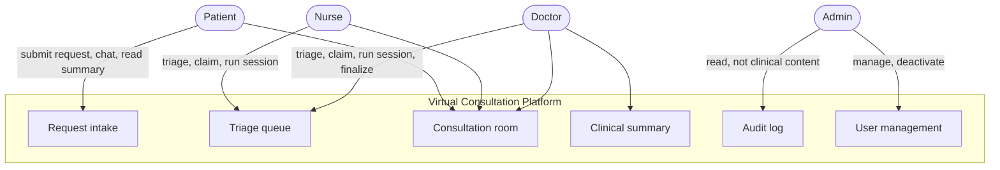

# Requirements

Functional and non-functional requirements for the Virtual Consultation Platform.
IDs (`FR-*`, `NFR-*`) are referenced by tests and by `success-criteria.md`.

## Actors & context

## Functional requirements

### Accounts & auth
- **FR-1** Users can register and log in. Each user has exactly one role:
  `PATIENT`, `NURSE`, `DOCTOR`, or `ADMIN`.
- **FR-2** All actions are authenticated; authorization is enforced server-side
  per the [authorization matrix](authorization-matrix.md).

### Patient
- **FR-3** A patient can submit a consultation request (intake schema below).
- **FR-4** A patient sees their own position in the queue as a live count
  ("N requests ahead"), not an exact global rank.
- **FR-5** After a clinician starts the session, the patient joins a private
  consultation room, exchanges messages, and shares attachments.
- **FR-6** A patient can read their own finalized summary; they cannot see other
  patients, the triage queue, or other consultations.

### Clinician (nurse / doctor)
- **FR-7** Clinicians see the live triage queue with the **minimum pre-claim
  information** (priority, symptom category, coarse demographics, wait time, short
  complaint) — not full identity or attachments.
- **FR-8** A clinician can **claim** a queued case. Claiming assigns it and
  removes it from other clinicians' queues but does **not** start the session.
- **FR-9** Claiming is resolved at the database level; exactly one clinician wins
  a contested claim (the loser is told it was already claimed).
- **FR-10** A clinician can hold at most **one active (In Session) consultation**
  at a time (configurable cap).
- **FR-11** The claiming clinician explicitly **starts** the consultation, then
  can message, share attachments, and **complete** it.
- **FR-12** A claim that is not started within a **start TTL** auto-requeues the
  case and is audited.
- **FR-13** Clinicians can draft a clinical summary. **Only a doctor can finalize**
  it; a finalized summary is immutable (corrections are append-only addendums).

### Admin
- **FR-14** An admin can manage users and deactivate accounts.
- **FR-15** An admin can read the audit log of system activity.
- **FR-16** An admin **cannot** read clinical consultation content (messages,
  attachments, summaries) — separation of duties.

### Workflow
- **FR-17** Every consultation follows the [state machine](state-machine.md);
  only transitions valid for the actor's role and the current state are allowed.
- **FR-18** The queue updates in real time on: enqueue, priority change, claim,
  requeue, state change, completion.
- **FR-19** Security-relevant, state-changing, and clinically significant actions
  are recorded in the audit log (see [audit-logging.md](audit-logging.md)).

## Intake schema — required vs optional

| Field | Required? | Notes |
|-------|-----------|-------|
| Chief complaint | **Required** | Free text, bounded length |
| Symptom category | **Required** | Controlled list |
| Onset / duration | **Required** | e.g. "2 days" |
| Severity (1–5) | **Required** | Self-reported |
| Consent to process clinical data | **Required** | Must be explicitly granted |
| Relevant history | Optional | Free text |
| Current medications | Optional | Free text |
| Attachments | Optional | JPEG/PNG/PDF, ≤10 MB each, max N files |

## Priority & queue rules

- **FR-20** Priority tiers: `ROUTINE`, `URGENT`, `EMERGENCY`. Patient-suggested,
  adjustable by a triage nurse.
- **FR-21** Queue order = priority tier first, then FIFO (`enqueuedAt`) within a tier.
- **FR-22** Anti-starvation: a case waiting beyond a threshold is aged up a tier.
  *(MVP ships tiers + FIFO; aging is a fast-follow.)*

## Account deactivation rules

- **FR-23** Deactivation is a soft state change, never a hard delete.
- **FR-24** If a clinician is deactivated mid-session, the consultation is paused
  and requeued/reassigned, and the patient is notified.
- **FR-25** Historical records are preserved for audit and continuity; a
  deactivated user cannot log in; reactivation restores permitted access.

## Non-functional requirements

- **NFR-1 Security:** TLS in transit, encryption at rest for sensitive data,
  role+state authorization, no privilege escalation. See [security-privacy.md](security-privacy.md).
- **NFR-2 Privacy:** data minimization (pre-claim views), signed-URL attachment
  access, no PII/clinical data in logs or URLs, stated retention policy.
- **NFR-3 Concurrency:** claim correctness guaranteed under simultaneous requests.
- **NFR-4 Real-time:** queue/room updates delivered within a small latency budget.
- **NFR-5 Observability:** structured logs with correlation IDs, health checks,
  metrics. See [observability.md](observability.md).
- **NFR-6 Accessibility:** WCAG 2.1 AA on critical screens.
- **NFR-7 Testability:** backend ≥90% / frontend ≥80% coverage, with the critical
  scenarios in [testing-strategy.md](testing-strategy.md) always covered.
- **NFR-8 Reproducibility:** one-command local startup via Docker Compose.
