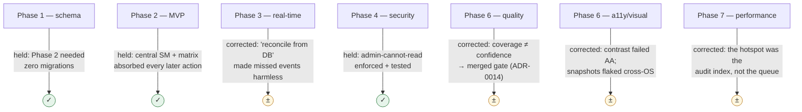

# Retrospective

An honest end-of-project reflection (SC-19). The goal of this document is not to
claim the build went perfectly — it is to record the assumptions that turned out
wrong, the risks that actually bit, the lessons that generalise, and what a second
attempt would do differently. It is grounded in what happened across Phases 0–7, not
in hindsight tidiness.

Related: [project plan](project-plan.md) (phases, risk register) ·
[performance](performance.md) · [testing strategy](testing-strategy.md) · [ADRs](adr/).

---

## Where the design held, and where each phase forced a course-correction

The green nodes are where Phase 0–1 planning paid off directly; the amber nodes are
where reality corrected a design assumption. Both are the point — the corrections are
where the real engineering judgment shows.

---

## Assumptions that proved wrong

- **"A high unit-coverage number means the backend is well-tested."** Backend
  **unit-only** coverage is ~13% _by design_: the guarantees that matter
  (DB-atomic claim, RBAC, real-time, readiness) can only be proven against a real
  Postgres, not mocks. Chasing a unit number would have meant mocking away the
  very things under test. This forced the coverage gate to be redefined as the
  **merged union of unit + e2e** Istanbul coverage ([ADR-0014](adr/0014-coverage-gate-strategy.md)) —
  a better model of confidence, but not the one assumed at the start.
- **"Pixel snapshots are portable."** Visual-regression baselines generated on the
  development OS failed in CI because of font hinting and anti-aliasing differences.
  The fix was to **pin baseline generation and comparison to one Playwright Linux
  container** ([ADR-0016](adr/0016-visual-regression.md)). Assumed portability cost a
  rework of the whole visual suite's workflow.
- **"The palette is obviously accessible."** The Phase 6 token-contrast test found
  **real WCAG AA violations** — the muted text, the `urgent` tier colour and the
  patient badge were all below 4.5:1 and had to be darkened. "It looks fine" is not a
  contrast measurement.
- **"The queue query will be the performance hotspot."** Intuition said the triage
  queue sort or the position `COUNT`s would hurt first. Measurement
  ([performance.md](performance.md)) said otherwise: those were sub-millisecond on a
  realistic dataset, and the actual scaling problem was the **audit log's missing
  `created_at` index**, which turned the default admin view into a full-table scan.
- **"A per-row position lookup is harmless."** `getMine` worked out each queued
  case's position with its own query, creating an **N+1 shape** that only showed up
  when the query count was measured. Reading the queue once and mapping positions by
  id fixed it.
- **"Saving is just a technical detail."** Once saving a draft also _handed it to
  every doctor_ for sign-off, the moment of saving became a clinical decision — a
  doctor must never sign a half-written sentence. Walking the nurse → doctor flow end
  to end in two browsers made this obvious; the answer was an explicit save with
  safety nets ([ADR-0021](adr/0021-explicit-summary-save.md)).
- **"The new workflow pieces are live like the rest."** The sign-off hand-off was the
  one flow still running on 20-second polling, because its audience ("any doctor") had
  no room. It took a `signoff` room and content-free signals
  ([ADR-0022](adr/0022-live-summary-and-signoff-signals.md)) to make it as live as the
  queue — the gap was only visible when testing the roles side by side.

## Risks that actually materialised (vs. the Phase 0 register)

- **Concurrency bugs (predicted High-impact):** did **not** bite — but only because
  the guarantee was put in the database early (ADR-0003) and the _same_ atomic
  conditional-update pattern was then reused for start/complete/cancel, the claim-TTL
  requeue and the "not during a session" deactivation rule. Centralising the mechanism
  paid a compounding dividend.
- **Real-time complexity (predicted Medium):** did bite, in the expected place —
  reconnection and missed events. The mitigation that worked was a design rule, not
  code: **clients treat events as signals and reconcile authoritative state from
  REST**, so a dropped event is harmless.
- **Accessibility left too late (predicted Low):** materialised as the contrast
  violations above. Scoping it to four screens kept it tractable, but finding real
  defects in Phase 6 vindicates the worry — earlier gating would have been cheaper.
- **Scope creep / solo time overrun (predicted High):** held, because the MVP was a
  genuine end-to-end slice and every later phase kept it demonstrable rather than
  widening one layer.

## Lessons learned

- **One source of truth for rules compounds.** The central transition registry and
  the single authorization matrix meant every new capability — doctor sign-off, the
  sign-off history, user deactivation — slotted into one place, and the
  role→state→ownership ordering made correct HTTP semantics (403 vs 409) fall out for
  free.
- **"PostgreSQL is the only source of truth" is a load-bearing rule.** Positions,
  the TTL sweeper and every live update reconcile from the database, which made them
  testable against a real Postgres and made the Phase 7 performance changes safe to
  reason about.
- **Measure before optimising — and be willing to _not_ optimise.** The performance
  pass both found a real hotspot (one index) and explicitly rejected several
  plausible-sounding changes (queue index direction, extra audit composites) because
  the query plans showed no gain and the write cost was real.
- **Coverage is a floor, not the goal.** The critical scenarios (CS-1…CS-20) were the
  real signal; the added tests closed genuine gaps (summary immutability, deactivation
  guards, room targeting), not vanity lines.
- **A flexible audit `metadata` JSON bag aged well.** It let correlation IDs be added
  in Phase 5 with no migration — a small early decision that avoided later friction.

## What I would redesign

- **Index time-ordered tables at ER-design time.** The data model flagged "indexing to
  implement in Phase 1" but only captured the queue index; the audit log's
  order-by-time access was missed and surfaced as a scan in Phase 7. Any append-heavy
  table that is read newest-first should get its `created_at` index when it is drawn.
- **Make queue position a single source.** "N ahead" is computed two ways (one
  ordered read for lists and live pushes, a per-item `COUNT` for a single request). A
  derived ranking — a DB view or a single ordered read everywhere — would remove the
  duplication at its root.
- **Settle the session/token story up front.** Short-lived JWTs shipped with
  "refresh is a Phase 2 addition" that never fully materialised; deciding the refresh
  model in Phase 1 would have been cleaner than carrying the loose end.
- **Gate accessibility from day one.** Defining colour tokens against AA contrast at
  the start would have prevented the late Phase 6 colour changes.
- **Design pagination for unbounded logs.** The exact `COUNT(*)` total on the audit
  query is fine now but is the one audit read that still scans the whole table;
  planning for an approximate/estimated count up front would scale better.

## Net assessment

The parts the plan invested in early — the state machine, the DB-level claim, the
single authorization matrix, and "Postgres is the only source of truth" — are
exactly the parts that never needed rework and that made every later phase
cheaper. The corrections were concentrated in the areas that are genuinely hard to get
right on paper: how to _measure_ confidence, cross-OS rendering, real contrast, and
real query plans. That distribution — stable core, adjustments at the measured edges —
is the outcome the process was aiming for.
