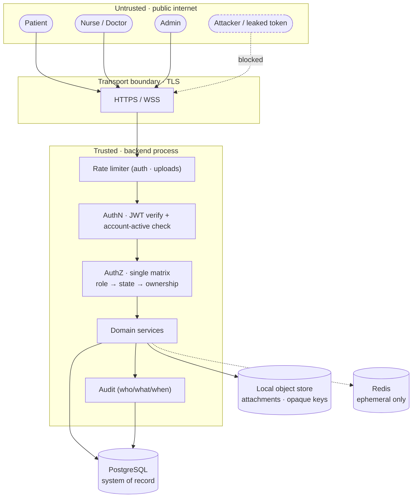
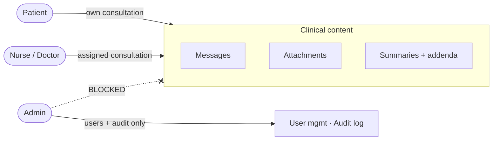

# Security & Privacy — Threat Model

How the Virtual Consultation Platform protects sensitive clinical data, who it
defends against, and the risks it explicitly accepts. This document is
**diagram-first**: the trust boundaries come first, then the threats and their
mitigations.

Related: [authorization matrix](authorization-matrix.md) ·
[audit logging](audit-logging.md) · [architecture](architecture.md) ·
[ADR-0006 authn/authz](adr/0006-authn-authz.md) ·
[ADR-0007 attachments](adr/0007-attachment-storage.md) ·
[ADR-0011 rate limiting](adr/0011-rate-limiting.md).

---

## 1. Trust boundaries & data flow

Everything left of the transport boundary is **untrusted**; the only inputs the
server trusts are what the authenticated user sends through this pipeline. Every
request crosses the **same order of checks**: TLS → rate limit → authentication
(JWT verified _and_ the account re-checked as active) → authorization (the one
matrix, role → state → ownership) → the domain service, which writes to the
authoritative DB and the append-only audit log. The object store holds attachment
bytes under opaque keys and is **never served directly** — only through the signed-
URL download handler, which re-enters the authorization pipeline. Redis is
ephemeral (presence, fan-out, cached positions, rate-limit counters) and never a
source of truth or an authorization authority.

---

## 2. Separation of duties — the clinical-content boundary

The strongest invariant: **admins operate the system but can never read clinical
content** (invariant 3). This holds over REST, over WebSockets (admins are refused
every clinical room), **and** for attachments (admins cannot list, upload, or
download — even with a valid signed link) and the audit log (who/what/when only).
It is encoded by omission in the [authorization matrix](authorization-matrix.md)
(no admin cell on any clinical row) and enforced by deny-by-default.

---

## 3. Threats & mitigations

| #   | Threat                                    | Vector                                                                         | Mitigation                                                                                                                                     | Status      |
| --- | ----------------------------------------- | ------------------------------------------------------------------------------ | ---------------------------------------------------------------------------------------------------------------------------------------------- | ----------- |
| T1  | **Unauthorized access** to a consultation | Guessing/iterating ids; calling an endpoint without a token                    | Every route authenticated (JWT); `404`/`403` hide existence from non-participants; deny-by-default matrix                                      | Implemented |
| T2  | **Privilege escalation** across roles     | Patient claiming, nurse finalizing, non-assigned clinician acting              | Single matrix checks **role + state + ownership**; negative tests for every ❌ cell (SC-7)                                                     | Implemented |
| T3  | **Admin reads clinical content**          | Admin hitting messages/attachments/summary, or joining a WS room               | Admin absent from all clinical matrix rows; tested over REST, WS, attachments, audit (SC-6)                                                    | Implemented |
| T4  | **Attachment access abuse**               | Public/guessable file URLs; leaked link; cross-consultation fetch; admin fetch | Opaque storage keys; **short-lived, user-bound signed URLs**; download re-runs the matrix + active-account check; no PII in the URL (SC-8)     | Implemented |
| T5  | **Data exposure in logs/URLs**            | PII/clinical data in audit metadata, query strings, or app logs                | Audit stores who/what/when only; signed tokens are opaque; no clinical data in URLs; pre-claim view minimized (NFR-2, SC-9)                    | Implemented |
| T6  | **Stale credential after deactivation**   | Using a JWT issued before deactivation                                         | Account status re-checked from the DB on **every** REST request and WS handshake; live sockets dropped on deactivate (FR-25)                   | Implemented |
| T7  | **Credential brute-force / enumeration**  | Repeated login attempts                                                        | Uniform `401`; rate limiting on auth (ADR-0011); `LOGIN_FAILURE` audited                                                                       | Implemented |
| T8  | **Malicious upload**                      | Over-size file, wrong/spoofed type, path traversal, memory exhaustion          | Size cap + per-consultation count; **magic-byte sniff** + declared-type match (JPEG/PNG/PDF only → `415`); opaque UUID keys; upload rate limit | Implemented |
| T9  | **Oversized/malformed payloads**          | Large JSON bodies, unknown fields                                              | Body-size cap; `ValidationPipe` (whitelist, `forbidNonWhitelisted`); `helmet` headers                                                          | Implemented |
| T10 | **Lost/forged claim under concurrency**   | Two clinicians claim at once; forged state change                              | DB-atomic conditional update ([ADR-0003](adr/0003-claim-concurrency.md)); exactly one winner (SC-2)                                            | Implemented |
| T11 | **Tampered real-time events**             | Spoofed WS payloads granting access                                            | Events are **signals**, not authority; clients reconcile from REST/DB; rooms gated by the matrix                                               | Implemented |
| T12 | **Over-broad real-time fan-out**          | A draft or note pushed to someone who may not read it (e.g. the patient)       | Summary/attachment signals carry ids only; `signoff`/`user:` rooms joined server-side from the JWT; never sent to the patient (ADR-0027)       | Implemented |
| T13 | **Expired session left open**             | A tab keeps a signed-in UI after the short-lived JWT expires                   | Expired tokens are not restored on load; any `401` signs the user out and says why — the server already rejects the token                      | Implemented |

---

## 4. Data minimization

- **Pre-claim view**: the triage queue exposes only priority, symptom category,
  severity, a truncated complaint, and wait time — never identity or attachments
  (FR-7/C7). Full detail unlocks only after a successful claim.
- **Patient position** is "N ahead", not an exact global rank (C2), leaking less.
- **Audit metadata** is who/what/when only — attachment events carry id/type/size,
  never the filename or bytes; message/summary events never carry the text.
- **Signed URLs** carry an opaque token only.

---

## 5. Accepted risks & out-of-scope (capstone)

These are deliberate, reasoned limits for a local, single-operator capstone
([ADR-0008](adr/0008-deployment-target.md)); each notes what production would add.

- **TLS / encryption at rest are environment concerns.** The design assumes TLS in
  transit and disk/DB encryption at rest; the one-command-local target does not
  terminate TLS or manage KMS keys. _Production:_ real certs, encrypted volumes,
  managed secrets.
- **JWT revocation is status-based, not a deny-list.** A deactivated user is blocked
  because status is re-checked each request; a _specific token_ cannot otherwise be
  revoked before its (short, 15 min) expiry. _Production:_ refresh-token rotation +
  a revocation list.
- **Rate-limit store is in-memory by default.** Limits are per-instance unless a
  Redis store is configured (ADR-0011). _Production:_ Redis-backed shared limits.
- **No antivirus scan on uploads.** Type/size/magic-byte validation is enforced, but
  file contents are not malware-scanned. _Production:_ a scanning step before the
  file is downloadable.
- **Attachment store is a local directory.** Durable and access-controlled, but not
  replicated/backed-up like managed object storage. _Production:_ S3-compatible
  storage fronted by the same app-issued signed-URL handler.
- **Rate limiting of the audit-write path.** Failed logins write audit rows; abusive
  volume is bounded by the auth rate limiter rather than a separate audit quota.

---

## 6. How these are proven

The critical security scenarios are mandatory tests (see
[testing-strategy.md](testing-strategy.md)): admin-cannot-read (REST/WS/attachments/
audit), full privilege-escalation matrix, signed-URL scoping/expiry/tamper,
deactivation lifecycle, and the DB-atomic claim. They map to SC-6…SC-9 in
[success-criteria.md](success-criteria.md).
