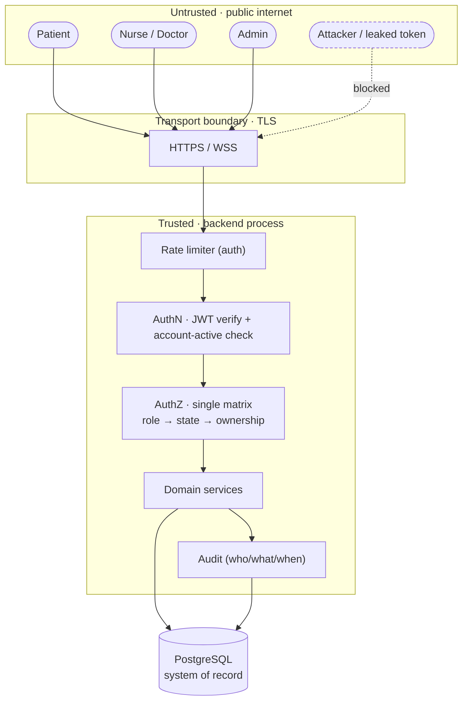
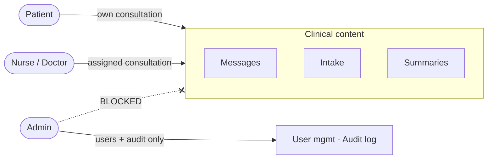

# Security & Privacy — Threat Model

How the Virtual Consultation Platform protects sensitive clinical data, who it
defends against, and the risks it explicitly accepts. This document is
**diagram-first**: the trust boundaries come first, then the threats and their
mitigations.

Related: [authorization matrix](authorization-matrix.md) ·
[audit logging](audit-logging.md) · [architecture](architecture.md) ·
[ADR-0005 authn/authz](adr/0005-authn-authz.md) ·
[ADR-0009 rate limiting](adr/0009-rate-limiting.md).

---

## 1. Trust boundaries & data flow

Everything left of the transport boundary is **untrusted**; the only inputs the
server trusts are what the authenticated user sends through this pipeline. Every
request crosses the **same order of checks**: TLS → rate limit → authentication
(JWT verified _and_ the account re-checked as active) → authorization (the one
matrix, role → state → ownership) → the domain service, which writes to the
authoritative DB and the append-only audit log. PostgreSQL is the only data store,
so there is exactly one place where clinical data lives and one place to protect.

---

## 2. Separation of duties — the clinical-content boundary

The strongest invariant: **admins operate the system but can never read clinical
content** (invariant 3). This holds over REST, over WebSockets (admins are refused
every clinical room), and in the audit log (who/what/when only).
It is encoded by omission in the [authorization matrix](authorization-matrix.md)
(no admin cell on any clinical row) and enforced by deny-by-default.

---

## 3. Threats & mitigations

| #   | Threat                                    | Vector                                                                   | Mitigation                                                                                                                    | Status      |
| --- | ----------------------------------------- | ------------------------------------------------------------------------ | ----------------------------------------------------------------------------------------------------------------------------- | ----------- |
| T1  | **Unauthorized access** to a consultation | Guessing/iterating ids; calling an endpoint without a token              | Every route authenticated (JWT); `404`/`403` hide existence from non-participants; deny-by-default matrix                     | Implemented |
| T2  | **Privilege escalation** across roles     | Patient claiming, nurse finalizing, non-assigned clinician acting        | Single matrix checks **role + state + ownership**; negative tests for every ❌ cell (SC-7)                                    | Implemented |
| T3  | **Admin reads clinical content**          | Admin hitting messages/consultation detail/summary, or joining a WS room | Admin absent from all clinical matrix rows; tested over REST, WS and the audit log (SC-6)                                     | Implemented |
| T4  | **Messages reach the wrong person**       | Another patient or a non-assigned clinician reading or posting in a room | Messages are participant-only in the matrix, over REST and in the private WS room; negative tests for each outsider (SC-8)    | Implemented |
| T5  | **Data exposure in logs/URLs**            | PII/clinical data in audit metadata, query strings, or app logs          | Audit stores who/what/when only; no clinical data in URLs; pre-claim view minimized (NFR-2, SC-9)                             | Implemented |
| T6  | **Stale credential after deactivation**   | Using a JWT issued before deactivation                                   | Account status re-checked from the DB on **every** REST request and WS handshake; live sockets dropped on deactivate (FR-25)  | Implemented |
| T7  | **Credential brute-force / enumeration**  | Repeated login attempts                                                  | Uniform `401`; rate limiting on auth (ADR-0009); `LOGIN_FAILURE` audited                                                      | Implemented |
| T8  | **Oversized/malformed payloads**          | Large JSON bodies, unknown fields                                        | Body-size cap; `ValidationPipe` (whitelist, `forbidNonWhitelisted`); `helmet` headers                                         | Implemented |
| T9  | **Lost/forged claim under concurrency**   | Two clinicians claim at once; forged state change                        | DB-atomic conditional update ([ADR-0003](adr/0003-claim-concurrency.md)); exactly one winner (SC-2)                           | Implemented |
| T10 | **Tampered real-time events**             | Spoofed WS payloads granting access                                      | Events are **signals**, not authority; clients reconcile from REST/DB; rooms gated by the matrix                              | Implemented |
| T11 | **Over-broad real-time fan-out**          | A draft pushed to someone who may not read it (e.g. the patient)         | Summary signals carry ids only; `signoff`/`user:` rooms joined server-side from the JWT; never sent to the patient (ADR-0022) | Implemented |
| T12 | **Expired session left open**             | A tab keeps a signed-in UI after the short-lived JWT expires             | Expired tokens are not restored on load; any `401` signs the user out and says why — the server already rejects the token     | Implemented |

---

## 4. Data minimization

- **Pre-claim view**: the triage queue exposes only priority, symptom category,
  severity, a truncated complaint, and wait time — never identity or the full
  narrative (FR-7/C7). Full detail unlocks only after a successful claim.
- **Patient position** is "N ahead", not an exact global rank (C2), leaking less.
- **Audit metadata** is who/what/when only — message/summary events never carry
  the text.

---

## 5. Accepted risks & out-of-scope (capstone)

These are deliberate, reasoned limits for a local, single-operator capstone
([ADR-0006](adr/0006-deployment-target.md)); each notes what production would add.

- **TLS / encryption at rest are environment concerns.** The design assumes TLS in
  transit and disk/DB encryption at rest; the one-command-local target does not
  terminate TLS or manage KMS keys. _Production:_ real certs, encrypted volumes,
  managed secrets.
- **JWT revocation is status-based, not a deny-list.** A deactivated user is blocked
  because status is re-checked each request; a _specific token_ cannot otherwise be
  revoked before its (short, 15 min) expiry. _Production:_ refresh-token rotation +
  a revocation list.
- **Rate-limit counters are in memory.** They reset on restart and are per
  instance (ADR-0009). _Production:_ a shared store if the API is ever scaled out.
- **Deactivation waits for a live session to end.** An admin cannot cut off a user
  mid-consultation ([ADR-0010](adr/0010-deactivation-during-session.md)).
  _Production:_ an "end session now" admin action for urgent cases.
- **Rate limiting of the audit-write path.** Failed logins write audit rows; abusive
  volume is bounded by the auth rate limiter rather than a separate audit quota.

---

## 6. How these are proven

The critical security scenarios are mandatory tests (see
[testing-strategy.md](testing-strategy.md)): admin-cannot-read (REST/WS/audit),
full privilege-escalation matrix, participant-only messaging, deactivation
lifecycle, and the DB-atomic claim. They map to SC-6…SC-9 in
[success-criteria.md](success-criteria.md).
