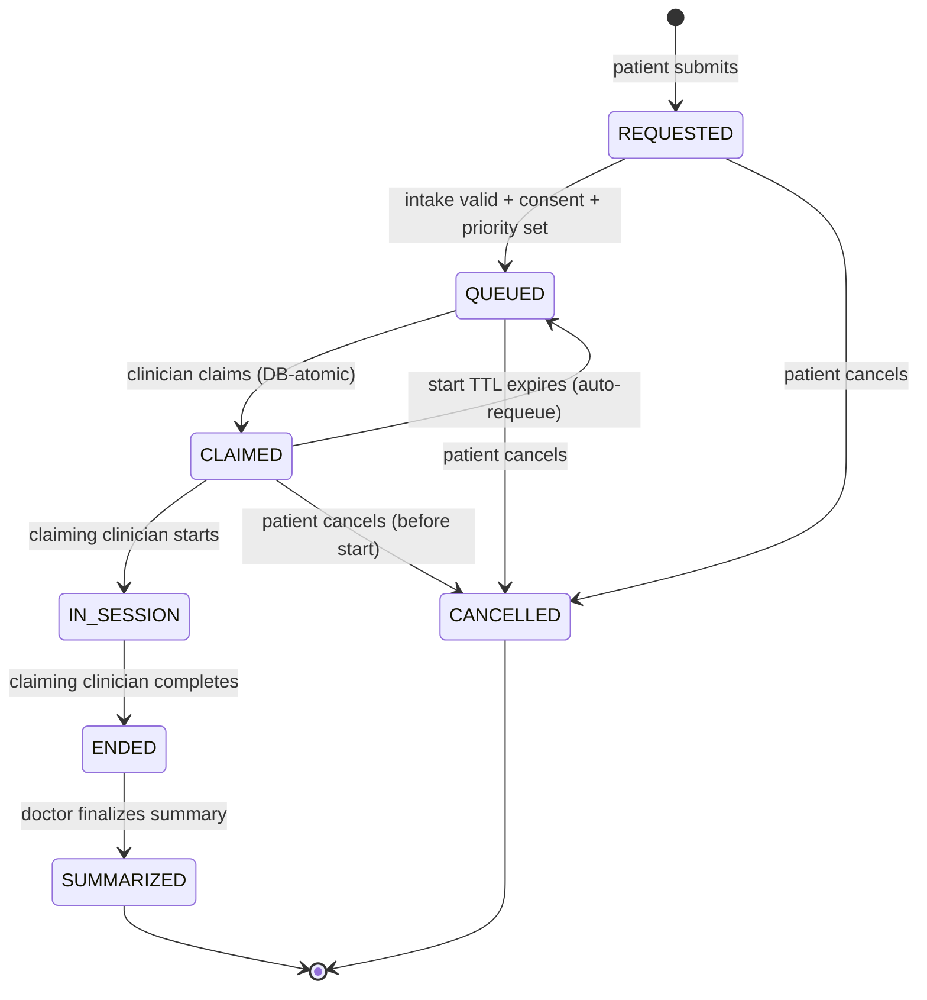

# Consultation State Machine

The consultation lifecycle is the **single source of truth** for which actions are
legal. All transitions are enforced server-side from one central transition
registry — never ad hoc in individual handlers.

## States

| State        | Meaning                                              |
| ------------ | ---------------------------------------------------- |
| `REQUESTED`  | Patient submitted intake; not yet validated/enqueued |
| `QUEUED`     | In the live triage queue, awaiting a clinician       |
| `CLAIMED`    | Assigned to a clinician, not yet started             |
| `IN_SESSION` | Active consultation (live messaging)                 |
| `ENDED`      | Clinician completed the consultation                 |
| `SUMMARIZED` | A doctor finalized the clinical summary (terminal)   |
| `CANCELLED`  | Cancelled before a session began (terminal)          |

## Diagram

## Transition table (allowed)

| From → To             | Actor              | Guard                                                            |
| --------------------- | ------------------ | ---------------------------------------------------------------- |
| REQUESTED → QUEUED    | System             | Intake valid, consent granted, priority assigned                 |
| REQUESTED → CANCELLED | Patient (owner)    | Before enqueue                                                   |
| QUEUED → CLAIMED      | Nurse / Doctor     | `state=QUEUED AND claimed_by IS NULL` (atomic)                   |
| QUEUED → CANCELLED    | Patient (owner)    | Not yet claimed                                                  |
| CLAIMED → IN_SESSION  | Claiming clinician | `actor = claimed_by`; within start TTL; under active-session cap |
| CLAIMED → QUEUED      | System             | Start TTL expired; clears `claimed_by`; audited (`REQUEUE`)      |
| CLAIMED → CANCELLED   | Patient (owner)    | Before session starts                                            |
| IN_SESSION → ENDED    | Claiming clinician | `actor = claimed_by`                                             |
| ENDED → SUMMARIZED    | Doctor             | `role = DOCTOR`; summary finalized                               |

## Invalid transitions (explicitly rejected)

| Attempt                                | Why rejected            | Expected response |
| -------------------------------------- | ----------------------- | ----------------- |
| QUEUED → IN_SESSION                    | Must be claimed first   | `409 Conflict`    |
| CLAIMED → IN_SESSION by a non-claimer  | `actor ≠ claimed_by`    | `403 Forbidden`   |
| CLAIMED → IN_SESSION at session cap    | Already in max sessions | `409 Conflict`    |
| Second clinician claims a CLAIMED case | Already claimed         | `409 Conflict`    |
| ENDED → IN_SESSION                     | No reopening            | `409 Conflict`    |
| ENDED → SUMMARIZED by a nurse          | Finalize is doctor-only | `403 Forbidden`   |
| SUMMARIZED → *                         | Terminal state          | `409 Conflict`    |
| Any transition after CANCELLED         | Terminal state          | `409 Conflict`    |

## Exception / edge-case handling

- **Claim timeout:** a `CLAIMED` case not started within the start TTL is
  auto-requeued (`CLAIMED → QUEUED`), `claimed_by` cleared, event audited, queue
  subscribers notified. Implemented in Phase 3 by a DB-authoritative sweeper
  ([ADR-0008](adr/0008-claim-start-ttl.md)) and audited as `CONSULTATION_REQUEUED`.
- **Session cap, not a claim cap:** `MAX_ACTIVE_CONSULTATIONS_PER_CLINICIAN` (default
  1, FR-10) limits `IN_SESSION` cases and is checked at `start`. There is no separate
  limit on how many cases one clinician can hold in `CLAIMED`; the start TTL returns
  any they do not start.
- **Deactivation during a session:** an admin cannot deactivate the patient or the
  clinician of an `IN_SESSION` consultation — the request is refused with `409`
  until the session ends, so no new transition is needed (FR-24;
  [ADR-0010](adr/0010-deactivation-during-session.md)). A clinician who has only
  claimed a case can be deactivated; the claim-timeout rule above returns that
  case to the queue.
- **Connection loss in session:** the state is unchanged server-side; clients
  reconcile on reconnect from the server's authoritative state.

## Implementation note

The allowed-transition table is encoded once (a transition registry keyed by
`state × action`). Both the API layer and the authorization check read from it,
so there is a single place that defines what is legal — no duplicated logic.
